# Redis安装与卸载


## Redis安装步骤


**获取linux下redis安装包**

[下载地址](https://download.redis.io/releases/)


**1.将Redis安装包上传到Linux**


**2.解压安装包到/usr/local**

```
tar -zxvf redis-7.0.0.tar.gz -C /usr/local
```


**3.安装Redis的依赖环境gcc**

```
# 安装依赖环境
yum -y install gcc-c++
```

出现问题：

```
trying other mirror
```

原因：设置静态ip的时候没有将网关、服务器地址等和虚拟机的保持一致，保持一致就可

解决：[参考博客](https://blog.csdn.net/u011711878/article/details/82852055)


**4.进入`/usr/local/redis根目录`，进行编译**

```
# 进入到根目录
cd /usr/local/redis-7.0.0/
 
# 编译
make
```


**5.进入redis的src目录，进行安装**

```
# 进入到src目录
cd /usr/local/redis-7.0.0/src

# 进行安装
make install
```


**redis默认安装到`/usr/local/bin`，有如下几个命令**

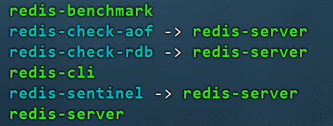

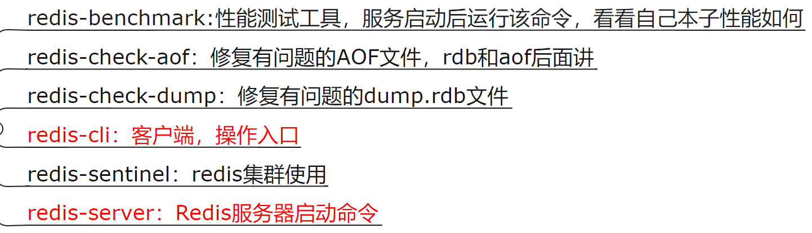


## Redis配置文件说明


**进入redis配置文件目录**

```
cd /usr/local/redis-7.0.0/
```


**修改redis.conf为下面配置**

```
# 是否为守护进程，修改为yes后即可后台运行
daemonize yes 

# 是否启用保护模式
protected-mode no

# 允许访问的地址，默认是127.0.0.1，会导致只能在本地访问。修改为0.0.0.0则可以在任意IP访问，生产环境不要设置为0.0.0.0
bind 0.0.0.0

# 密码，设置后访问Redis必须输入密码
requirepass 123456
```


## 开放端口


```
# 开启6379端口
firewall-cmd --zone=public --add-port=6379/tcp --permanent

# 设置立即生效
firewall-cmd --reload

# 查看开放的端口
firewall-cmd --zone=public --list-ports
```


## Redis启动与停止


**启动服务端**

```
redis-server /usr/local/redis-7.0.0/redis.conf
```


**启动客户端**

```
redis-cli -a 123456 -p 6379
```


**停止服务端**

- 通过`kill -9 进程号`

```
ps -ef | grep redis
kill -9 进程号
```

- 单实例关闭（未进入redis-cli）

```
redis-cli -u 123456 shutdown
```

- 单实例关闭（进入redis-cli）

```
shutdown
```

- 多实例关闭、指定端口关闭

```
redis-cli -p 6379 shutdown
```


**客户端退出**

```
exit
```


## Redis卸载


**停止Redis**


**删除/usr/local/lib目录下与redis相关的文件**


# Redis十大数据类型


## Redis键


### 常用


### 案例


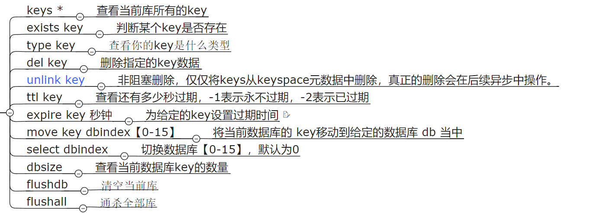


## 字符串String


### 最常用


#### set key value


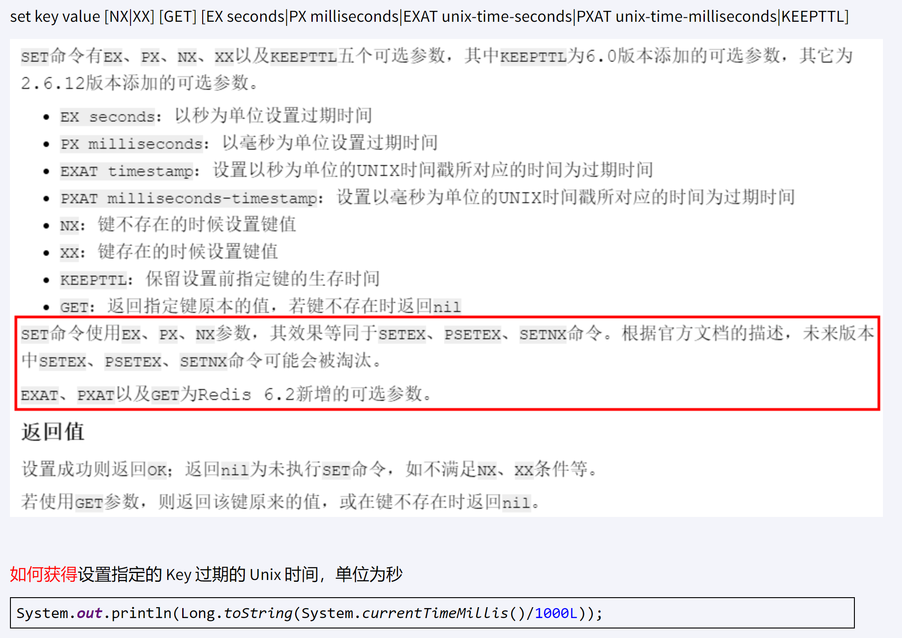


#### get key


### 同时设置/获取多个键值


#### mset/mget/msetnx


- mset:同时设置一个或多 个key-value对。
- mget:获取所有(一个或多个)给定key的值。
- msetnx:同时设置一个或多个 key-value对，当且仅当所有给定key都不存在。


### 获取指定区间范围内的值


#### getrange/setrange


- getrange:获取指定区间范围内的值，类似betee....and的关系。从0到-1表示全部
- setrange设置指定区间范围内的值，格式是setrange key值具体值


### 数值增减


#### INCR/INCRBY/DECR/DECRBY


### 获取字符串的长度和内容追加


#### STRLEN key


#### APPEND key value


### 分布式锁


- 高阶篇讲解


### getset(先get再set)


- getset:将给定key的值设为value，并返回key的旧值(old value)。
- 简单一句话，先get然后立即set


### 应用场景


**INCR应用**

- 比如抖音无限点赞某个视频或者商品，点一下加一次
- 是否喜欢文章


## 列表List


### 底层数据结构


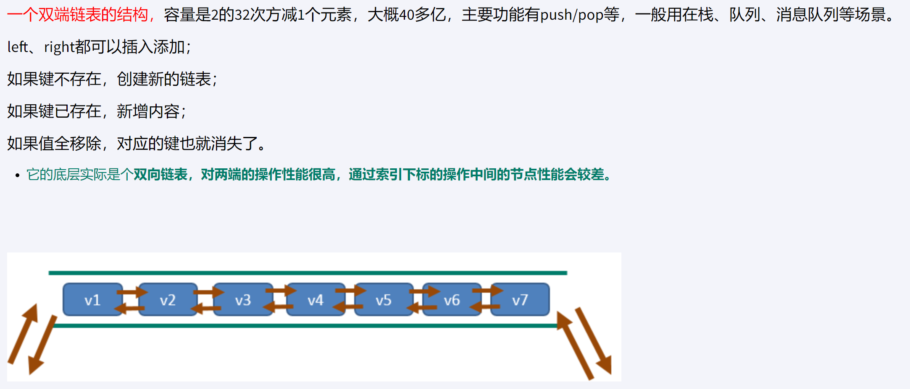


### 常用命令


#### lpush/rpush/lrange


#### lpop/rpop


#### lindex


通过索引获取列表中的元素lindex key index


#### llen


获取列表中元素的个数


#### lrem key 数字N 给定值v1


- 从left往right删除N个值等于v1的元素，返回的值为实际删除的数量
- LREM        list3      0      值，表示删除全部给定的值。零个就是全部值


#### ltrim key


开始index结束index,截取指定范围的值后再赋值给key


#### rpoplpush    源列表    目的列表


移除列表的最后一个元素，并将该元素添加到另一个列表开头并返回


#### lset key index value


#### insert key before/after 已有值  插入的新值


在list某个已有值的前后再添加具体值


### 应用场景


**微信公众号订阅的信息**


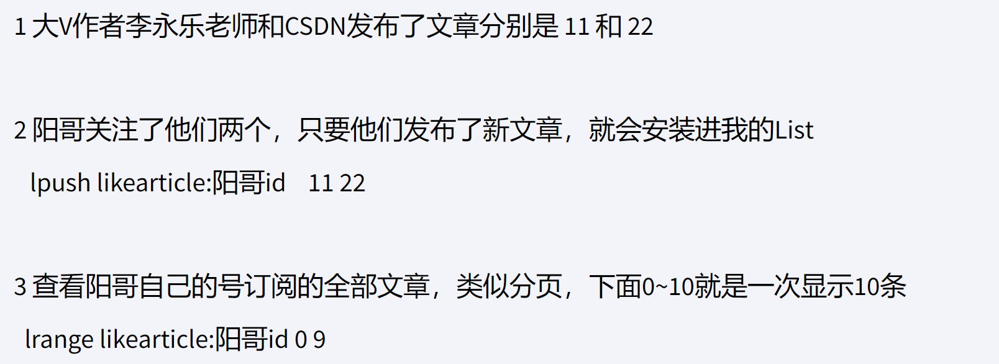


## 哈希Hash


KV模式不变，但V是一个键值对。Map<String ,Map<0bject,object>>


### 常用命令


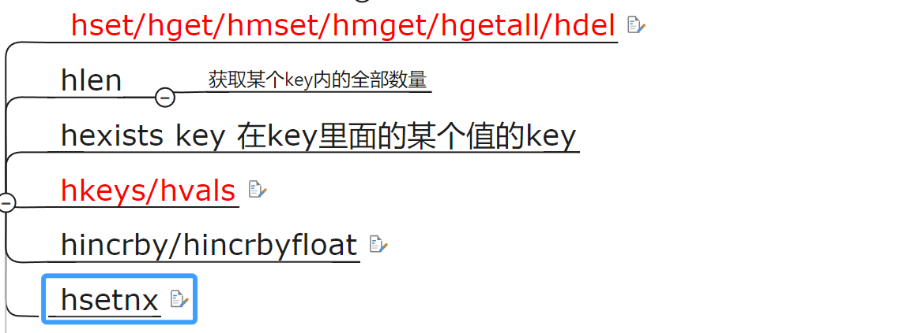


### 应用场景


JD购物车早期设计，目前不再采用，当前小中厂可用


## 集合Set


### 常用命令


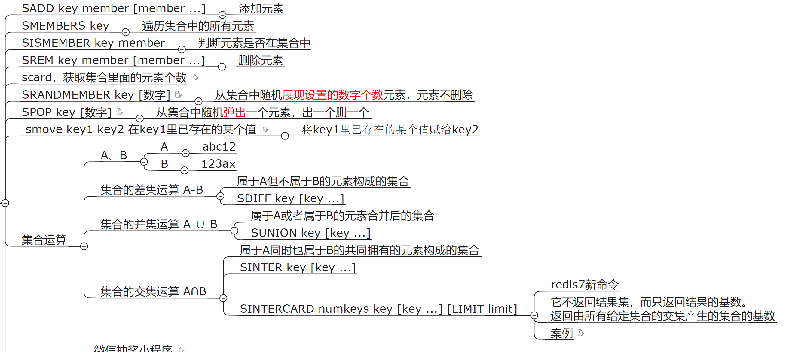


### 应用场景


具体细节参见阳哥课件

- 微信抽奖小程序
- 微信朋友圈点赞查看同赞朋友
- QQ内推可能认识的人


## 有序集合Zset


### 常用命令


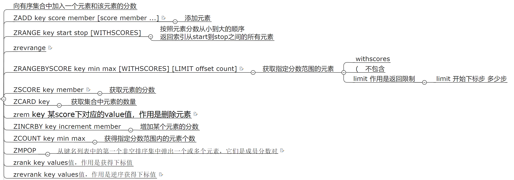


### 应用场景


根据商品销售对商品进行排序显示


## 位图bitmap


### 是什么


- 一句话：由0和1状态表现的二进制位的bit数组


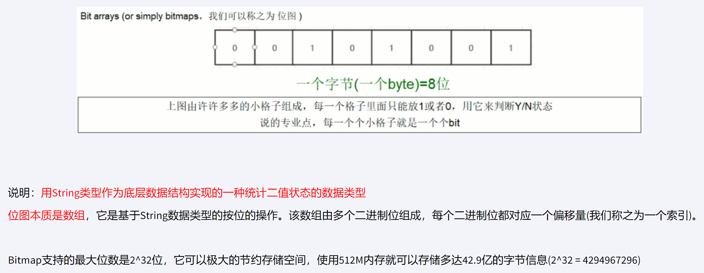


### 常用命令


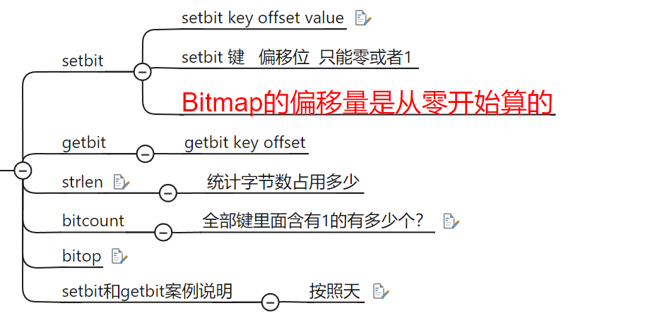


## 基数统计HyperLogLog


### 看需求


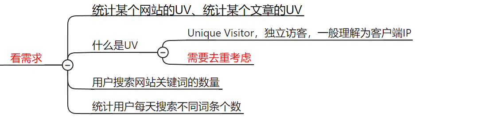


### 是什么


- 只计算基数，不会返回输入的各个元素
- 基数不是准确值，是近似值，有误差
- 是一种数据集去重后的真实个数

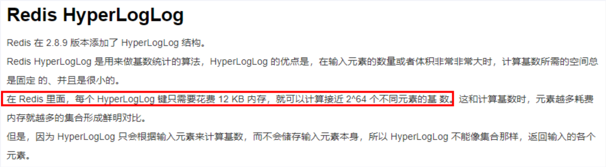


### 常用命令


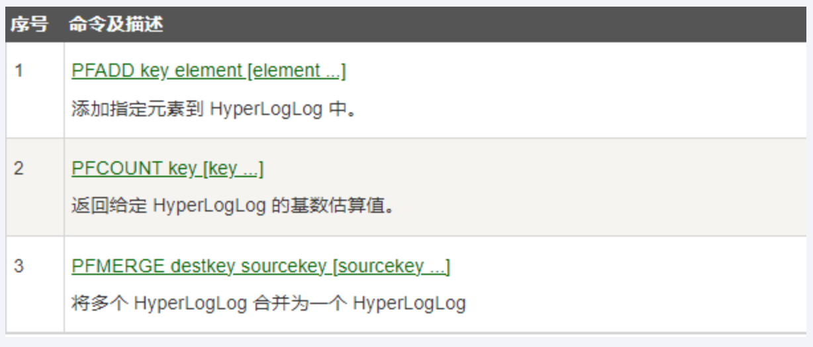


### 应用场景


天猫网站首页亿级UV的Redis统计方案


## 地理空间GEO


### 常用命令


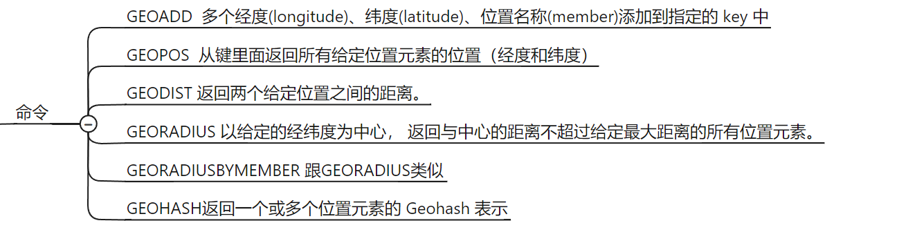


#### GEOADD


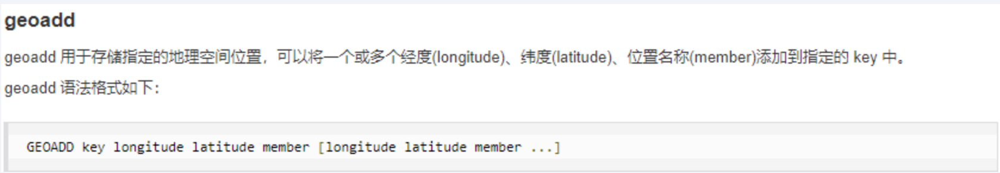


#### GEOPOS


#### GEOHASH


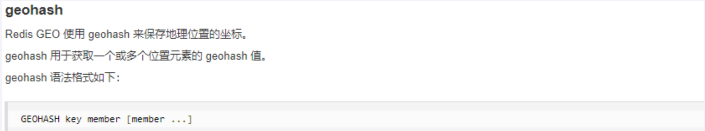


#### GEODIST


#### GEORADIUS


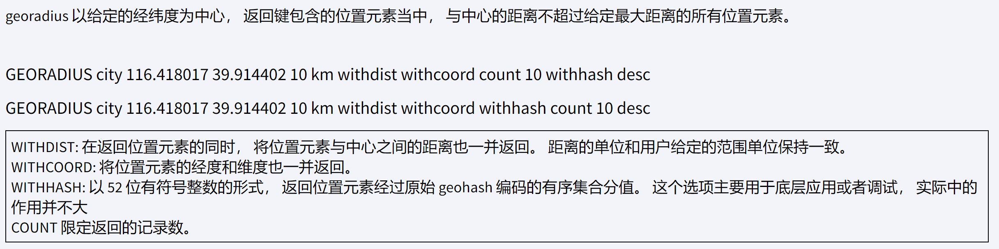


#### GEORADIUSBYMEMBER


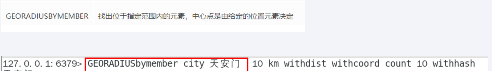


### 应用场景


- 美团地图位置附近的酒店推送
- 高德地图附近的核算检查点


## 流Stream


- 见尚硅谷课件


## 位域bitfield


- 见尚硅谷课件


# Redis持久化


## RDB（Redis DataBase）


### 是什么


- 在指定的时间间隔，执行数据集的时间点快照

- 实现类似照片记录效果的方式，就是把某一时刻的数据和状态以文件的形式写到磁盘上，也就是

  快照。这样一来即使故障宕机，快照文件也不会丢失，数据的可靠性也就得到了保证。

  这个快照文件就称为RDB文件(dump.rdb)，其中，RDB就是Redis DataBase的缩写。


### 能干嘛


- 快照文件直接读回到内存里
- Redis的数据都在内存中，保存备份时它执行的是全量快照,也就是说，把内存中的所有数据都记录到磁盘中
- RDB保存的是dump.rdb


### 自动触发RDB备份


#### 6.0和7.0对比


**Redis6.0.16以下**

- 15分钟1个key发生变化
- 5分钟10个key发生变化
- 1分钟10000个可以发生变化

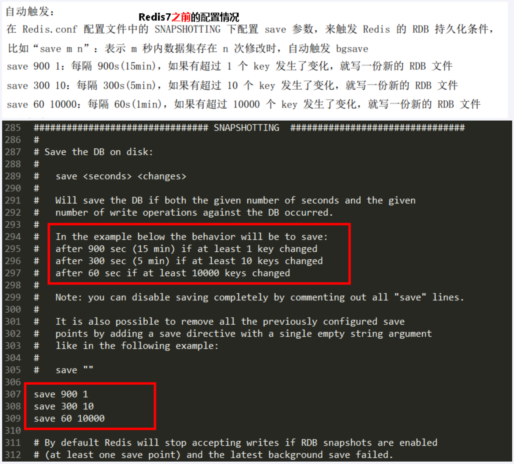


**Redis6.2及7.0.0以上**

- 1小时1个key发生变化
- 5分钟100个key发生变化
- 1分钟10000个可以发生变化

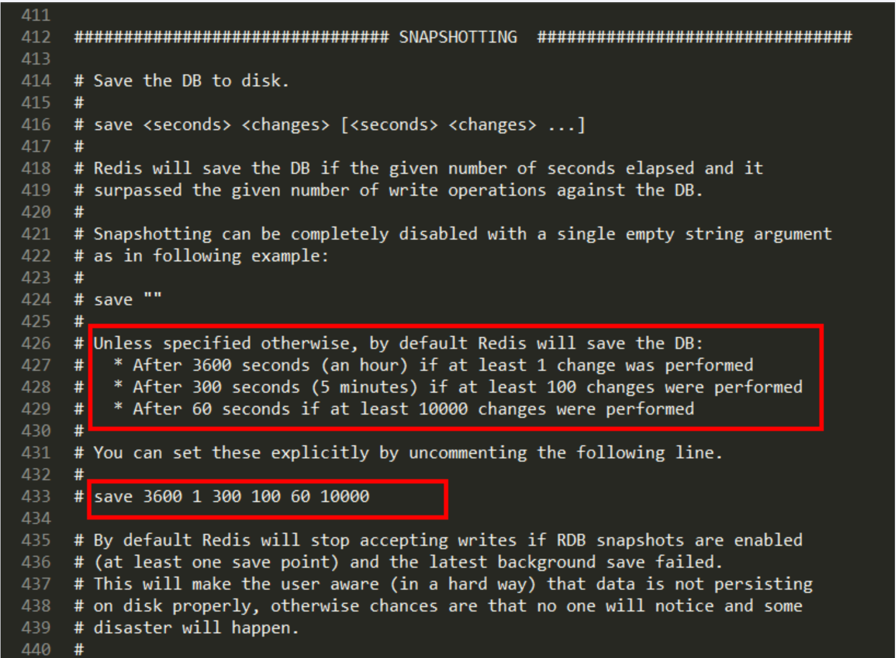


#### redis.conf配置文件修改


**修改生成dump.rdb条件**

```
save 10 2
```


**修改dump文件保存路径**

- 可使用`CONFIG GET dir`来查看配置文件里配置的内容
- 默认目录：`/root`下

```
# 默认 -> /root目录下
dir ./
```


#### 如何恢复


1. 停止redis服务
2. 将备份的dump.rdb文件替换/root目录下的dump.rdb文件
3. 重启redis服务，即可完成备份恢复


### 手动触发RDB备份


#### SAVE


- 在主程序中执行会阻塞当前redis服务器，直到持久化工作完成
- 执行save命令期间，Redis不能处理其他命令，线上禁止使用


#### BGSAVE


- Redis会在后台异步进行快照操作，不阻塞快照同时还可以响应客户端请求，该触发方式会fork一个子进程由子进程复制持久化过程
- Redis会使用bgsave对当前内存中的所有数据做快照,这个操作是子进程在后台完成的，这就允许主进程同时可以修改数据。


可以通过**lastsave**命令获取最后一次成功执行快照的时间

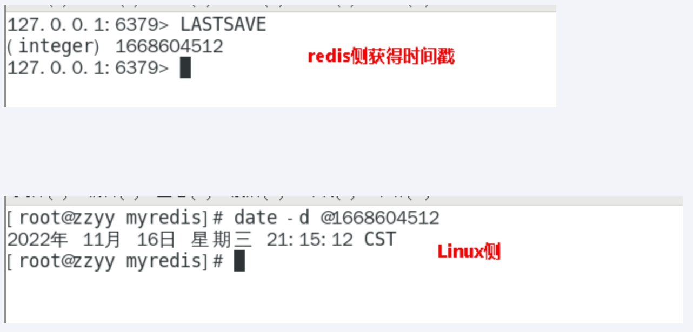


### 优势和劣势


**优势**


**劣势**

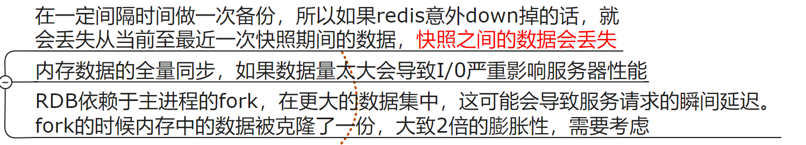


### 检查修复dump.rdb文件


- 使用`/usr/local/bin/`下的`redis-check-rdb -> redis-server`指令
- `/root`目录下存储`dump.rdb`文件


检查修复示例

- `/root`目录下执行

```
redis-check-rdb dump.rdb
```


### 触发RDB快照情况


- 配置文件中默认的快照配置

- 手动save/bgsave命令
- 执行flushall/flushdb命令也会产生dump.rdb文件，但里面是空的，无意义
- 执行shutdown且没有设置开启AOF持久化
- 主从复制时，主节点自动触发


### 禁用快照


redis.conf中设置

```
save ""
```

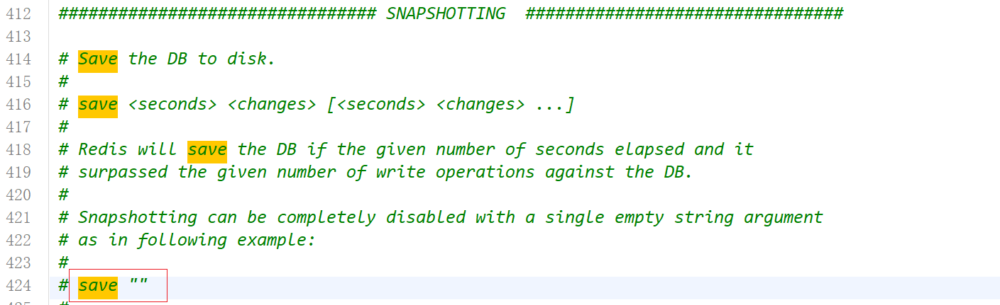


### RDB优化配置项详解


**配置文件SNAPSHOTTING模块**


**save < seconds> < changes>**

- 配置RDB存储的触发频率


**dbfilename**

- rdb文件名字


**dir**

- rdb文件存储位置


**stop-writes-on-bgsave-error**

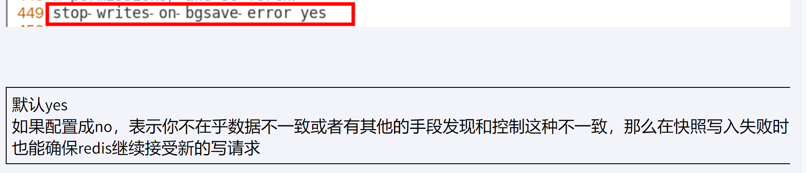


**rdbcompression**

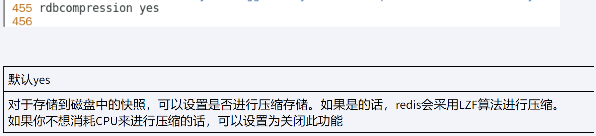


**rdbchecksum**

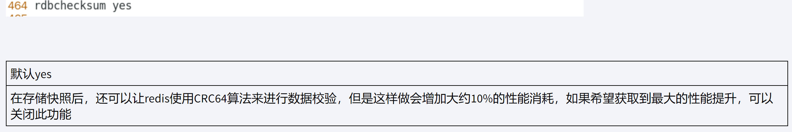


**rdb-del-sync-files**

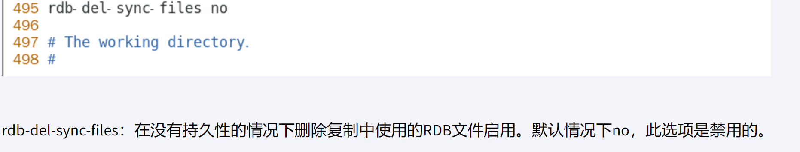


## AOF(Append Only File)


### 是什么


- 以日志的形式来记录每个写操作，将Redis执行过的所有写指令记录下来(读操作不记录),只许追加文件但不可以改写文件，redis启动之初会读取该文件重新构建数据，换言之，redis重启的话就根据日志文件的内容将写指令从前到后执行一次以完成数据的恢复工作
- 默认情况下，redis是没有开启AOF(append only file)的。开启AOF功能需要设置配置: appendonly yes
- AOF保存的是appendonly.aof文件


### AOF持久化工作流程


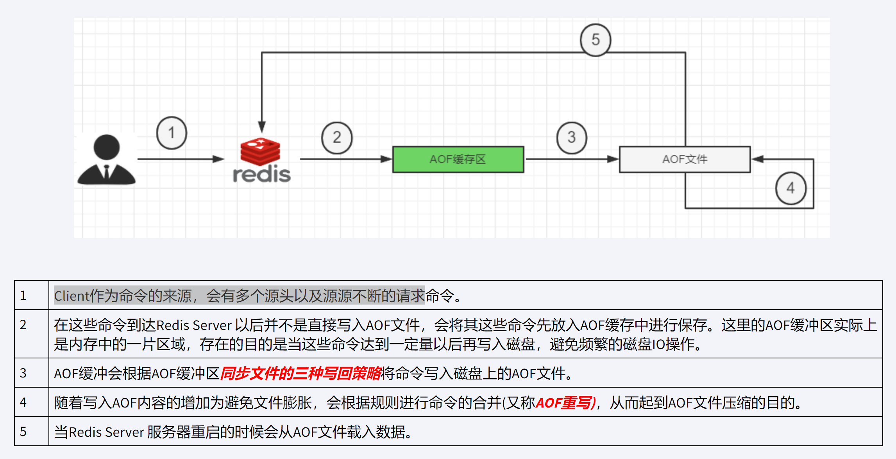


### AOF缓冲区三种写回策略


- appendfsync always：同步写回，每个写命令执行完立刻同步地将日志写回磁盘
- appendfsync everysec：每秒写回，每个写命令执行完，只是先把日志写到AOF文件的内存缓冲区，每隔1秒把缓冲区中的内容写入磁盘
- appendfsync no：操作系统控制的写回，每个写命令执行完，只是先把日志写到AOF文件的内存缓冲区，由操作系统决定何时将缓冲区内容写回磁盘


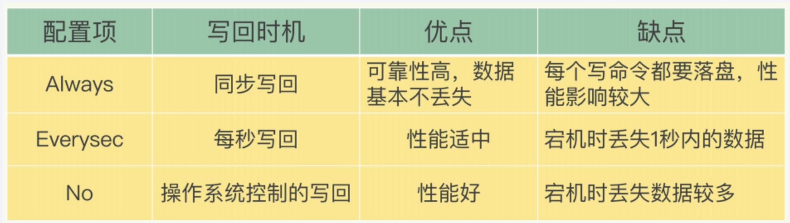


### 配置文件说明（6 vs 7）


**开启AOF**

- redis.conf中配置
- 6和7是一样的

```
appendonly yes
```


**默认策略：每秒写回**

- redis.conf中配置
- 6和7是一样的

```
# appendfsync always
appendfsync everysec
# appendfsync no
```


**AOF文件—保存路径**

**redis6**

- AOF保存文件的位置和RDB保存文件的位置一样,都是通过redis.conf配置文件的dir配置
- 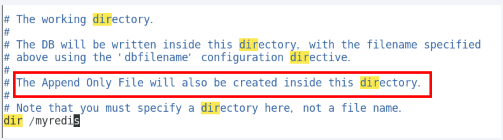

**redis7**

- reids.conf中dir目录下`appenddirname "appendonlydir"`参数中指定的`"appendonlydir"`目录

- 也就是说，默认的目录是`/root/appendonlydir`

- ```
  appenddirname "appendonlydir"
  ```


**AOF文件—保存名称**

**redis6**

- 只有一个appendonly.aof

```
appendfilename "appendonly.aof"
```

**redis7**

- Redis7.0 Multi Part AOF的设计
  - base基本文件
  - incr增量文件
  - manifest清单文件
- 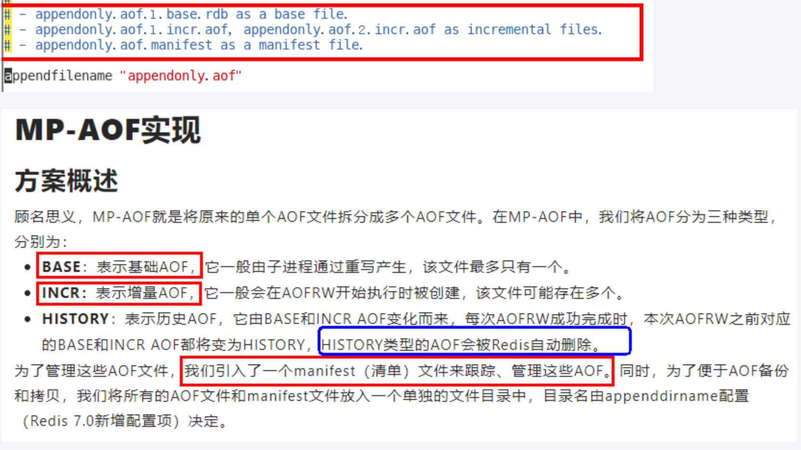


### 正常恢复


1. 保留备份好的appendonlydir文件夹
2. 关闭redis服务
3. 将RDB文件和新生成的appendonlydir文件夹删除
4. 恢复备份好的appendonlydir文件夹
5. 重启redis服务，数据恢复


### 异常AOF文件修复


```
# redis-check-aof --fix 需要修复的文件
redis-check-aof --fix /root/appendonlydir/appendonly.aof.1.incr.aof
```


### 优势劣势


**优势**

- 更好的保护数据不丢失、性能高、可做紧急恢复


**劣势**

- 相同数据集的数据而言AOF文件要远大于rdb文件，恢复速度慢于rdb
- aof运行效率要慢于rdb,每秒同步策略效率较好，不同步效率和rdb相同


### AOF重写机制


#### 是什么


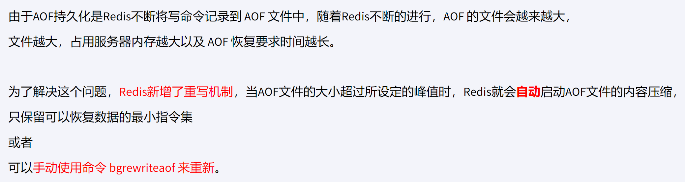


#### 触发机制


##### 官网默认配置


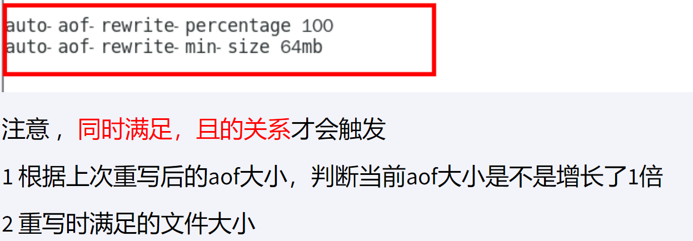


##### 自动触发


满足配置文件中的选项后，Redis会记录上次重写时的AOF大小,默认配置是当AOF文件大小是上次rewrite后大小的一倍且文件大于64M时


##### 手动触发


客户端向服务器发送bgrewriteaof命令


#### 案例说明


**前期配置准备**

- redis.conf中开启AOF

```
appendonly yes
```


**关闭混合**

- redis.conf中进行配置

```
aof-use-rdb-preamble no
```


##### 自动触发


自动触发案例不实验了，达到触发的峰值，会吃法重写机制


##### 手动触发


客户端向服务器发送`bgrewriteaof`命令


**文件名变化**

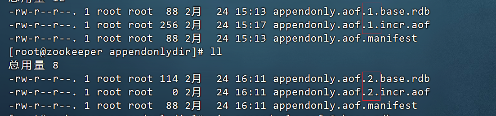


### 重写原理


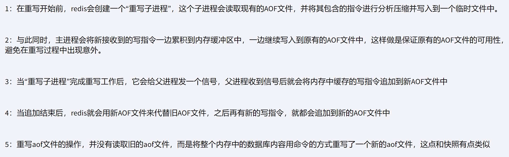


## RDB-AOF混合持久化


### 数据恢复加载流程


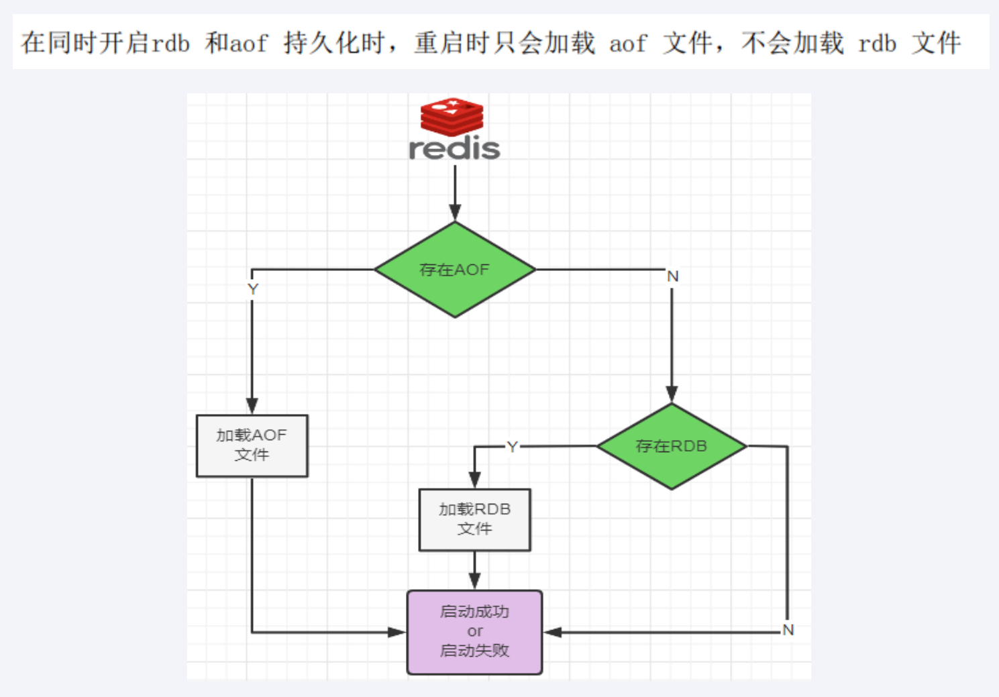


### 推荐方式


**RDB + AOF混合使用**


## 纯缓存模式


**同时关闭RDB + AOF**


**关闭RDB**

- redis.conf中配置

  - ```
    SAVE ""
    ```

- 禁用rdb持久化模式下，我们仍然可以使用命令save、bgsave生成rdb文件


**关闭AOF**

- redis.conf中配置

  - ```
    appendonly on
    ```

- 禁用aof持久化模式下，我们仍然可以使用命令bgrewriteaof生成aof文件


# Redis事务


## 是什么


- 可以一次执行多个命令，本质是一组命令的集合。一个事务中的所有命令都会序列化，按顺序地串行化执行而不会被其它命令插入，不许加塞


## 能干嘛


- 一个队列中，一次性、顺序性、排他性的执行一系列命令


## 特性


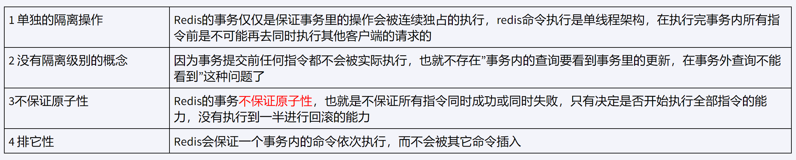


## 常用命令


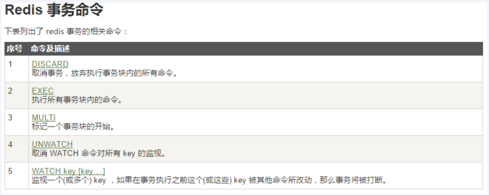


### 正常执行


- MULTI:开启事务
- EXEC:提交事务


**开启事务和提交事务之间命令没有错误**

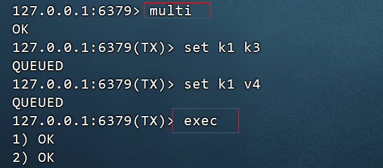


### 放弃事务


- MULTI:开启事务
- DISCARD:放弃事务


### 全部不执行


- MULTI:开启事务
- EXEC:提交事务


**事务之间的命令编译就报错，提交事务都不执行**

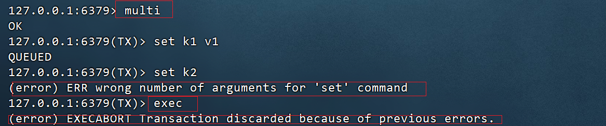


### 错误的不执行


- MULTI:开启事务
- EXEC:提交事务


**编译通过时，提交了事务，有错误的，不妨碍正确的执行**

- Redis不提供事务回滚的功能，开发者必须在事务执行出错后，自行恢复数据库状态

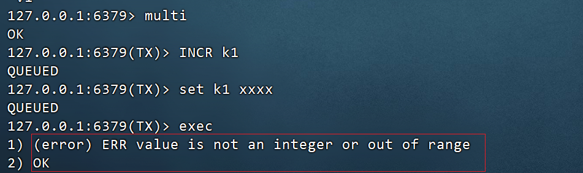


### watch监控


Redis使用Watch来提供乐观锁定，类似于CAS( Check-and-Set)


**初始化k1和balance两个key,先监控再开启multi,保证两key变动在同一个事务内**

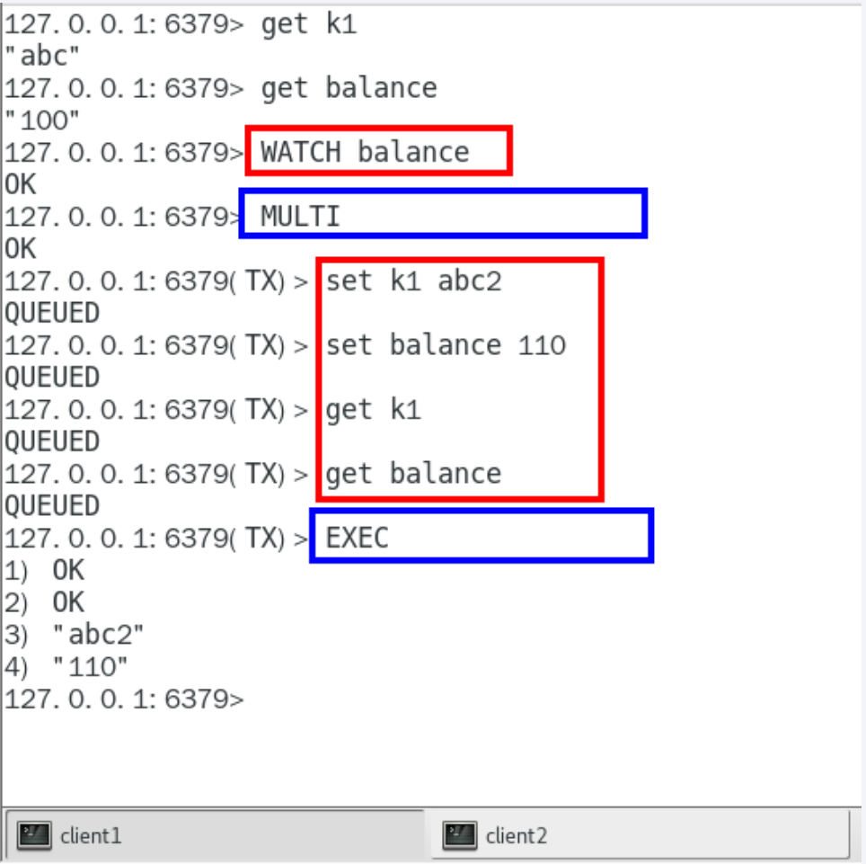


**另一个线程在事务期间修改了**

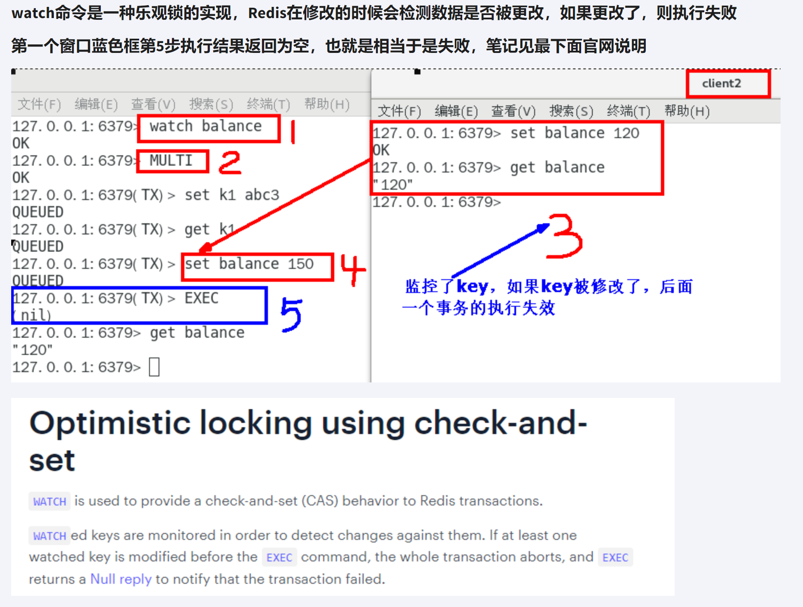


**unwatch进行取消**

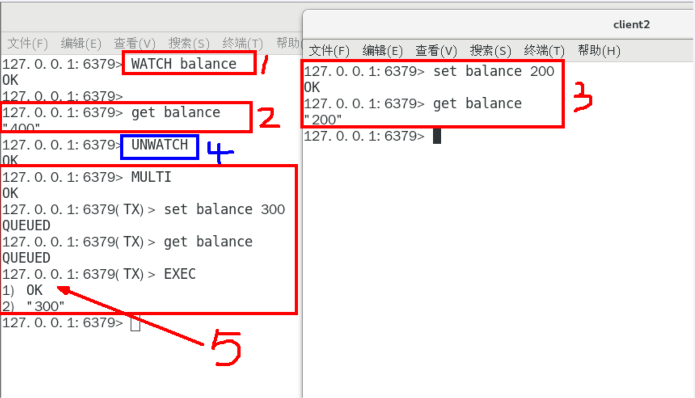


- 一旦执行了exec之前加的监控锁都会被取消掉了
- 当客户端连接丢失的时候(比如退出链接)，所有东西都会被取消监视


## 小总结


- 开启:以MULTI开始一个事务
- 入队:将多个命令入队到事务中，接到这些命令并不会立即执行,而是放到等待执行的事务队列里面
- 执行:由EXEC命令触发事务


# Redis管道


## 面试题


- 如何优化频繁命令往返造成的性能瓶颈?


**RTT介绍**

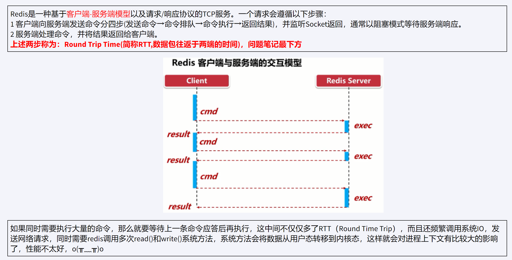


## 是什么


**解决思路，引出管道这个概念**

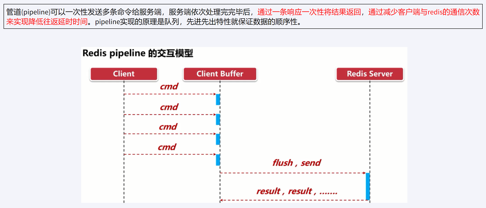


**定义**

Pipeline是为了解决RTT往返回时，仅仅是将命令打包一次性发送,对整个Redis的执行不造成其它任何影响


**一句话**

批处理命令变种优化措施，类似Redis的原生批命令( mget和mset)


## 案例演示


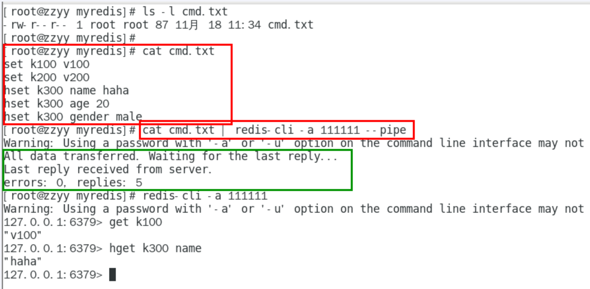


## 小总结


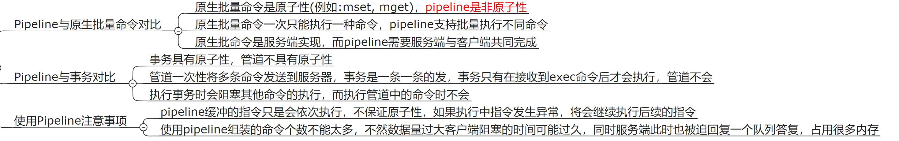


# Redis发布订阅


- 直接跳过了，这玩意用RabbitMQ


# Redis复制


## 是什么


- 就是主从复制，master以写为主，Slave以读为主
- 当master数据变化的时候，自动将新的数据异步同步到其它slave数据库


## 能干吗


- 读写分离
- 容灾恢复
- 数据备份
- 水平扩容支持高并发


## 怎么玩


- 配从库不配主库
- master如果配置了requirepass参数，需要密码登陆，那么slave就要配置masterauth来设置校验密码,
  否则的话master会拒绝slave的访问请求


## 基本操作命令


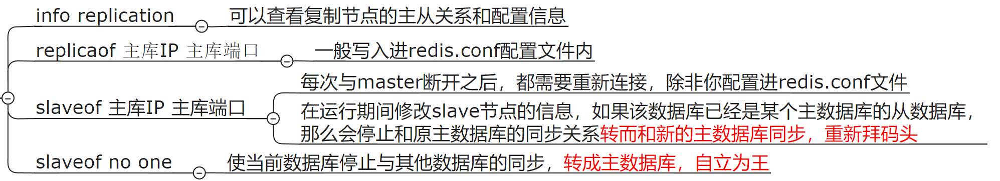


## 案例演示


### 三台虚拟机IP


- 192.168.188.128
- 192.168.188.129
- 192.168.188.131


### 三大命令


- 主从复制
  - 配从库，不配主库
  - 从库redis.conf中配置：replicaof 主库IP 主库端口
- 改换门庭
  - slaveof 新主库IP 新主库端口
- 自立为王
  - slaveof no one


### 配置文件细节


- 主库、从库都是一样的配置

```
daemonize yes

bind 0.0.0.0

protected-mode no

port 6379

dir ./

pidfile /var/run/redis_6379.pid

logfile ""

requirepass 123456

dbfilename dump.rdb

appendonly yes

appendfilename "appendonly.aof"
```


- 从库需要配置、主库不需要配置

```
replicaof 192.168.188.128 6379

masterauth 123456
```


### 常用主从库配置


#### 一主二从


##### 方案1：配置文件固定写死


**从库配置文件配置**

```
replicaof 192.168.188.128 6379

masterauth 123456
```


**先启动主库，再启动两个从库**


**日志查看**

- 找到日志的地址进行查看


**主从关系查看**

```
info replication
```


##### 主从问题演示


**从机可以执行写命令吗**

- 不可以


**从机切入点之前的也复制吗**

- 是的，前面未跟随的数据也会复制


**主机shutdown后，从机会上位吗?**

- 从机不动，原地待命，从机数据可以正常使用；等待主机重启动归来


**主机shutdown后，重启后主从关系还在吗?从机还能否顺利复制?**

- 还在
- 能


**某台从机down后，master继续，从机重启后它能跟上大部队吗?**

- 能


##### 方案2：命令操作手动指定


- 从机停机去掉配置文件中的配置项,3台目前都是主机状态，各不从属
- 从机上执行命令
  - slaveof 主库IP 主库端口
- 用命令使用的话，2台从机重启后，关系还在吗?
  - 不在


##### 两种方式对比


- 配置方式：持久稳定
- 命令方式：当此生效


#### 薪火相传


- 上一个slave可以是下一-个slave的master, slave同样可以接收其他slaves的连接和同步请求，那么该slave作为了链条中下一个的master,可以有效减轻主master的写压力
- 中途变更转向:会清除之前的数据，重新建立拷贝最新的
- slaveof  新主库IP  新主库端口


#### 反客为主


- 使用命令：slaveof no one

- 使当前数据库停止与其他数据库的同步，转成主数据库


## 复制原理和工作流程


## 缺点


- **复制延时，信号衰弱**

- master挂了之后，不会重现选举新的master，需要人工干预


# Redis哨兵


## 是什么


吹哨人巡查监控后台master主机是否故障，如果故障了根据**投票数**自动将某一个从库转换为新主库，继续对外服务


## 能干嘛


- 主从监控：监控主从redis库运行是否正常
- 消息通知：哨兵可以将故障转移的结果发送给客户端
- 故障转移：如果Master异常，则会进行主从切换,将其中一个Slave作为新Master
- 配置中心：客户端通过连接哨兵来获得当前Redis服务的主节点地址


## 案例演示


### Redis Sentinel架构


- 3个哨兵：自动监控和维护集群，不存放数据，只是吹哨人
- 1主2从：用于数据读取和存放


### sentinel.conf配置文件说明


### 3个哨兵的sentinel.conf配置


由于机器硬件关系，我们的3个哨兵都同时配置进192.168.188.128同一台机器


**sentinel26379.conf**

```
bind 0.0.0.0
daemonize yes
protected-mode no
port 26379
logfile "/usr/local/redis-7.0.0/sentinel26379.log"
pidfile /var/run/redis-sentinel26379.pid
dir /tmp
sentinel monitor mymaster 192.168.188.128 6379 2
sentinel auth-pass mymaster 123456
```


**sentinel26380.conf**

```
bind 0.0.0.0
daemonize yes
protected-mode no
port 26380
logfile "/usr/local/redis-7.0.0/sentinel26380.log"
pidfile /var/run/redis-sentinel26380.pid
dir /tmp
sentinel monitor mymaster 192.168.188.128 6379 2
sentinel auth-pass mymaster 123456
```


**sentinel26381.conf**

```
bind 0.0.0.0
daemonize yes
protected-mode no
port 26381
logfile "/usr/local/redis-7.0.0/sentinel26381.log"
pidfile /var/run/redis-sentinel26381.pid
dir /tmp
sentinel monitor mymaster 192.168.188.128 6379 2
sentinel auth-pass mymaster 123456
```


### 一主二从配置文件说明


**主机masterauth要进行设置**

- 因为主机宕机会成为从机，需要密码进行连接

```
masterauth 123456
```


**从机replicaof和masterauth保持原样**


### 哨兵启动命令


```
redis-sentinel /usr/local/redis-7.0.0/sentinel26379.conf

redis-sentinel /usr/local/redis-7.0.0/sentinel26380.conf

redis-sentinel /usr/local/redis-7.0.0/sentinel26381.conf
```


### master挂了动态变化


**问题一：两台从机的数据是否都可用**

- 都可用


**问题二：是否会从剩下的2台机器上选出新的master**

- 会重新选出master


**问题三：之前down机的master机器重启回来,谁将会是新老大?会不会双master冲突?**

- 原来master将会成为slave,不会有冲突


### 配置文件改变


- 文件的内容，在运行期间会被sentinel动态进行更改
- Master-Slave切换后，master_ redis.conf、 slave_ redis.conf和sentinel.conf的内容都会发生改变，即master_ redis.conf中会多一行slaveof的配置，sentinel.conf的监控目标会随之调换


## 哨兵运行流程和选举原理


### 大致流程


当一个主从配置中的master失效之后，sentinel可以选举出一个新的master，用于自动接替原master的工作，主从配置中的其他redis服务器自动指向新的master同步数据。一般建议sentinel采取奇数台，防止某一台sentinel无法连接到master导致误切换。


### 具体流程


#### SDown主观下线(Subjectively Down)


- SDOWN(主观不可用)是**单个sentinel自己主观上**检测到的关于master的状态，从sentinel的角度来看,如果发送了PING心跳后,在一定时间内没有收到合法的回复，就达到了SDOWN的条件。

- sentinel配置文件中的down-after- milliseconds设置了判断主观下线的时间长度

  - ```
    # Default is 30 seconds.
    sentinel down-after-milliseconds mymaster 30000
    ```

  


#### ODown客观下线(Objectively Down)


ODOWN需要一定数量的sentinel, 多个哨兵达成一致意见才能认为一个master客观上已经宕掉


#### 选举出领导者哨兵(哨兵中选出兵王)


当主节点被判断客观下线以后，各个哨兵节点会进行协商,先选举出一个领导者哨兵节点(兵王)并由该领导者节点,
也即被选举出的兵王进行failover (故障迁移)


**哨兵领导者，兵王如何选出来的？**

- Raft算法


#### master故障迁移


选举出兵王之后，由兵王开始推动故障切换流程并选出一个新master


##### 新主登基


- 选Master流程如下


- redis.conf优先级设置（数字越小，优先级越大）

```
replica-priority 100
```


##### 群臣俯首


##### 旧主拜服


##### 小总结


上述的failover操作均由sentinel自己独自完成，完全无需人工干预。


## 哨兵使用建议


# Redis集群


## 是什么


**定义**

- **由于数据量过大**，单个Master复制集难以承担，因此需要对多个复制集进行集群，形成水平扩展，每个复制集只负责存储整个数据集的一部分，这就是Redis的集群，其作用是提供在多个Redis节点间共享数据的程序集。


**一句话**

- Redis集群是一个提供在多 个Redis节点间共享数据的程序集
- Redis集群可以支持多个Master


## 能干嘛


## 集群算法—分片—槽位slot


### 官网说明


**官网出处**


**翻译说明**


### redis集群的槽位slot


### redis集群的分片


### 槽位和分片的优势


### slot槽位映射解决方案


#### 哈希取余分区


#### 一致性哈希算法分区


##### 背景


- 一致性哈希算法在1997年由麻省理工学院中提出的，设计目标是为了解决**分布式缓存数据变动和映射问题，某个机器宕机了，分母数量改变了，自然取余数不OK了。**


##### 能干嘛


- 提出一致性Hash解决方案。
- 目的是当服务器个数发生变动时，尽量减少影响客户端到服务器的映射关系


##### 3大步骤


###### 算法构建一致性哈希环


###### redis服务器IP节点映射


###### key落到服务器的落键规则


##### 优点


**容错性**


**扩展性**


##### 缺点


**数据倾斜问题**


##### 小总结


#### 哈希槽分区


##### 是什么


##### 哈希槽计算


##### 面试题：为什么redis集群的最大槽数是16384？


**为什么redis集群的最大槽数是16384？**


**说明1：作者说明翻译**

- 看不懂


**说明2：阳哥解释**


**计算结论**


##### 不保证强一致性

- Redis集群不保证强一致性， 这意味着在特定的条件下，Redis集群可能会丢掉一些被系统收到的写入请求命令


## 集群环境案例步骤


### 3主3从redis集群配置


#### **建配置文件等所在目录**


```
mkdir -p /myredis/cluster
```


#### **新建6个独立的redis实例服务**


**IP:192.168.188.128 端口：6381 配置文件名称：redisCluster6381.conf** 

```
bind 0.0.0.0
daemonize yes
protected-mode no
port 6381
logfile "/myredis/cluster/cluster6381.log"
pidfile /myredis/cluster6381.pid
dir /myredis/cluster
dbfilename dump6381.rdb
appendonly yes
appendfilename "appendonly6381.aof"
requirepass 123456
masterauth 123456
 
cluster-enabled yes
cluster-config-file nodes-6381.conf
cluster-node-timeout 5000
```


**IP:192.168.188.128 端口：6382 配置文件名称：redisCluster6382.conf** 

```
bind 0.0.0.0
daemonize yes
protected-mode no
port 6382
logfile "/myredis/cluster/cluster6382.log"
pidfile /myredis/cluster6382.pid
dir /myredis/cluster
dbfilename dump6382.rdb
appendonly yes
appendfilename "appendonly6382.aof"
requirepass 123456
masterauth 123456
 
cluster-enabled yes
cluster-config-file nodes-6382.conf
cluster-node-timeout 5000
```


**IP:192.168.188.129 端口：6383 配置文件名称：redisCluster6383.conf** 

```
bind 0.0.0.0
daemonize yes
protected-mode no
port 6383
logfile "/myredis/cluster/cluster6383.log"
pidfile /myredis/cluster6383.pid
dir /myredis/cluster
dbfilename dump6383.rdb
appendonly yes
appendfilename "appendonly6383.aof"
requirepass 123456
masterauth 123456

cluster-enabled yes
cluster-config-file nodes-6383.conf
cluster-node-timeout 5000
```


**IP:192.168.188.129 端口：6384 配置文件名称：redisCluster6384.conf** 

```
bind 0.0.0.0
daemonize yes
protected-mode no
port 6384
logfile "/myredis/cluster/cluster6384.log"
pidfile /myredis/cluster6384.pid
dir /myredis/cluster
dbfilename dump6384.rdb
appendonly yes
appendfilename "appendonly6384.aof"
requirepass 123456
masterauth 123456
 
cluster-enabled yes
cluster-config-file nodes-6384.conf
cluster-node-timeout 5000
```


**IP:192.168.188.131 端口：6385配置文件名称：redisCluster6385.conf** 

```
bind 0.0.0.0
daemonize yes
protected-mode no
port 6385
logfile "/myredis/cluster/cluster6385.log"
pidfile /myredis/cluster6385.pid
dir /myredis/cluster
dbfilename dump6385.rdb
appendonly yes
appendfilename "appendonly6385.aof"
requirepass 123456
masterauth 123456
 
cluster-enabled yes
cluster-config-file nodes-6385.conf
cluster-node-timeout 5000
```


**IP:192.168.188.131 端口：6386 配置文件名称：redisCluster6386.conf** 

```

bind 0.0.0.0
daemonize yes
protected-mode no
port 6386
logfile "/myredis/cluster/cluster6386.log"
pidfile /myredis/cluster6386.pid
dir /myredis/cluster
dbfilename dump6386.rdb
appendonly yes
appendfilename "appendonly6386.aof"
requirepass 123456
masterauth 123456
 
cluster-enabled yes
cluster-config-file nodes-6386.conf
cluster-node-timeout 5000
```


#### 启动redis主机实例


```
redis-server /myredis/cluster/redisCluster6381.conf
redis-server /myredis/cluster/redisCluster6382.conf
redis-server /myredis/cluster/redisCluster6383.conf
redis-server /myredis/cluster/redisCluster6384.conf
redis-server /myredis/cluster/redisCluster6385.conf
redis-server /myredis/cluster/redisCluster6386.conf
```


#### 通过redis-cli命令为6台机器构建集群关系


- 构建集群关系的命令

```
redis-cli -a 123456 --cluster create --cluster-replicas 1 192.168.188.128:6381 192.168.188.128:6382 192.168.188.129:6383 192.168.188.129:6384 192.168.188.131:6385 192.168.188.131:6386
```


- 看到如下结果代表构建成功


#### 查看并验证集群状态


**链接进入6381作为切入点，查看节点状态**

```
redis-cli -a 123456 -p 6381
```


**查看集群状态相关命令**

```
info replication

cluster info

cluster nodes
```


### 3主3从redis集群读写


**6381新增两个key，看看效果**


**为什么报错**


**如何解决**

- 防止路由失效加参数-c并新增两个key

```
redis-cli -a 123456 -p 6381 -c
```


**查看集群信息**

```
cluster nodes
```


**查看某个key该属于对应的槽位值**

```
cluster keyslot 键名称
```


### 主从容错切换迁移案例


#### **容错切换迁移**


**6381是主，6384是从**


**6381宕机，6384成为master**


**6381重新上线，不会上线，成为6384的slave**


#### 不保证数据一致性


- 集群不保证数据一致性100%OK，一定会有数据丢失情况
- Redis集群不保证强一致性，这意味着在特定的条件下，Redis集群可能会丢掉一些被系统收到的写入请求命令


#### 节点从属调整


**命令**

```
cluster failover
```


- 6381重回master,6384重回slave


### 主从扩容案例


#### 新建主从配置文件


**IP:192.168.188.131 端口：6387配置文件名称：redisCluster6387.conf** 

```
bind 0.0.0.0
daemonize yes
protected-mode no
port 6387
logfile "/myredis/cluster/cluster6387.log"
pidfile /myredis/cluster6387.pid
dir /myredis/cluster
dbfilename dump6387.rdb
appendonly yes
appendfilename "appendonly6387.aof"
requirepass 123456
masterauth 123456

cluster-enabled yes
cluster-config-file nodes-6387.conf
cluster-node-timeout 5000
```


**IP:192.168.188.131 端口：6388配置文件名称：redisCluster6388.conf** 

```
bind 0.0.0.0
daemonize yes
protected-mode no
port 6388
logfile "/myredis/cluster/cluster6388.log"
pidfile /myredis/cluster6388.pid
dir /myredis/cluster
dbfilename dump6388.rdb
appendonly yes
appendfilename "appendonly6388.aof"
requirepass 123456
masterauth 123456
 
cluster-enabled yes
cluster-config-file nodes-6388.conf
cluster-node-timeout 5000
```


#### 启动新建的两个redis实例


```
redis-server /myredis/cluster/redisCluster6387.conf
redis-server /myredis/cluster/redisCluster6387.conf
```


#### 将新增的6387节点作为master节点加入原集群


- 将新增的6387作为master节点加入原有集群
- redis-cli -a 密码 --cluster add-node 自己实际IP地址:6387 自己实际IP地址:6381
- 6387 就是将要作为master新增节点
- 6381 就是原来集群节点里面的领路人，相当于6387拜拜6381的码头从而找到组织加入集群

```
redis-cli -a 123456  --cluster add-node 192.168.188.131:6387 192.168.188.128:6381
```


#### 检查集群情况第一次


- redis-cli -a 密码 --cluster check 真实ip地址:6381

```
redis-cli -a 123456 --cluster check 192.168.188.131:6387
```


#### 重新分配槽位


- 命令:redis-cli -a 密码 --cluster **reshard** IP地址:端口号

```
redis-cli -a 123456 --cluster reshard 192.168.188.131:6387
```


#### 检查集群情况第2次

```
redis-cli -a 123456 --cluster check 192.168.188.131:6387
```


**槽号分派说明**


#### 为主节点6387分配从节点6388


- 命令：redis-cli -a 密码 --cluster add-node ip:新slave端口 ip:新master端口 --cluster-slave --cluster-master-id 新主机节点ID

```
redis-cli -a 123456 --cluster add-node 192.168.188.131:6388 192.168.188.131:6387 --cluster-slave --cluster-master-id 01ee172617a98b2f6a7e5f28413a918c971d0da9
```


#### 检查集群情况第3次


```
redis-cli -a 123456 --cluster check 192.168.188.131:6387
```


### 主从缩容案例


目的：就是让6387和6388从集群中下线


#### 检查集群情况第一次，获得从节点6388的节点ID


- redis-cli -a 密码 --cluster check 192.168.111.174:6388

```
redis-cli -a 123456 --cluster check 192.168.188.131:6388
```


#### 从集群中删除6388节点


- 命令：redis-cli -a 密码 --cluster del-node ip:从机端口 从机6388节点ID

```
redis-cli -a 123456 --cluster del-node 192.168.188.131:6388 d9da2d99c152ef9925def888c27c1c9aa034c12a
```


**检查集群情况**

```
redis-cli -a 123456 --cluster check 192.168.188.128:6381
```


#### 将6387的槽清空，重新分配


**本例将清出来的槽位都给6381**


```
redis-cli -a 123456 --cluster reshard 192.168.188.128:6381
```


#### 检查集群情况第二次


```
redis-cli -a 123456 --cluster check 192.168.188.128:6381
```


#### 将6387删除


```
redis-cli -a 123456 --cluster del-node 192.168.188.131:6387 01ee172617a98b2f6a7e5f28413a918c971d0da9
```


#### 第三次检查


**6387、6388均被删除**


- 第三次检查

```
redis-cli -a 123456 --cluster check 192.168.188.128:6381
```


## 集群常用操作命令和CRC算法分析


- 不在同一个slot槽位 下的多键操作支持不好，通识占位符登场


- Redis集群有16384个哈希槽，每个key通过CRC16校验后对16384取模来决定放 置哪个槽。
  集群的每个节负责一部分hash槽


**常用命令**


- cluster-require-full-coverage
  - 集群是否完整才能对外提供服务


- CLUSTER COUNTKEYSINSLOT 槽位数字编号
  - 1：该槽位被占用
  - 0：该槽位没占用


- CLUSTER KEYSLOT 键名称
  - 该键应该存在哪个槽位上


# Springboot集成Redis


## 本地Java连接Redis常见问题


- bind配置请注释掉
- 保护模式设置为no
- Linux系统的防火墙设置
- redis服务器的IP地址和密码是否正确
- 忘记写访问redis的服务端口号和auth密码
- 无脑粘贴脑图笔记


## 集成Jedis


### 是什么


- Jedis Client是Redis官网推荐的一个面向java客户端,库文件实现了对各类API进行封装调用


### 案例


**导入pom文件**

```
<!-- https://mvnrepository.com/artifact/redis.clients/jedis -->
<dependency>
    <groupId>redis.clients</groupId>
    <artifactId>jedis</artifactId>
    <version>4.2.3</version>
</dependency>
```


**简单Demo**

```
public class JedisTest {
    public static void main(String[] args) {

        //获取连接（远程linux上）
        Jedis jedis = new Jedis("192.168.188.128", 6379);
        //linux上连接需要密码，设置密码
        jedis.auth("123456");
        //执行操作
        String k1 = jedis.get("k1");
        System.out.println(k1);

        //关闭连接
        jedis.close();
        
    }
}
```


## 集成lettuce


### 是什么


- Lettuce是一个Redis的Java驱动包，Lettuce翻译为生菜


### Lettuce VS Jedis


### 案例


**导入pom文件**

```
        <!-- https://mvnrepository.com/artifact/io.lettuce/lettuce-core -->
        <dependency>
            <groupId>io.lettuce</groupId>
            <artifactId>lettuce-core</artifactId>
            <version>6.2.4.RELEASE</version>
        </dependency>
```


**简单Demo**

```
public class LettuceTest {

    public static void main(String[] args) {

        //使用构建器 RedisURI.builder
        RedisURI uri = RedisURI.builder().
                redis("192.168.188.128").
                withPort(6379).
                withAuthentication("default", "123456").
                build();

        //创建连接客户端
        RedisClient client = RedisClient.create(uri);
        StatefulRedisConnection<String, String> connect = client.connect();

        //操作命令api
        RedisCommands<String, String> commands = connect.sync();

        // 执行操作
        String k1 = commands.get("k1");
        System.out.println(k1);

        //关闭连接
        connect.close();
        client.shutdown();

    }
}
```


## 集成RedisTemplate


### SpringBoot整合redis连接单机


#### 工程基础


**POM文件**

```
<?xml version="1.0" encoding="UTF-8"?>
<project xmlns="http://maven.apache.org/POM/4.0.0"
         xmlns:xsi="http://www.w3.org/2001/XMLSchema-instance"
         xsi:schemaLocation="http://maven.apache.org/POM/4.0.0 http://maven.apache.org/xsd/maven-4.0.0.xsd">
    <modelVersion>4.0.0</modelVersion>

    <groupId>com.atguigu.redis7</groupId>
    <artifactId>redis7_study</artifactId>
    <version>1.0-SNAPSHOT</version>

    <parent>
        <groupId>org.springframework.boot</groupId>
        <artifactId>spring-boot-starter-parent</artifactId>
        <version>2.6.10</version>
        <relativePath/>
    </parent>

    <properties>
        <project.build.sourceEncoding>UTF-8</project.build.sourceEncoding>
        <maven.compiler.source>1.8</maven.compiler.source>
        <maven.compiler.target>1.8</maven.compiler.target>
        <junit.version>4.12</junit.version>
        <log4j.version>1.2.17</log4j.version>
        <lombok.version>1.16.18</lombok.version>
    </properties>


    <dependencies>
        <!--SpringBoot通用依赖模块-->
        <dependency>
            <groupId>org.springframework.boot</groupId>
            <artifactId>spring-boot-starter-web</artifactId>
        </dependency>
        <!--jedis-->
        <dependency>
            <groupId>redis.clients</groupId>
            <artifactId>jedis</artifactId>
            <version>4.3.1</version>
        </dependency>
        <!--lettuce-->
        <dependency>
            <groupId>io.lettuce</groupId>
            <artifactId>lettuce-core</artifactId>
            <version>6.2.1.RELEASE</version>
        </dependency>
        <!--SpringBoot与Redis整合依赖-->
        <dependency>
            <groupId>org.springframework.boot</groupId>
            <artifactId>spring-boot-starter-data-redis</artifactId>
        </dependency>
        <dependency>
            <groupId>org.apache.commons</groupId>
            <artifactId>commons-pool2</artifactId>
        </dependency>
        <!--swagger2-->
        <dependency>
            <groupId>io.springfox</groupId>
            <artifactId>springfox-swagger2</artifactId>
            <version>2.9.2</version>
        </dependency>
        <dependency>
            <groupId>io.springfox</groupId>
            <artifactId>springfox-swagger-ui</artifactId>
            <version>2.9.2</version>
        </dependency>
        <!--通用基础配置junit/devtools/test/log4j/lombok/hutool-->
        <dependency>
            <groupId>junit</groupId>
            <artifactId>junit</artifactId>
            <version>${junit.version}</version>
        </dependency>
        <dependency>
            <groupId>org.springframework.boot</groupId>
            <artifactId>spring-boot-starter-test</artifactId>
            <scope>test</scope>
        </dependency>
        <dependency>
            <groupId>log4j</groupId>
            <artifactId>log4j</artifactId>
            <version>${log4j.version}</version>
        </dependency>
        <dependency>
            <groupId>org.projectlombok</groupId>
            <artifactId>lombok</artifactId>
            <version>${lombok.version}</version>
            <optional>true</optional>
        </dependency>
    </dependencies>

    <build>
        <plugins>
            <plugin>
                <groupId>org.springframework.boot</groupId>
                <artifactId>spring-boot-maven-plugin</artifactId>
            </plugin>
        </plugins>
    </build>

</project>
```


**写properties**

```
server.port=7777

spring.application.name=redis7_study

# ========================logging=====================
logging.level.root=info
logging.level.com.atguigu.redis7=info
logging.pattern.console=%d{yyyy-MM-dd HH:mm:ss.SSS} [%thread] %-5level %logger- %msg%n 

logging.file.name=D:/mylogs2023/redis7_study.log
logging.pattern.file=%d{yyyy-MM-dd HH:mm:ss.SSS} [%thread] %-5level %logger- %msg%n

# ========================swagger=====================
spring.swagger2.enabled=true
#在springboot2.6.X结合swagger2.9.X会提示documentationPluginsBootstrapper空指针异常，
#原因是在springboot2.6.X中将SpringMVC默认路径匹配策略从AntPathMatcher更改为PathPatternParser，
# 导致出错，解决办法是matching-strategy切换回之前ant_path_matcher
spring.mvc.pathmatch.matching-strategy=ant_path_matcher

# ========================redis单机=====================
spring.redis.database=0
# 修改为自己真实IP
spring.redis.host=192.168.188.129
spring.redis.port=6379
spring.redis.password=123456
spring.redis.lettuce.pool.max-active=8
spring.redis.lettuce.pool.max-wait=-1ms
spring.redis.lettuce.pool.max-idle=8
spring.redis.lettuce.pool.min-idle=0
```


**service**

```
package com.atguigu.redis.demo.service;

import lombok.extern.slf4j.Slf4j;
import org.springframework.data.redis.core.RedisTemplate;
import org.springframework.stereotype.Service;

import javax.annotation.Resource;
import java.util.UUID;
import java.util.concurrent.ThreadLocalRandom;

/**
 * @auther zzyy
 * @create 2022-07-14 15:11
 */
@Service
@Slf4j
public class OrderService
{
    public static final String ORDER_KEY = "order:";

    @Resource
    private RedisTemplate redisTemplate;

    public void addOrder()
    {
        int keyId = ThreadLocalRandom.current().nextInt(1000)+1;
        String orderNo = UUID.randomUUID().toString();
        redisTemplate.opsForValue().set(ORDER_KEY+keyId,"京东订单"+ orderNo);
        log.info("=====>编号"+keyId+"的订单流水生成:{}",orderNo);
    }

    public String getOrderById(Integer id)
    {
        return (String)redisTemplate.opsForValue().get(ORDER_KEY + id);
    }
}
```


**controller**

```
package com.atguigu.redis.demo.controller;

import com.atguigu.redis.demo.service.OrderService;
import io.swagger.annotations.Api;
import io.swagger.annotations.ApiOperation;
import lombok.extern.slf4j.Slf4j;
import org.springframework.web.bind.annotation.PathVariable;
import org.springframework.web.bind.annotation.RequestMapping;
import org.springframework.web.bind.annotation.RequestMethod;
import org.springframework.web.bind.annotation.RestController;

import javax.annotation.Resource;

/**
 * @auther zzyy
 * @create 2022-07-14 15:08
 */
@Api(tags = "订单接口")
@RestController
@Slf4j
public class OrderController
{
    @Resource
    private OrderService orderService;

    @ApiOperation("新增订单")
    @RequestMapping(value = "/order/add",method = RequestMethod.POST)
    public void addOrder()
    {
        orderService.addOrder();
    }


    @ApiOperation("按orderId查订单信息")
    @RequestMapping(value = "/order/{id}", method = RequestMethod.GET)
    public String findUserById(@PathVariable Integer id)
    {
        return orderService.getOrderById(id);
    }
}
```


**配置类—SwaggerConfig**

- 无法显示swagger界面，估计配置已经过时

```
package com.atguigu.redis.demo.config;

import org.springframework.beans.factory.annotation.Value;
import org.springframework.context.annotation.Bean;
import org.springframework.context.annotation.Configuration;
import springfox.documentation.builders.ApiInfoBuilder;
import springfox.documentation.builders.PathSelectors;
import springfox.documentation.builders.RequestHandlerSelectors;
import springfox.documentation.service.ApiInfo;
import springfox.documentation.spi.DocumentationType;
import springfox.documentation.spring.web.plugins.Docket;
import springfox.documentation.swagger2.annotations.EnableSwagger2;

import java.time.LocalDateTime;
import java.time.format.DateTimeFormatter;

/**
 * @auther zzyy
 * @create 2022-11-17 17:44
 */
@Configuration
@EnableSwagger2
public class SwaggerConfig
{
    @Value("${spring.swagger2.enabled}")
    private Boolean enabled;

    @Bean
    public Docket createRestApi() {
        return new Docket(DocumentationType.SWAGGER_2)
                .apiInfo(apiInfo())
                .enable(enabled)
                .select()
                .apis(RequestHandlerSelectors.basePackage("com.atguigu.redis7")) //你自己的package
                .paths(PathSelectors.any())
                .build();
    }
    public ApiInfo apiInfo() {
        return new ApiInfoBuilder()
                .title("springboot利用swagger2构建api接口文档 "+"\t"+ DateTimeFormatter.ofPattern("yyyy-MM-dd").format(LocalDateTime.now()))
                .description("springboot+redis整合,有问题给管理员阳哥邮件:zzyybs@126.com")
                .version("1.0")
                .termsOfServiceUrl("https://www.atguigu.com/")
                .build();
    }
}
```


#### 向redis存数据


**postman中执行post请求**

```
localhost:7777/order/add
```


#### 出现乱码问题


#### 出现乱码问题原因


- 使用了默认的`JdkSerializationRedisSerializer`序列器


#### 解决乱码方案一：使用StringRedisTemplate


**将OrderService中的RedisTemplate改为StringRedisTemplate**

```
@Service
@Slf4j
public class OrderService
{
    public static final String ORDER_KEY = "order:";

    @Resource
    private RedisTemplate redisTemplate;

    @Autowired
    private StringRedisTemplate stringRedisTemplate;


    public void addOrder()
    {
        int keyId = ThreadLocalRandom.current().nextInt(1000)+1;
        String orderNo = UUID.randomUUID().toString();
//        redisTemplate.opsForValue().set(ORDER_KEY+keyId,"京东订单"+ orderNo);
        stringRedisTemplate.opsForValue().set(ORDER_KEY+keyId,"京东订单"+ orderNo);
        log.info("=====>编号"+keyId+"的订单流水生成:{}",orderNo);
    }

    public String getOrderById(Integer id)
    {
        return stringRedisTemplate.opsForValue().get(ORDER_KEY + id);
    }
}
```


**linux进入redis要加`--raw`参数，否则查看还是乱码**

```
redis-cli -a 123456 --raw
```


**效果展示**


#### 解决乱码方案二：添加配置文件RedisConfig


- 添加下面配置文件之后，乱码问题也解决了

```
@Configuration
public class RedisConfig
{
    /**
     * redis序列化的工具配置类，下面这个请一定开启配置
     * 127.0.0.1:6379> keys *
     * 1) "ord:102"  序列化过
     * 2) "\xac\xed\x00\x05t\x00\aord:102"   野生，没有序列化过
     * this.redisTemplate.opsForValue(); //提供了操作string类型的所有方法
     * this.redisTemplate.opsForList(); // 提供了操作list类型的所有方法
     * this.redisTemplate.opsForSet(); //提供了操作set的所有方法
     * this.redisTemplate.opsForHash(); //提供了操作hash表的所有方法
     * this.redisTemplate.opsForZSet(); //提供了操作zset的所有方法
     * @param lettuceConnectionFactory
     * @return
     */
    @Bean
    public RedisTemplate<String, Object> redisTemplate(LettuceConnectionFactory lettuceConnectionFactory)
    {
        RedisTemplate<String,Object> redisTemplate = new RedisTemplate<>();

        redisTemplate.setConnectionFactory(lettuceConnectionFactory);
        //设置key序列化方式string
        redisTemplate.setKeySerializer(new StringRedisSerializer());
        //设置value的序列化方式json，使用GenericJackson2JsonRedisSerializer替换默认序列化
        redisTemplate.setValueSerializer(new GenericJackson2JsonRedisSerializer());

        redisTemplate.setHashKeySerializer(new StringRedisSerializer());
        redisTemplate.setHashValueSerializer(new GenericJackson2JsonRedisSerializer());

        redisTemplate.afterPropertiesSet();

        return redisTemplate;
    }
}
```


### SpringBoot整合redis连接集群


#### 第一次改写YML


- 改完配置文件后，代码不用改，直接运行就OK


- redis配置更改为集群模式

```
server.port=7777

spring.application.name=redis7_study

# ========================logging=====================
logging.level.root=info
logging.level.com.atguigu.redis7=info
logging.pattern.console=%d{yyyy-MM-dd HH:mm:ss.SSS} [%thread] %-5level %logger- %msg%n 

logging.file.name=D:/mylogs2023/redis7_study.log
logging.pattern.file=%d{yyyy-MM-dd HH:mm:ss.SSS} [%thread] %-5level %logger- %msg%n

# ========================swagger=====================
spring.swagger2.enabled=true
#在springboot2.6.X结合swagger2.9.X会提示documentationPluginsBootstrapper空指针异常，
#原因是在springboot2.6.X中将SpringMVC默认路径匹配策略从AntPathMatcher更改为PathPatternParser，
# 导致出错，解决办法是matching-strategy切换回之前ant_path_matcher
spring.mvc.pathmatch.matching-strategy=ant_path_matcher

# ========================redis集群=====================
spring.redis.password=123456
# 获取失败 最大重定向次数
spring.redis.cluster.max-redirects=3
spring.redis.lettuce.pool.max-active=8
spring.redis.lettuce.pool.max-wait=-1ms
spring.redis.lettuce.pool.max-idle=8
spring.redis.lettuce.pool.min-idle=0

spring.redis.cluster.nodes=192.168.188.128:6381,192.168.188.128:6382,192.168.188.129:6383,192.168.188.129:6384,192.168.188.131:6385,192.168.188.131:6386
```


#### 出现问题


##### 6381宕机


- 人为模拟，master-6381机器 意外宕机，手动shutdown
- 先对redis集群命令方式，手动验证各种读写命令，看看6384是否上位
- Redis Cluster集群能自动感知并自动完成主备切换，对应的slave6384会被选举 为新的master节点
- 6381宕机之后，在linux上进行操作没有问题


##### 微服务客户端访问出现问题


###### 故障原因


SpringBoot客户端没有动态感知到RedisCluster的最新集群信息


###### 导致原因


SpringBoot 2.X版本，Redis默认的连接池采用Lettuce，当Redis集群节点发生变化后，Letture默认是不会刷新节点拓扑


##### 解决方案


###### 排除lettuce采用jedis (不推荐)


###### 重写连接工厂实例(极度不推荐)


- 了解一下这个方法即可


###### 刷新节点集群拓扑动态感应


YML文件中增加下列配置

```
#支持集群拓扑动态感应刷新,自适应拓扑刷新是否使用所有可用的更新，默认false关闭
spring.redis.lettuce.cluster.refresh.adaptive=true
#定时刷新
spring.redis.lettuce.cluster.refresh.period=2000
```


##### 第二次改写YML


```
server.port=7777

spring.application.name=redis7_study

# ========================logging=====================
logging.level.root=info
logging.level.com.atguigu.redis7=info
logging.pattern.console=%d{yyyy-MM-dd HH:mm:ss.SSS} [%thread] %-5level %logger- %msg%n 

logging.file.name=D:/mylogs2023/redis7_study.log
logging.pattern.file=%d{yyyy-MM-dd HH:mm:ss.SSS} [%thread] %-5level %logger- %msg%n

# ========================swagger=====================
spring.swagger2.enabled=true
#在springboot2.6.X结合swagger2.9.X会提示documentationPluginsBootstrapper空指针异常，
#原因是在springboot2.6.X中将SpringMVC默认路径匹配策略从AntPathMatcher更改为PathPatternParser，
# 导致出错，解决办法是matching-strategy切换回之前ant_path_matcher
spring.mvc.pathmatch.matching-strategy=ant_path_matcher

# ========================redis集群=====================
spring.redis.password=123456
# 获取失败 最大重定向次数
spring.redis.cluster.max-redirects=3
spring.redis.lettuce.pool.max-active=8
spring.redis.lettuce.pool.max-wait=-1ms
spring.redis.lettuce.pool.max-idle=8
spring.redis.lettuce.pool.min-idle=0

#支持集群拓扑动态感应刷新,自适应拓扑刷新是否使用所有可用的更新，默认false关闭
spring.redis.lettuce.cluster.refresh.adaptive=true
#定时刷新
spring.redis.lettuce.cluster.refresh.period=2000

spring.redis.cluster.nodes=192.168.188.128:6381,192.168.188.128:6382,192.168.188.129:6383,192.168.188.129:6384,192.168.188.131:6385,192.168.188.131:6386
```


# Redis单线程 VS 多线程（入门篇）


## 面试题


- redis到底是单线程还是多线程?
- IO多路复用听说过吗?
- redis为什么快?


## Redis为什么选择单线程


### 是什么


### Redis是单线程是什么意思


### Redis3.x单线程时代性能依旧很快的原因


### Redis4.0之前一直采用单线程的主要原因


## 单线程这么好，为什么逐步引入多线程


### 单线程问题：大key问题


### 解决方法以及案例


**解决方法**

- 使用惰性删除可以有效的避免Redis卡顿的问题
- 在Redis 4.0就引入了多个线程来实现数据的异步惰性删除等功能,但是其处理读写请求的仍然只有一个线程，所以仍然算是狭义上的单线程。


**案例**


## Redis6/7多线程特性和IO多路复用（入门篇）


### Redis主要的性能瓶颈有哪些


- Redis主要的性能瓶颈是**内存或者网络带宽而并非CPU**


### Redis的瓶颈可以初步定为：网络IO


#### Redis6/7：真正多线程登场


#### 主线程和IO线程协作完成请求处理的过程（精讲版）


### IO多路复用—IO multiplexing


**Unix网络编程中的五种IO模型**


- Blocking IO -阻塞IO
- NoneBlocking IO -非阻塞IO
- **IO multiplexing - IO多路复用**
- signal driven IO -信号驱动IO
- asynchronous IO -异步IO


#### FileDescriptor


又称：文件描述符、简称FD、句柄


- [参考理解博客](https://blog.csdn.net/weixin_47156401/article/details/125678720?ops_request_misc=%257B%2522request%255Fid%2522%253A%2522170917584616800222836561%2522%252C%2522scm%2522%253A%252220140713.130102334..%2522%257D&request_id=170917584616800222836561&biz_id=0&utm_medium=distribute.pc_search_result.none-task-blog-2~all~top_positive~default-1-125678720-null-null.142^v99^pc_search_result_base8&utm_term=%E6%96%87%E4%BB%B6%E6%8F%8F%E8%BF%B0%E7%AC%A6&spm=1018.2226.3001.4187)


#### IO多路复用是什么


一种同步的IO模型，实现**一个线程**监视**多个文件句柄**，**一旦某个文件句柄**就绪就能够通知到对应应用程序进行相应的读写操作，**没有文件句柄就绪时**就会阻塞应用程序,从而释放CPU资源


**概念**


#### 场景体验和引出epoll


##### 场景体验


##### 简单理解IO多路复用模型


#### 小总结


- 只使用一个服务端进程可以同时处理多个套接字描述符连接


#### 面试题：redis为什么这么快


IO多路复用+epoll函数使用，才是redis为什么这么快的直接原因，而不是仅仅单线程命令+redis安装在内存中。


### 简单说明


**Redis工作线程是单线程的,但是,整个Redis来说，是多线程的;**


#### 主线程和IO线程协作完成请求处理—精简版


#### 总结


### Redis默认是否开启了多线程？


- 多线程机制默认是关闭的


**如果你在实际应用中，发现Redis实例的CPU开销不大但吞吐量却没有提升,可以考虑使用Redis7的多线程机制，加速网络处理，进而提升实例的吞吐量**


### 总结


# BigKey


## 面试题


- 阿里广告平台，海量数据里查询某一固定前缀的key
- 小红书，你如何生产上限制keys */flushdb/flushall等危险命令以防止误删误用?
- 美团，MEMORY USAGE命令你用过吗?
- BigKey问题，多大算big? 你如何发现?如何删除?如何处理?
- BigKey你做过调优吗?惰性释放lazyfree 了解过吗?
- Morekey问题，生产上redis数据库有1000W记录,你如何遍历? key *可以吗?


## MonKey案例


### 大批量往redis里面插入2000W测试数据key


#### Linux Bash下面执行，插入100W


```
# 生成100W条redis批量设置kv的语句(key=kn,value=vn)写入到/tmp目录下的redisTest.txt文件中
for((i=1;i<=100*10000;i++)); do echo "set k$i v$i" >> /tmp/redisTest.txt ;done;
```


#### 通过redis提供的管道-- pipe命令插入100W大批量数据


- pipe管道相关的看上面的**Redis管道**章节

```
cat /tmp/redisTest.txt | redis-cli -a 111111 --pipe
```


### 如何限制keys * / flushdb/flushall等危险命令


**redis.conf中进行配置**

```
rename-command keys ""
rename-command flushdb ""
rename-command flushall ""
```


### 不用keys *避免卡顿，用SCAN命令


SCAN:用于迭代数据库中的数据库键


#### SCAN命令地址


```
英文地址：https://redis.io/commands/scan/
中文地址：https://redis.com.cn/commands/scan.html
```


#### 语法


#### 特点


#### 使用


## BigKey案例


### 多大算Big


**《阿里云Redis开发规范》**


**String**

- 最大512MB
- `>=`10KB就是bigkey


**list、hash、set、zset**

- 最多可以

- 个数**超过5000**就是bigkey


### 哪些危害


- 内存不足，集群迁移困难
- 超时删除，大key删除作梗
- 网络流量阻塞


### 如何产生


- 比如：某个博主的粉丝逐步增长
- 比如：某个报表多年的积累


### 如何发现bigkey


#### 方法一：redis-cli --bigkeys


- 执行命令
- 查找的是键的大小

```
redis-cli -a 123456 --bigkeys
```

```
# 每隔 100 条 scan 指令就会休眠 0.1s，ops 就不会剧烈抬升，但是扫描的时间会变长
redis-cli –-bigkeys -i 0.1
```


**好处**

- 给出每种数据结构Top 1 bigkey，同时给出每种数据类型的键值个数+平均大小


**不足**

- **想查询大于10kb的所有key**，--bigkeys参数就无能为力了，需要用到memory usage来计算每个键值的字节数
  - 为什么？因为这个命令只是返回最大的key，而不能搜索


**结果展示**


#### 方法二：MEMORY USAGE 键


**参考**

```
https://redis.com.cn/commands/memory-usage.html
```


**介绍**


**语法**

```
redis 127.0.0.1:6379> MEMORY USAGE key [SAMPLES count]
```


**例子**

- 空字符串：实际数据为空，但是存储时仍然耗费了一些内存，这些内存用于 Redis 服务器维护内部数据结构。随着 key 和 value 的增大，内存使用量和 key 大小基本成线性关系。


### 如何删除


#### 阿里云Redis开发规范


#### String


- 一般用del即可
- 过于庞大用unlink


#### hash


- 使用**hscan**每次获取少量field-value
- 再使用**hdel**删除每个field


**命令**


**阿里手册：Java代码删除**


#### list


- 使用ltrim渐进式逐步删除，直到全部删除为止
- ltrim:让列表只保留指定区间内的元素，不在指定区间之内的元素都将被删除


**命令**


**阿里手册：Java代码删除**


#### set


- 使用sscan每次获取部分元素
- 再使用srem命令删除每个元素


**命令**


**阿里手册：Java代码删除**


#### zset


- 使用zscan每次获取部分元素
- 再使用zremrangebyrank命令删除每个元素


**命令**


**阿里手册：Java代码删除**


## BigKey生产调优


### lazyfree


- lazyfree就是原本del操作是直接删除内存，现在del变成了和unlink处理方式一样
  - [参考博客](https://blog.csdn.net/ldw201510803006/article/details/126093439?ops_request_misc=&request_id=&biz_id=102&utm_term=redis%E6%83%B0%E6%80%A7%E9%87%8A%E6%94%BE&utm_medium=distribute.pc_search_result.none-task-blog-2~all~sobaiduweb~default-3-126093439.142^v99^pc_search_result_base8&spm=1018.2226.3001.4187)


**阻塞和非阻塞删除命令**


**修改redis.conf配置**

- 将no改为yes

```
lazyfree-lazy-server-del yes
replica-lazy-flush yes
lazyfree-lazy-user-del yes
```


# 缓存双写一致性之更新策略探讨


## 面试题


- 上面业务逻辑你用java代码如何写？
- 你只要用缓存，就可能会涉及到redis缓存与数据库双存储双写,你只要是双写，就一定会有数据一致性的问题,
  那么你如何解决一致性问题?
- 双写一致性, 你先动缓存redis还是数据库mysql哪一个? why?
- 延时双删你做过吗?会有哪些问题?
- 有这么一种情况，微服务查询redis无mysql有，为保证数据双写一致性回写redis你需要注意什么? 双检加锁策略你了解过吗?如何尽量避免缓存击穿?
- redis和mysql双写100%会出纰漏，做不到强一致性， 你如何保证最终一致性?


## 缓存双写一致性


- 如果redis中有数据，需要和数据库中的值相同
- 如果redis中无数据，数据库中的值要是最新值，且准备回写redis


### 缓存按照操作来分


### 双检加锁策略（针对读）代码书写


#### 问题


#### 双检加锁策略


- 尽量避免redis缓存大量同一时间失效，造成打爆mysql的情况


#### 双检加锁策略前后代码


```
package com.atguigu.redis.service;

import com.atguigu.redis.entities.User;
import com.atguigu.redis.mapper.UserMapper;
import io.swagger.models.auth.In;
import lombok.extern.slf4j.Slf4j;
import org.slf4j.Logger;
import org.slf4j.LoggerFactory;
import org.springframework.beans.factory.annotation.Autowired;
import org.springframework.data.redis.core.RedisTemplate;
import org.springframework.data.redis.core.ValueOperations;
import org.springframework.stereotype.Service;
import org.springframework.web.bind.annotation.PathVariable;

import javax.annotation.Resource;
import java.util.concurrent.TimeUnit;

/**
 * @auther zzyy
 * @create 2021-05-01 14:58
 */
@Service
@Slf4j
public class UserService {
    public static final String CACHE_KEY_USER = "user:";
    @Resource
    private UserMapper userMapper;
    @Resource
    private RedisTemplate redisTemplate;

    /**
     * 业务逻辑没有写错，对于小厂中厂(QPS《=1000)可以使用，但是大厂不行
     * @param id
     * @return
     */
    public User findUserById(Integer id)
    {
        User user = null;
        String key = CACHE_KEY_USER+id;

        //1 先从redis里面查询，如果有直接返回结果，如果没有再去查询mysql
        user = (User) redisTemplate.opsForValue().get(key);

        if(user == null)
        {
            //2 redis里面无，继续查询mysql
            user = userMapper.selectByPrimaryKey(id);
            if(user == null)
            {
                //3.1 redis+mysql 都无数据
                //你具体细化，防止多次穿透，我们业务规定，记录下导致穿透的这个key回写redis
                return user;
            }else{
                //3.2 mysql有，需要将数据写回redis，保证下一次的缓存命中率
                redisTemplate.opsForValue().set(key,user);
            }
        }
        return user;
    }


    /**
     * 加强补充，避免突然key失效了，打爆mysql，做一下预防，尽量不出现击穿的情况。
     * @param id
     * @return
     */
    public User findUserById2(Integer id)
    {
        User user = null;
        String key = CACHE_KEY_USER+id;

        //1 先从redis里面查询，如果有直接返回结果，如果没有再去查询mysql，
        // 第1次查询redis，加锁前
        user = (User) redisTemplate.opsForValue().get(key);
        if(user == null) {
            //2 大厂用，对于高QPS的优化，进来就先加锁，保证一个请求操作，让外面的redis等待一下，避免击穿mysql
            synchronized (UserService.class){
                //第2次查询redis，加锁后
                user = (User) redisTemplate.opsForValue().get(key);
                //3 二次查redis还是null，可以去查mysql了(mysql默认有数据)
                if (user == null) {
                    //4 查询mysql拿数据(mysql默认有数据)
                    user = userMapper.selectByPrimaryKey(id);
                    if (user == null) {
                        return null;
                    }else{
                        //5 mysql里面有数据的，需要回写redis，完成数据一致性的同步工作
                        redisTemplate.opsForValue().setIfAbsent(key,user,7L,TimeUnit.DAYS);
                    }
                }
            }
        }
        return user;
    }

}
```


## 数据库和缓存一致性的几种更新策略


### 目的


- 达到最终一致性


### 可以停机的情况如何更新


- 挂牌报错，凌晨升级，温馨提示，服务降级
- 单线程，这样重量级的数据操作最好不要多线程


### 4种更新策略


#### 先更新数据库，再更新缓存


##### 异常问题1：redis更新失败


##### 异常问题2：多线程下执行快慢问题


#### 先更新缓存，再更新数据库


- 不推荐，业务上一般把mysql作为底单数据库，保证最后解释


##### 异常问题1：多线程下执行快慢问题


#### 先删除缓存，再更新数据库


##### 异常问题：脏数据


**异常问题分析步骤**


**上面分析步骤梳理**


##### 解决方案


###### 采用延时双删策略


###### 双删方案面试题


**这个删除该休眠多久？**


**这种同步淘汰策略，吞吐量降低怎么办?**

- 采用异步编程


**后续看门狗WatchDog源码分析**


#### 先更新数据库，再删除缓存


##### 异常问题：可能读取到旧值


##### 业务指导思想


##### 解决方案


##### 最终一致性


### 小总结


#### 如何选择方案？利弊如何？


#### 一图总结


# Redis与MySQL数据双写一致性工程落地案例


## 复习 + 面试题


## canal


### 是什么


**官网地址**

```
https://github.com/alibaba/canal
```


**一句话**

- 主要用途是基于 MySQL 数据库增量日志解析，提供增量数据订阅和消费


### 能干嘛


- 数据库镜像
- 数据库实时备份
- 索引构建和实时维护(拆分异构索引、倒排索引等)
- 业务 cache 刷新
- 带业务逻辑的增量数据处理


### 去哪下


```
https://github.com/alibaba/canal/releases
```


## 工作原理-面试回答


### 传统MySQL主从复制工作原理


### canal工作原理


## mysql-canal-redis双写一致性Coding


### mysql


#### 查看mysql版本


- mysql外

```
mysql --version
```

- mysql内

```
select version();
```


#### 当前主机的二进制日志


```
show master status;
```


#### 查看log_bin日志的状态


```
show variables like'log_bin';
```


#### 开启mysql的binlog写入功能


修改配置文件`my.cnf`

- my.cnf位置

```
/etc/my.cnf
```

- 添加内容如下

```
[mysqld]
log-bin=mysql-bin #开启 binlog
binlog-format=ROW #选择 ROW 模式
server_id=1    #配置MySQL replaction需要定义，不要和canal的 slaveId重复
```


#### 重启mysql


```
systemctl restart mysqld
```


#### 再次查看log_bin情况


```
show variables like'log_bin';
```

- 可以看到为开启状态


#### 授权canal连接mysql账号


**mysql默认的用户在mysql库的user表里**

```
SELECT * FROM mysql.`user`
```


**新建canal + 授权**

```
DROP USER IF EXISTS 'canal'@'%';

set global validate_password.length = 5;   //设置密码长度最低位数
set global validate_password.policy=low;    //设置密码安全等级低，便于密码可以修改成123456

CREATE USER 'canal'@'%' IDENTIFIED BY 'canal';  

grant all privileges on *.* to canal@'%' with grant option;

FLUSH PRIVILEGES;
```


### canal安装


**下载**

- 下载地址

```
https://github.com/alibaba/canal/releases/tag/canal-1.1.6
```


**解压**

```
mkdir /usr/local/canal
tar -zxvf canal.deployer-1.1.6.tar.gz -C /usr/local/canal
```


**配置**

修改`instance.properties`

- 位置

```
cd /usr/local/canal/conf/example/
```

- 换成自己的mysql主机master的IP地址


```
canal.instance.master.address=192.168.188.128:3306
```

- 换成自己的在mysql新建的canal账户

```
canal.instance.dbUsername=canal
canal.instance.dbPassword=canal
```


**启动**

```
/usr/local/canal/bin/startup.sh
```


**判断canal是否启动成功**

- 查看server日志

```
cat /usr/local/canal/logs/canal/canal.log
```


### 业务代码编写


- 见课件，没跑通


# 案例落地实现bitmap/hyperloglog/GEO


## 大厂真实需求 + 面试题


### 面试题1


- 抖音电商直播，主播介绍的商品有评论，1个商品对应了1系列的评论，排序+展现+取前10条记录
- 户在手机App.上的签到打卡信息: 1天对应1系列用户的签到记录，新浪微博、钉钉打卡签到，来没来如何统计?
- 应用网站上的网页访问信息: 1个网页对应1系列的访问点击，淘宝网首页，天有多少人浏览首页?
- 你们公司系统上线后，说一下UV、PV、DAU分别是多少?


### 面试题2


### 需求痛点


- 亿级数据的收集 + 清洗 + 统计 + 展现
- 一句话：存的进 + 取的快 + 多维度
- 真正有价值的是统计


## 亿级系统中常见的四种统计


### 聚合统计


- 统计多个集合元素的聚合结果，就是前面讲解过的**交差并等集合统计**


- 复习命令


### 排序统计


**问题**

抖音短视频最新评论留言的场景，请你设计一个展现列表。考察你的数据结构和设计思路


以抖音vcr最新的留言评价为案例，所有评论需要两个功能，按照时间排序(正序、反序)+分页显示

 能够排序+分页显示的redis数据结构是什么合适？ 

- zset
- 在面对需要展示最新列表、排行榜等场景时,如果数据更新频繁或者需要分页显示，建议使用ZSet


### 二值统计


- 集合元素的取值就只有0和1两种。在钉钉上班签到打卡的场景中，我们只用记录有签到(1)或没签到(0)
- 见bitmap


### 基数统计


- 指统计一个集合中**不重复的元素个数**
- 见hyperloglog


## hyperloglog


### 说名词，行话谈资


#### 什么是UV


- Unique Visitor 独立访客，一般理解为客户端IP
- **需要去重考虑**


#### 什么是PV


- Page View 页面访问量
- 不用去重


#### 什么是DAU


- Daily Active User 日活跃用户量
- 登录或者使用了某个产品的用户数（去重复登录的用户）
- 常用于反应网站、互联网应用或者网络游戏的运营情况


#### 什么是MAU


- Monthly Active User 月活跃用户量


### 看需求


### 基数是什么


**基数**

- 是一种数据集，去重复后的真实个数


**去重复统计功能的基数估计算法就是HyperLogLog**


**基数统计**

- 用于统计一个集合中不重复的元素个数，就是对集合去重复后剩余元素的计算
- 一句话：去重后的真实数据的数量


**基本命令**


### HyPerLogLog如何做的？如何演化出来的？


- 基数统计就是HyperLogLog


#### 去重复统计有哪些方法


**HashSet**


**bitmap**


**结论**

- 样本元素越多，内存消耗急剧增大，对于亿级别统计不太合适，大数据害死人


**解决办法：概率算法**


#### 原理说明


- **只是进行不重复的基数统计，不是集合也不保存数据，只记录数量而不是具体内容。**

- 有误差

  - Hyperloglog提供不精确的去重计数方案
  - **牺牲准确率来换取空间，误差仅仅只是0.81%左右**

- 这个误差如何来的？论文和出处

  - 论文地址：http://antirez.com/news/75

  - Redis之父安特雷兹回答

    


### 淘宝网站首页亿级UV的Redis统计方案


#### **需求**


- UV的统计需要去重，一个用户-天内的多次访问只能算作-次
- 淘宝、天猫首页的UV,平均每天是1-1.5个亿左右
- 每天存1.5个亿的IP，访问者来了后先去查是否存在，不存在加入


#### 方案讨论


- 用mysql:不现实

- 用redis的hash结构存储

  

- HyperLogLog

  


#### 存入redis代码：HyperLogLogService


```
@Service
@Slf4j
public class HyperLogLogService {

    @Autowired
    private RedisTemplate redisTemplate;


    @PostConstruct
    public void init(){

        new Thread(() -> {
            String ip = null;
            for (int i = 0; i < 30; i++) {
                Random r = new Random();
//                ip = r.nextInt(256) + "." + r.nextInt(256) + "." + r.nextInt(256) + "." + r.nextInt(256);
                ip = "1.1.1.1";
                Long hll = redisTemplate.opsForHyperLogLog().add("hll", ip);
                log.info("ip={},该ip地址访问首页的次数={}",ip,hll);
                try { TimeUnit.SECONDS.sleep(3); } catch (InterruptedException e) { e.printStackTrace(); }

            }
        }, "t1").start();


    }


}
```


#### 统计基数代码：HyperLogLogController


```
@RestController
public class HyperLogLogController {

    @Autowired
    private RedisTemplate redisTemplate;
    
    @GetMapping("/uv")
    public long uv(){
        return redisTemplate.opsForHyperLogLog().size("hll");
    }
    
}
```


## GEO


### 大厂面试题


### 复习GEO的相关指令


#### GEOADD：添加经纬度坐标


```
GEOADD city 116.403963 39.915119 "天安门" 116.403414 39.924091 "故宫" 116.024067 40.362639 "长城"
```


#### GEOPOS：返回经纬度坐标


```
GEOPOS city 天安门
```


#### GEOHASH：返回坐标的geohash表示


```
GEOHASH city 天安门
```


#### GEODIST：两个位置之间的距离


```
GEODIST city 天安门 故宫 m
```


#### GEORADIUS：以半径为中心,提供经纬度查找


```
GEORADIUS city 116.418017 39.914402 10 km withdist withcoord count 10 withhash desc

GEORADIUS city 116.418017 39.914402 10 km withdist withcoord count 10 desc
```


#### GEORADIUSBYMEMBER：以半径为中心,提供位置名查找


```
GEORADIUSBYMEMBER city 天安门 10 km withdist withcoord count 10 withhash
```


### 美团地图位置附近的酒店推送


#### 需求分析


- 美团app附近的酒店
- 摇个妹子，附近的妹子
- 高德地图附近的人或者一公里以内的各种营业厅、 加油站、理发店、超市....
- 找个单车


#### 编码实战（未自己动手敲）


- GeoController

```
import com.atguigu.redis7.service.GeoService;
import io.swagger.annotations.Api;
import io.swagger.annotations.ApiOperation;
import lombok.extern.slf4j.Slf4j;
import org.springframework.data.geo.*;
import org.springframework.data.redis.connection.RedisGeoCommands;
import org.springframework.web.bind.annotation.GetMapping;
import org.springframework.web.bind.annotation.RequestMapping;
import org.springframework.web.bind.annotation.RequestMethod;
import org.springframework.web.bind.annotation.RestController;

import javax.annotation.Resource;
import java.util.HashMap;
import java.util.List;
import java.util.Map;

/**
 * @auther zzyy
 * @create 2022-12-25 12:12
 */
@Api(tags = "美团地图位置附近的酒店推送GEO")
@RestController
@Slf4j
public class GeoController
{
    @Resource
    private GeoService geoService;

    @ApiOperation("添加坐标geoadd")
    @RequestMapping(value = "/geoadd",method = RequestMethod.GET)
    public String geoAdd()
    {
        return geoService.geoAdd();
    }

    @ApiOperation("获取经纬度坐标geopos")
    @RequestMapping(value = "/geopos",method = RequestMethod.GET)
    public Point position(String member)
    {
        return geoService.position(member);
    }

    @ApiOperation("获取经纬度生成的base32编码值geohash")
    @RequestMapping(value = "/geohash",method = RequestMethod.GET)
    public String hash(String member)
    {
        return geoService.hash(member);
    }

    @ApiOperation("获取两个给定位置之间的距离")
    @RequestMapping(value = "/geodist",method = RequestMethod.GET)
    public Distance distance(String member1, String member2)
    {
        return geoService.distance(member1,member2);
    }

    @ApiOperation("通过经度纬度查找北京王府井附近的")
    @RequestMapping(value = "/georadius",method = RequestMethod.GET)
    public GeoResults radiusByxy()
    {
        return geoService.radiusByxy();
    }

    @ApiOperation("通过地方查找附近,本例写死天安门作为地址")
    @RequestMapping(value = "/georadiusByMember",method = RequestMethod.GET)
    public GeoResults radiusByMember()
    {
        return geoService.radiusByMember();
    }

}
```


- GeoService

```
import lombok.extern.slf4j.Slf4j;
import org.springframework.beans.factory.annotation.Autowired;
import org.springframework.data.geo.Distance;
import org.springframework.data.geo.GeoResults;
import org.springframework.data.geo.Metrics;
import org.springframework.data.geo.Point;
import org.springframework.data.geo.Circle;
import org.springframework.data.redis.connection.RedisGeoCommands;
import org.springframework.data.redis.core.RedisTemplate;
import org.springframework.stereotype.Service;
import org.springframework.web.bind.annotation.GetMapping;
import org.springframework.web.bind.annotation.RequestMapping;

import java.util.HashMap;
import java.util.List;
import java.util.Map;

/**
 * @auther zzyy
 * @create 2022-12-25 12:11
 */
@Service
@Slf4j
public class GeoService
{
    public static final String CITY ="city";

    @Autowired
    private RedisTemplate redisTemplate;

    public String geoAdd()
    {
        Map<String, Point> map= new HashMap<>();
        map.put("天安门",new Point(116.403963,39.915119));
        map.put("故宫",new Point(116.403414 ,39.924091));
        map.put("长城" ,new Point(116.024067,40.362639));

        redisTemplate.opsForGeo().add(CITY,map);

        return map.toString();
    }

    public Point position(String member) {
        //获取经纬度坐标
        List<Point> list= this.redisTemplate.opsForGeo().position(CITY,member);
        return list.get(0);
    }


    public String hash(String member) {
        //geohash算法生成的base32编码值
        List<String> list= this.redisTemplate.opsForGeo().hash(CITY,member);
        return list.get(0);
    }


    public Distance distance(String member1, String member2) {
        //获取两个给定位置之间的距离
        Distance distance= this.redisTemplate.opsForGeo().distance(CITY,member1,member2, RedisGeoCommands.DistanceUnit.KILOMETERS);
        return distance;
    }

    public GeoResults radiusByxy() {
        //通过经度，纬度查找附近的,北京王府井位置116.418017,39.914402
        Circle circle = new Circle(116.418017, 39.914402, Metrics.KILOMETERS.getMultiplier());
        //返回50条
        RedisGeoCommands.GeoRadiusCommandArgs args = RedisGeoCommands.GeoRadiusCommandArgs.newGeoRadiusArgs().includeDistance().includeCoordinates().sortAscending().limit(50);
        GeoResults<RedisGeoCommands.GeoLocation<String>> geoResults= this.redisTemplate.opsForGeo().radius(CITY,circle, args);
        return geoResults;
    }

    public GeoResults radiusByMember() {
        //通过地方查找附近
        String member="天安门";
        //返回50条
        RedisGeoCommands.GeoRadiusCommandArgs args = RedisGeoCommands.GeoRadiusCommandArgs.newGeoRadiusArgs().includeDistance().includeCoordinates().sortAscending().limit(50);
        //半径10公里内
        Distance distance=new Distance(10, Metrics.KILOMETERS);
        GeoResults<RedisGeoCommands.GeoLocation<String>> geoResults= this.redisTemplate.opsForGeo().radius(CITY,member, distance,args);
        return geoResults;
    }
}
```


## bitmap


### 大厂真实面试题案例


- 日活统计
- 连续签到打卡
- 最近一周的活跃用户
- 统计指定用户一年之中的登陆天数
- 某用户按照一年365天， 哪几天登陆过?哪几天没有登陆?全年中登录的天数共计多少?


### 是什么


- 由0和1状态表现的二进制位的bit数组


### 能够干嘛


- 用于状态统计：Y、N，类似Atomi C Boolean
- 用户是否登陆过Y、N,比如京东每日签到送京豆
- 电影、广告是否被点击播放过
- 钉钉打卡上下班，签到统计


### 京东签到领取京豆案例


**需求说明**


**小厂方法，传统mysql方式**

- 建表SQL

  

- 困难和解决思路

  


**大厂方法，基于Redis的Bitmaps实现签到日历**


### **复习命令**


### 案例实战


- bitmap类型签到+结合布隆过滤器，案例升级


# 布隆过滤器BloomFilter


## 面试题


- 现有50亿个电话号码，现有10万个电话号码,如何要快速准确的判断这些电话号码是否已经存在?

  

- 判断是否存在，布隆过滤器了解过吗?
- 安全连接网址，全球数10亿的网址判断
- 黑名单校验，识别垃圾邮件
- 名单校验,识别出合法用户进行后续处理


## 是什么


**一句话**

- 由一个初值都为零的bit数组和多个哈希函数构成,用来快速判断集合中是否存在某个元素

- 设计思想：本质就是判断具体数据是否存在于一个大的集合中

  


**备注**

布隆过滤器是一种类似set的数据结构，只是统计结果在巨量数据下有小瑕疵，不够完美


## 能干嘛—特点考察


## 布隆过滤器原理


### 布隆过滤器实现原理和数据结构


#### 原理


#### 添加key、查询key


#### hash冲突导致数据不精准


**哈希函数**


### 使用3步骤


#### 初始化bitmap


#### 添加占坑位


判断是否存在


### 布隆过滤器误判率，为什么不要删除


### 小总结


## 布隆过滤器的使用场景


**解决缓存穿透的问题，和redis结合bitmap使用**


**黑名单校验，识别垃圾邮件**


**安全连接网址，全球上10亿的网址判断**


## 手写布隆过滤器，结合bitmap自研一下体会思想


### 整体架构


### 步骤设计


### springboot+redis + mybatis案例基础与一键编码环境整合


#### MyBatis通用Mapper4


**MyBatis通用Mapper4官网**

```
https://github.com/abel533/Mapper
```


**t_ customer用户表SQL**

```
CREATE TABLE `t_customer` (

  `id` int(20) NOT NULL AUTO_INCREMENT,

  `cname` varchar(50) NOT NULL,

  `age` int(10) NOT NULL,

  `phone` varchar(20) NOT NULL,

  `sex` tinyint(4) NOT NULL,

  `birth` timestamp NOT NULL DEFAULT CURRENT_TIMESTAMP ON UPDATE CURRENT_TIMESTAMP,

  PRIMARY KEY (`id`),

  KEY `idx_cname` (`cname`)

) ENGINE=InnoDB AUTO_INCREMENT=10 DEFAULT CHARSET=utf8mb4
```


**建springboot的Module：mybatis_ generator**


**POM文件**

```
<?xml version="1.0" encoding="UTF-8"?>
<project xmlns="http://maven.apache.org/POM/4.0.0"
         xmlns:xsi="http://www.w3.org/2001/XMLSchema-instance"
         xsi:schemaLocation="http://maven.apache.org/POM/4.0.0 http://maven.apache.org/xsd/maven-4.0.0.xsd">
    <modelVersion>4.0.0</modelVersion>

    <groupId>com.atguigu.redis7</groupId>
    <artifactId>mybatis_generator</artifactId>
    <version>1.0-SNAPSHOT</version>

    <parent>
        <groupId>org.springframework.boot</groupId>
        <artifactId>spring-boot-starter-parent</artifactId>
        <version>2.6.10</version>
        <relativePath/>
    </parent>


    <properties>
        <!--  依赖版本号 -->
        <project.build.sourceEncoding>UTF-8</project.build.sourceEncoding>
        <maven.compiler.source>1.8</maven.compiler.source>
        <maven.compiler.target>1.8</maven.compiler.target>
        <java.version>1.8</java.version>
        <hutool.version>5.5.8</hutool.version>
        <druid.version>1.1.18</druid.version>
        <mapper.version>4.1.5</mapper.version>
        <pagehelper.version>5.1.4</pagehelper.version>
        <mysql.version>8.0.28</mysql.version>
        <swagger2.version>2.9.2</swagger2.version>
        <swagger-ui.version>2.9.2</swagger-ui.version>
        <mybatis.spring.version>2.1.3</mybatis.spring.version>
    </properties>


    <dependencies>
        <dependency>
            <groupId>org.springframework.boot</groupId>
            <artifactId>spring-boot-starter-web</artifactId>
        </dependency>

        <!--Mybatis 通用mapper tk单独使用，自己带着版本号-->
        <dependency>
            <groupId>org.mybatis</groupId>
            <artifactId>mybatis</artifactId>
            <version>3.4.6</version>
        </dependency>
        <!--mybatis-spring-->
        <dependency>
            <groupId>org.mybatis.spring.boot</groupId>
            <artifactId>mybatis-spring-boot-starter</artifactId>
            <version>${mybatis.spring.version}</version>
        </dependency>
        <!-- Mybatis Generator -->
        <dependency>
            <groupId>org.mybatis.generator</groupId>
            <artifactId>mybatis-generator-core</artifactId>
            <version>1.4.0</version>
            <scope>compile</scope>
            <optional>true</optional>
        </dependency>
        <!--通用Mapper-->
        <dependency>
            <groupId>tk.mybatis</groupId>
            <artifactId>mapper</artifactId>
            <version>${mapper.version}</version>
        </dependency>
        <!--persistence-->
        <dependency>
            <groupId>javax.persistence</groupId>
            <artifactId>persistence-api</artifactId>
            <version>1.0.2</version>
        </dependency>

        <dependency>
            <groupId>org.projectlombok</groupId>
            <artifactId>lombok</artifactId>
            <optional>true</optional>
        </dependency>
        <dependency>
            <groupId>org.springframework.boot</groupId>
            <artifactId>spring-boot-starter-test</artifactId>
            <scope>test</scope>
            <exclusions>
                <exclusion>
                    <groupId>org.junit.vintage</groupId>
                    <artifactId>junit-vintage-engine</artifactId>
                </exclusion>
            </exclusions>
        </dependency>
    </dependencies>

    <build>
        <resources>
            <resource>
                <directory>${basedir}/src/main/java</directory>
                <includes>
                    <include>**/*.xml</include>
                </includes>
            </resource>
            <resource>
                <directory>${basedir}/src/main/resources</directory>
            </resource>
        </resources>
        <plugins>
            <plugin>
                <groupId>org.springframework.boot</groupId>
                <artifactId>spring-boot-maven-plugin</artifactId>
                <configuration>
                    <excludes>
                        <exclude>
                            <groupId>org.projectlombok</groupId>
                            <artifactId>lombok</artifactId>
                        </exclude>
                    </excludes>
                </configuration>
            </plugin>
            <plugin>
                <groupId>org.mybatis.generator</groupId>
                <artifactId>mybatis-generator-maven-plugin</artifactId>
                <version>1.3.6</version>
                <configuration>
                    <configurationFile>${basedir}/src/main/resources/generatorConfig.xml</configurationFile>
                    <overwrite>true</overwrite>
                    <verbose>true</verbose>
                </configuration>
                <dependencies>
                    <dependency>
                        <groupId>mysql</groupId>
                        <artifactId>mysql-connector-java</artifactId>
                        <version>${mysql.version}</version>
                    </dependency>
                    <dependency>
                        <groupId>tk.mybatis</groupId>
                        <artifactId>mapper</artifactId>
                        <version>${mapper.version}</version>
                    </dependency>
                </dependencies>
            </plugin>
        </plugins>
    </build>
</project>
```


**mgb配置相关src\main\resources路径下新建**

- config.properties

  ```
  #t_customer表包名
  package.name=com.atguigu.redis7
  
  jdbc.driverClass = com.mysql.cj.jdbc.Driver
  jdbc.url = jdbc:mysql://192.168.188.128:3306/test1
  jdbc.user = root
  jdbc.password =123456
  ```

- generatorConfig.xml

  ```
  <?xml version="1.0" encoding="UTF-8"?>
  <!DOCTYPE generatorConfiguration
          PUBLIC "-//mybatis.org//DTD MyBatis Generator Configuration 1.0//EN"
          "http://mybatis.org/dtd/mybatis-generator-config_1_0.dtd">
  
  <generatorConfiguration>
      <properties resource="config.properties"/>
  
      <context id="Mysql" targetRuntime="MyBatis3Simple" defaultModelType="flat">
          <property name="beginningDelimiter" value="`"/>
          <property name="endingDelimiter" value="`"/>
  
          <plugin type="tk.mybatis.mapper.generator.MapperPlugin">
              <property name="mappers" value="tk.mybatis.mapper.common.Mapper"/>
              <property name="caseSensitive" value="true"/>
          </plugin>
  
          <jdbcConnection driverClass="${jdbc.driverClass}"
                          connectionURL="${jdbc.url}"
                          userId="${jdbc.user}"
                          password="${jdbc.password}">
          </jdbcConnection>
  
          <javaModelGenerator targetPackage="${package.name}.entities" targetProject="src/main/java"/>
  
          <sqlMapGenerator targetPackage="${package.name}.mapper" targetProject="src/main/java"/>
  
          <javaClientGenerator targetPackage="${package.name}.mapper" targetProject="src/main/java" type="XMLMAPPER"/>
  
          <table tableName="t_customer" domainObjectName="Customer">
              <generatedKey column="id" sqlStatement="JDBC"/>
          </table>
      </context>
  </generatorConfiguration>
  ```


**一键生成**

- 双击插件mybatis-generator:gererate，一键生成生成entity+mapper接口+xml实现SQL


- 生成的结果


#### SpringBoot + Mybatis + Redis缓存实战编码


**建Module：redis7_ study_工程**


**POM文件**

```
<?xml version="1.0" encoding="UTF-8"?>
<project xmlns="http://maven.apache.org/POM/4.0.0"
         xmlns:xsi="http://www.w3.org/2001/XMLSchema-instance"
         xsi:schemaLocation="http://maven.apache.org/POM/4.0.0 http://maven.apache.org/xsd/maven-4.0.0.xsd">
    <modelVersion>4.0.0</modelVersion>

    <groupId>com.atguigu.redis7</groupId>
    <artifactId>redis7_study</artifactId>
    <version>1.0-SNAPSHOT</version>

    <parent>
        <groupId>org.springframework.boot</groupId>
        <artifactId>spring-boot-starter-parent</artifactId>
        <version>2.6.10</version>
        <relativePath/>
    </parent>

    <properties>
        <project.build.sourceEncoding>UTF-8</project.build.sourceEncoding>
        <maven.compiler.source>1.8</maven.compiler.source>
        <maven.compiler.target>1.8</maven.compiler.target>
        <junit.version>4.12</junit.version>
        <log4j.version>1.2.17</log4j.version>
        <lombok.version>1.16.18</lombok.version>
    </properties>

    <dependencies>
        <!--SpringBoot通用依赖模块-->
        <dependency>
            <groupId>org.springframework.boot</groupId>
            <artifactId>spring-boot-starter-web</artifactId>
        </dependency>
        <!--jedis-->
        <dependency>
            <groupId>redis.clients</groupId>
            <artifactId>jedis</artifactId>
            <version>4.3.1</version>
        </dependency>
        <!--lettuce-->
        <!--<dependency>
            <groupId>io.lettuce</groupId>
            <artifactId>lettuce-core</artifactId>
            <version>6.2.1.RELEASE</version>
        </dependency>-->
        <!--SpringBoot与Redis整合依赖-->
        <dependency>
            <groupId>org.springframework.boot</groupId>
            <artifactId>spring-boot-starter-data-redis</artifactId>
        </dependency>
        <dependency>
            <groupId>org.apache.commons</groupId>
            <artifactId>commons-pool2</artifactId>
        </dependency>
        <!--swagger2-->
        <dependency>
            <groupId>io.springfox</groupId>
            <artifactId>springfox-swagger2</artifactId>
            <version>2.9.2</version>
        </dependency>
        <dependency>
            <groupId>io.springfox</groupId>
            <artifactId>springfox-swagger-ui</artifactId>
            <version>2.9.2</version>
        </dependency>
        <!--Mysql数据库驱动-->
        <dependency>
            <groupId>mysql</groupId>
            <artifactId>mysql-connector-java</artifactId>
            <version>8.0.31</version>
        </dependency>
        <!--SpringBoot集成druid连接池-->
        <dependency>
            <groupId>com.alibaba</groupId>
            <artifactId>druid-spring-boot-starter</artifactId>
            <version>1.1.10</version>
        </dependency>
        <dependency>
            <groupId>com.alibaba</groupId>
            <artifactId>druid</artifactId>
            <version>1.1.16</version>
        </dependency>
        <!--mybatis和springboot整合-->
        <dependency>
            <groupId>org.mybatis.spring.boot</groupId>
            <artifactId>mybatis-spring-boot-starter</artifactId>
            <version>1.3.0</version>
        </dependency>
        <!--hutool-->
        <dependency>
            <groupId>cn.hutool</groupId>
            <artifactId>hutool-all</artifactId>
            <version>5.2.3</version>
        </dependency>
        <!--persistence-->
        <dependency>
            <groupId>javax.persistence</groupId>
            <artifactId>persistence-api</artifactId>
            <version>1.0.2</version>
        </dependency>
        <!--通用Mapper-->
        <dependency>
            <groupId>tk.mybatis</groupId>
            <artifactId>mapper</artifactId>
            <version>4.1.5</version>
        </dependency>
        <dependency>
            <groupId>org.springframework.boot</groupId>
            <artifactId>spring-boot-autoconfigure</artifactId>
        </dependency>
        <!--通用基础配置junit/devtools/test/log4j/lombok/-->
        <dependency>
            <groupId>junit</groupId>
            <artifactId>junit</artifactId>
            <version>${junit.version}</version>
        </dependency>
        <dependency>
            <groupId>org.springframework.boot</groupId>
            <artifactId>spring-boot-starter-test</artifactId>
            <scope>test</scope>
        </dependency>
        <dependency>
            <groupId>log4j</groupId>
            <artifactId>log4j</artifactId>
            <version>${log4j.version}</version>
        </dependency>
        <dependency>
            <groupId>org.projectlombok</groupId>
            <artifactId>lombok</artifactId>
            <version>${lombok.version}</version>
            <optional>true</optional>
        </dependency>
    </dependencies>

    <build>
        <plugins>
            <plugin>
                <groupId>org.springframework.boot</groupId>
                <artifactId>spring-boot-maven-plugin</artifactId>
            </plugin>
        </plugins>
    </build>

</project>
```


**YML文件**

```
server.port=7777

spring.application.name=redis7_study

# ========================logging=====================
logging.level.root=info
logging.level.com.atguigu.redis7=info
logging.pattern.console=%d{yyyy-MM-dd HH:mm:ss.SSS} [%thread] %-5level %logger- %msg%n 

logging.file.name=D:/mylogs2023/redis7_study.log
logging.pattern.file=%d{yyyy-MM-dd HH:mm:ss.SSS} [%thread] %-5level %logger- %msg%n

# ========================swagger=====================
spring.swagger2.enabled=true
#在springboot2.6.X结合swagger2.9.X会提示documentationPluginsBootstrapper空指针异常，
#原因是在springboot2.6.X中将SpringMVC默认路径匹配策略从AntPathMatcher更改为PathPatternParser，
# 导致出错，解决办法是matching-strategy切换回之前ant_path_matcher
spring.mvc.pathmatch.matching-strategy=ant_path_matcher

# ========================redis单机=====================
spring.redis.database=0
# 修改为自己真实IP
spring.redis.host=192.168.188.129
spring.redis.port=6379
spring.redis.password=123456
spring.redis.lettuce.pool.max-active=8
spring.redis.lettuce.pool.max-wait=-1ms
spring.redis.lettuce.pool.max-idle=8
spring.redis.lettuce.pool.min-idle=0

# ========================alibaba.druid=====================
spring.datasource.type=com.alibaba.druid.pool.DruidDataSource
spring.datasource.driver-class-name=com.mysql.cj.jdbc.Driver
spring.datasource.url=jdbc:mysql://192.168.188.128:3306/test1?useUnicode=true&characterEncoding=utf-8&useSSL=false
spring.datasource.username=root
spring.datasource.password=123456
spring.datasource.druid.test-while-idle=false

# ========================mybatis===================
mybatis.mapper-locations=classpath:mapper/*.xml
mybatis.type-aliases-package=com.atguigu.redis7.entities

# ========================redis集群=====================
#spring.redis.password=111111
## 获取失败 最大重定向次数
#spring.redis.cluster.max-redirects=3
#spring.redis.lettuce.pool.max-active=8
#spring.redis.lettuce.pool.max-wait=-1ms
#spring.redis.lettuce.pool.max-idle=8
#spring.redis.lettuce.pool.min-idle=0
##支持集群拓扑动态感应刷新,自适应拓扑刷新是否使用所有可用的更新，默认false关闭
#spring.redis.lettuce.cluster.refresh.adaptive=true
##定时刷新
#spring.redis.lettuce.cluster.refresh.period=2000
#spring.redis.cluster.nodes=192.168.111.185:6381,192.168.111.185:6382,192.168.111.172:6383,192.168.111.172:6384,192.168.111.184:6385,192.168.111.184:6386

```


**\src\main\resources\目录下新建mapper文件夹并拷贝CustomerMapper.xml**

```
<?xml version="1.0" encoding="UTF-8"?>
<!DOCTYPE mapper PUBLIC "-//mybatis.org//DTD Mapper 3.0//EN" "http://mybatis.org/dtd/mybatis-3-mapper.dtd">
<mapper namespace="com.atguigu.redis7.mapper.CustomerMapper">
  <resultMap id="BaseResultMap" type="com.atguigu.redis7.entities.Customer">
    <!--
      WARNING - @mbg.generated
    -->
    <id column="id" jdbcType="INTEGER" property="id" />
    <result column="cname" jdbcType="VARCHAR" property="cname" />
    <result column="age" jdbcType="INTEGER" property="age" />
    <result column="phone" jdbcType="VARCHAR" property="phone" />
    <result column="sex" jdbcType="TINYINT" property="sex" />
    <result column="birth" jdbcType="TIMESTAMP" property="birth" />
  </resultMap>
</mapper>
```


**主启动**

- 关键要加`@MapperScan`注解

```
@SpringBootApplication
@MapperScan("com.atguigu.redis7.mapper") //import tk.mybatis.spring.annotation.MapperScan;
public class DemoApplication {

    public static void main(String[] args) {
        SpringApplication.run(DemoApplication.class, args);
    }

}
```


**下面为业务类内容**


**redis序列化配置类**

- RedisConfig

```
@Configuration
public class RedisConfig
{
    /**
     * redis序列化的工具配置类，下面这个请一定开启配置
     * 127.0.0.1:6379> keys *
     * 1) "ord:102"  序列化过
     * 2) "\xac\xed\x00\x05t\x00\aord:102"   野生，没有序列化过
     * this.redisTemplate.opsForValue(); //提供了操作string类型的所有方法
     * this.redisTemplate.opsForList(); // 提供了操作list类型的所有方法
     * this.redisTemplate.opsForSet(); //提供了操作set的所有方法
     * this.redisTemplate.opsForHash(); //提供了操作hash表的所有方法
     * this.redisTemplate.opsForZSet(); //提供了操作zset的所有方法
     * @param lettuceConnectionFactory
     * @return
     */
    @Bean
    public RedisTemplate<String, Object> redisTemplate(LettuceConnectionFactory lettuceConnectionFactory)
    {
        RedisTemplate<String,Object> redisTemplate = new RedisTemplate<>();

        redisTemplate.setConnectionFactory(lettuceConnectionFactory);
        //设置key序列化方式string
        redisTemplate.setKeySerializer(new StringRedisSerializer());
        //设置value的序列化方式json，使用GenericJackson2JsonRedisSerializer替换默认序列化
        redisTemplate.setValueSerializer(new GenericJackson2JsonRedisSerializer());

        redisTemplate.setHashKeySerializer(new StringRedisSerializer());
        redisTemplate.setHashValueSerializer(new GenericJackson2JsonRedisSerializer());

        redisTemplate.afterPropertiesSet();

        return redisTemplate;
    }
}
```


**entities包下放生成好的Customer类**

- 注意：要实现序列化，要不然报错

```
package com.atguigu.redis7.entities;

import javax.persistence.GeneratedValue;
import javax.persistence.Id;
import javax.persistence.Table;
import java.io.Serializable;
import java.util.Date;

@Table(name = "t_customer")
public class Customer implements Serializable {

    private static final long serialVersionUID = -4392658638228508589L;

    @Id
    @GeneratedValue(generator = "JDBC")
    private Integer id;

    private String cname;

    private Integer age;

    private String phone;

    private Byte sex;

    private Date birth;

    /**
     * @return id
     */
    public Integer getId() {
        return id;
    }

    /**
     * @param id
     */
    public void setId(Integer id) {
        this.id = id;
    }

    /**
     * @return cname
     */
    public String getCname() {
        return cname;
    }

    /**
     * @param cname
     */
    public void setCname(String cname) {
        this.cname = cname;
    }

    /**
     * @return age
     */
    public Integer getAge() {
        return age;
    }

    /**
     * @param age
     */
    public void setAge(Integer age) {
        this.age = age;
    }

    /**
     * @return phone
     */
    public String getPhone() {
        return phone;
    }

    /**
     * @param phone
     */
    public void setPhone(String phone) {
        this.phone = phone;
    }

    /**
     * @return sex
     */
    public Byte getSex() {
        return sex;
    }

    /**
     * @param sex
     */
    public void setSex(Byte sex) {
        this.sex = sex;
    }

    /**
     * @return birth
     */
    public Date getBirth() {
        return birth;
    }

    /**
     * @param birth
     */
    public void setBirth(Date birth) {
        this.birth = birth;
    }
}
```


**mapper接口**

- `CustomerMapper`

```
public interface CustomerMapper extends Mapper<Customer> {
}
```


**service**

- CustomerSerivce

```
@Service
@Slf4j
public class CustomerSerivce {

    public static final String CACHE_KEY_CUSTOMER = "customer:";

    @Autowired
    private CustomerMapper customerMapper;

    @Autowired
    private RedisTemplate redisTemplate;

    public void addCustomer(Customer customer){

        int i = customerMapper.insertSelective(customer);

        if(i > 0){
            //到数据库里面，重新捞出新数据出来，做缓存
            Customer result = customerMapper.selectByPrimaryKey(customer.getId());

            //往mysql里面插入成功随后再从mysql查询出来，再插入redis
            redisTemplate.opsForValue().set(CACHE_KEY_CUSTOMER + customer.getId(), customer);
        }

    }


    public Customer findCustomerById(Integer customerId){

        Customer customer = null;

        //缓存key的名称
        String key = CACHE_KEY_CUSTOMER + customerId;

        //1 查询redis
        customer = (Customer) redisTemplate.opsForValue().get(key);
        System.out.println("查询了redis");

        //redis无，进一步查询mysql
        if(customer == null){

            //2 从mysql查出来customer
            customer = customerMapper.selectByPrimaryKey(customerId);
            System.out.println("查询了数据库");

            // mysql有，redis无
            if(customer != null){
                //3 把mysql捞到的数据写入redis，方便下次查询能redis命中。
                redisTemplate.opsForValue().set(key, customer);
            }

        }

        return customer;

    }
    
}

```


**controller**

```
@Api(tags = "客户Customer接口+布隆过滤器讲解")
@RestController
@Slf4j
public class CustomerController{
    @Resource
    private CustomerSerivce customerSerivce;

    @ApiOperation("数据库初始化2条Customer数据")
    @RequestMapping(value = "/customer/add", method = RequestMethod.POST)
    public void addCustomer() {
        for (int i = 0; i < 2; i++) {
            Customer customer = new Customer();
            customer.setCname("customer"+i);
            customer.setAge(new Random().nextInt(30)+1);
            customer.setPhone("1381111xxxx");
            customer.setSex((byte) new Random().nextInt(2));
            customer.setBirth(Date.from(LocalDateTime.now().atZone(ZoneId.systemDefault()).toInstant()));
            customerSerivce.addCustomer(customer);
        }
    }
    @ApiOperation("单个用户查询，按customerid查用户信息")
    @RequestMapping(value = "/customer/{id}", method = RequestMethod.GET)
    public Customer findCustomerById(@PathVariable int id) {
        return customerSerivce.findCustomerById(id);
    }
}
```


### 新增布隆过滤器案例


#### code


**BloomFilterInit(白名单)**

- @PostConstruct初始化白名单数据，故意差异化数据演示效


```
@Component
@Slf4j
public class BloomFilterInit {

    @Autowired
    private RedisTemplate redisTemplate;

    @PostConstruct
    public void init(){

        String key = "customer:13";

        int hashValue = Math.abs(key.hashCode());

        long index = (long) (hashValue % Math.pow(2, 32));
        System.out.println("index:" + index);

        redisTemplate.opsForValue().setBit("BloomFilter", index, true);

    }

}
```


**CheckUtils**

```
@Component
public class CheckUtils {

    @Resource
    private RedisTemplate redisTemplate;


    public boolean check(String checkItem, String key){

        int hashValue = Math.abs(key.hashCode());

        long index = (long) (hashValue % Math.pow(2, 31));

        Boolean result = redisTemplate.opsForValue().getBit(checkItem, index);

        return result;

    }

}
```


**CustomerSerivce**

```
    public Customer findCustomerByIdWithBloomFilter(Integer customerId){

        Customer customer = null;

        //缓存key的名称
        String key = CACHE_KEY_CUSTOMER + customerId;

        boolean bloomFilter = checkUtils.check("BloomFilter", key);
        if(!bloomFilter){
            return null;
        }

        //1 查询redis
        customer = (Customer) redisTemplate.opsForValue().get(key);
        System.out.println("查询了redis");

        //redis无，进一步查询mysql
        if(customer == null){

            //2 从mysql查出来customer
            customer = customerMapper.selectByPrimaryKey(customerId);
            System.out.println("查询了数据库");

            // mysql有，redis无
            if(customer != null){
                //3 把mysql捞到的数据写入redis，方便下次查询能redis命中。
                redisTemplate.opsForValue().set(key, customer);
            }

        }

        return customer;

    }
```


**CustomerController**

```
    @ApiOperation("BloomFilter案例讲解")
    @RequestMapping(value = "/customerbloomfilter/{id}", method = RequestMethod.GET)
    public Customer findCustomerByIdWithBloomFilter(@PathVariable int id) throws ExecutionException, InterruptedException
    {
        return customerSerivce.findCustomerByIdWithBloomFilter(id);
    }
```


#### 测试说明


## 布隆过滤器优缺点


# 缓存预热+缓存雪崩+缓存击穿+缓存穿透


## 面试题


- 缓存预热、雪崩、穿透、击穿分别是什么?你遇到过那几个情况?
- 缓存预热你是怎么做的?
- 如何避免或者减少缓存雪崩?
- 穿透和击穿有什么区别?他两是一个意思还是截然不同?
- 穿透和击穿你有什么解决方案?如何避免?
- 假如出现了缓存不一致, 你有哪些修补方案?


## 缓存预热


**什么是缓存预热**

- 缓存预热是指系统上线后，提前将相关的缓存数据加载到缓存系统中，避免刚上线使用户有太多请求打到数据库上去，然后再去将数据缓存的问题。


**缓存预热的解决方案**

- 数据量不大的时候可以不进行缓存预热，或者工程启动后再进行加载缓存动作
- 数据量很大的时候，一定要保证热点数据提前加载到缓存。


## 缓存雪崩


### 什么是缓存雪崩


缓存雪崩是指在我们设置缓存时key采用了相同的过期时间，导致缓存在某一时刻同时失效，请求全部转发到DB, DB瞬时压力过重雪崩。


### 预防 + 解决


## 缓存穿透


### 是什么


指查询一个一定不存在的数据，由于缓存是不命中，将去查询数据库,但是数据库也无此记录,我们没有将这次查询的null写入缓存，这将导致这个不存在的数据每次请求都要到存储层去查询，失去了缓存的意义


### 解决方案


#### 方案一：空对象缓存或者缺省值


#### 方案2: Google布隆过滤器Guava解决缓存穿透


- Guava中布隆过滤器的实现算是比较权威的,所以实际项目中我们可以直接使用Guava布隆过滤器


##### 案例：白名单过滤器


**白名单架构说明**

- 误判问题，但是概率小可以接受，不能从布隆过滤器删除
- 全部合法的key都需要放入Guava版布隆过滤器+ redis里面，不然数据就是返回null


**建POM:redis7_study**


**改POM**

- Guava布隆过滤器依赖

```
        <!--guava Google 开源的 Guava 中自带的布隆过滤器-->
        <dependency>
            <groupId>com.google.guava</groupId>
            <artifactId>guava</artifactId>
            <version>23.0</version>
        </dependency>
```

```
<?xml version="1.0" encoding="UTF-8"?>
<project xmlns="http://maven.apache.org/POM/4.0.0"
         xmlns:xsi="http://www.w3.org/2001/XMLSchema-instance"
         xsi:schemaLocation="http://maven.apache.org/POM/4.0.0 http://maven.apache.org/xsd/maven-4.0.0.xsd">
    <modelVersion>4.0.0</modelVersion>

    <groupId>com.atguigu.redis7</groupId>
    <artifactId>redis7_study</artifactId>
    <version>1.0-SNAPSHOT</version>

    <parent>
        <groupId>org.springframework.boot</groupId>
        <artifactId>spring-boot-starter-parent</artifactId>
        <version>2.6.10</version>
        <relativePath/>
    </parent>

    <properties>
        <project.build.sourceEncoding>UTF-8</project.build.sourceEncoding>
        <maven.compiler.source>1.8</maven.compiler.source>
        <maven.compiler.target>1.8</maven.compiler.target>
        <junit.version>4.12</junit.version>
        <log4j.version>1.2.17</log4j.version>
        <lombok.version>1.16.18</lombok.version>
    </properties>

    <dependencies>
        <!--guava Google 开源的 Guava 中自带的布隆过滤器-->
        <dependency>
            <groupId>com.google.guava</groupId>
            <artifactId>guava</artifactId>
            <version>23.0</version>
        </dependency>
        <!--SpringBoot通用依赖模块-->
        <dependency>
            <groupId>org.springframework.boot</groupId>
            <artifactId>spring-boot-starter-web</artifactId>
        </dependency>
        <!--jedis-->
        <dependency>
            <groupId>redis.clients</groupId>
            <artifactId>jedis</artifactId>
            <version>4.3.1</version>
        </dependency>
        <!--lettuce-->
        <!--<dependency>
            <groupId>io.lettuce</groupId>
            <artifactId>lettuce-core</artifactId>
            <version>6.2.1.RELEASE</version>
        </dependency>-->
        <!--SpringBoot与Redis整合依赖-->
        <dependency>
            <groupId>org.springframework.boot</groupId>
            <artifactId>spring-boot-starter-data-redis</artifactId>
        </dependency>
        <dependency>
            <groupId>org.apache.commons</groupId>
            <artifactId>commons-pool2</artifactId>
        </dependency>
        <!--swagger2-->
        <dependency>
            <groupId>io.springfox</groupId>
            <artifactId>springfox-swagger2</artifactId>
            <version>2.9.2</version>
        </dependency>
        <dependency>
            <groupId>io.springfox</groupId>
            <artifactId>springfox-swagger-ui</artifactId>
            <version>2.9.2</version>
        </dependency>
        <!--Mysql数据库驱动-->
        <dependency>
            <groupId>mysql</groupId>
            <artifactId>mysql-connector-java</artifactId>
            <version>8.0.31</version>
        </dependency>
        <!--SpringBoot集成druid连接池-->
        <dependency>
            <groupId>com.alibaba</groupId>
            <artifactId>druid-spring-boot-starter</artifactId>
            <version>1.1.10</version>
        </dependency>
        <dependency>
            <groupId>com.alibaba</groupId>
            <artifactId>druid</artifactId>
            <version>1.1.16</version>
        </dependency>
        <!--mybatis和springboot整合-->
        <dependency>
            <groupId>org.mybatis.spring.boot</groupId>
            <artifactId>mybatis-spring-boot-starter</artifactId>
            <version>1.3.0</version>
        </dependency>
        <!--hutool-->
        <dependency>
            <groupId>cn.hutool</groupId>
            <artifactId>hutool-all</artifactId>
            <version>5.2.3</version>
        </dependency>
        <!--persistence-->
        <dependency>
            <groupId>javax.persistence</groupId>
            <artifactId>persistence-api</artifactId>
            <version>1.0.2</version>
        </dependency>
        <!--通用Mapper-->
        <dependency>
            <groupId>tk.mybatis</groupId>
            <artifactId>mapper</artifactId>
            <version>4.1.5</version>
        </dependency>
        <dependency>
            <groupId>org.springframework.boot</groupId>
            <artifactId>spring-boot-autoconfigure</artifactId>
        </dependency>
        <!--通用基础配置junit/devtools/test/log4j/lombok/-->
        <dependency>
            <groupId>junit</groupId>
            <artifactId>junit</artifactId>
            <version>${junit.version}</version>
        </dependency>
        <dependency>
            <groupId>org.springframework.boot</groupId>
            <artifactId>spring-boot-starter-test</artifactId>
            <scope>test</scope>
        </dependency>
        <dependency>
            <groupId>log4j</groupId>
            <artifactId>log4j</artifactId>
            <version>${log4j.version}</version>
        </dependency>
        <dependency>
            <groupId>org.projectlombok</groupId>
            <artifactId>lombok</artifactId>
            <version>${lombok.version}</version>
            <optional>true</optional>
        </dependency>
    </dependencies>

    <build>
        <plugins>
            <plugin>
                <groupId>org.springframework.boot</groupId>
                <artifactId>spring-boot-maven-plugin</artifactId>
            </plugin>
        </plugins>
    </build>

</project>
```


**写YML**

```
server.port=7777

spring.application.name=redis7_study

# ========================logging=====================
logging.level.root=info
logging.level.com.atguigu.redis7=info
logging.pattern.console=%d{yyyy-MM-dd HH:mm:ss.SSS} [%thread] %-5level %logger- %msg%n 

logging.file.name=D:/mylogs2023/redis7_study.log
logging.pattern.file=%d{yyyy-MM-dd HH:mm:ss.SSS} [%thread] %-5level %logger- %msg%n

# ========================swagger=====================
spring.swagger2.enabled=true
#在springboot2.6.X结合swagger2.9.X会提示documentationPluginsBootstrapper空指针异常，
#原因是在springboot2.6.X中将SpringMVC默认路径匹配策略从AntPathMatcher更改为PathPatternParser，
# 导致出错，解决办法是matching-strategy切换回之前ant_path_matcher
spring.mvc.pathmatch.matching-strategy=ant_path_matcher

# ========================redis单机=====================
spring.redis.database=0
# 修改为自己真实IP
spring.redis.host=192.168.188.129
spring.redis.port=6379
spring.redis.password=123456
spring.redis.lettuce.pool.max-active=8
spring.redis.lettuce.pool.max-wait=-1ms
spring.redis.lettuce.pool.max-idle=8
spring.redis.lettuce.pool.min-idle=0

# ========================alibaba.druid=====================
spring.datasource.type=com.alibaba.druid.pool.DruidDataSource
spring.datasource.driver-class-name=com.mysql.cj.jdbc.Driver
spring.datasource.url=jdbc:mysql://192.168.188.128:3306/test1?useUnicode=true&characterEncoding=utf-8&useSSL=false
spring.datasource.username=root
spring.datasource.password=123456
spring.datasource.druid.test-while-idle=false

# ========================mybatis===================
mybatis.mapper-locations=classpath:mapper/*.xml
mybatis.type-aliases-package=com.atguigu.redis7.entities

# ========================redis集群=====================
#spring.redis.password=111111
## 获取失败 最大重定向次数
#spring.redis.cluster.max-redirects=3
#spring.redis.lettuce.pool.max-active=8
#spring.redis.lettuce.pool.max-wait=-1ms
#spring.redis.lettuce.pool.max-idle=8
#spring.redis.lettuce.pool.min-idle=0
##支持集群拓扑动态感应刷新,自适应拓扑刷新是否使用所有可用的更新，默认false关闭
#spring.redis.lettuce.cluster.refresh.adaptive=true
##定时刷新
#spring.redis.lettuce.cluster.refresh.period=2000
#spring.redis.cluster.nodes=192.168.111.185:6381,192.168.111.185:6382,192.168.111.172:6383,192.168.111.172:6384,192.168.111.184:6385,192.168.111.184:6386
```


**主启动**

```
@SpringBootApplication
@MapperScan("com.atguigu.redis7.mapper") //import tk.mybatis.spring.annotation.MapperScan;
public class DemoApplication {

    public static void main(String[] args) {
        SpringApplication.run(DemoApplication.class, args);
    }

}
```


**业务类—简单测试**

```
@SpringBootTest
public class DemoApplicationTests {

    @Test
    public void contextLoads() {

        BloomFilter<Integer> filter = BloomFilter.create(Funnels.integerFunnel(), 100);

        System.out.println(filter.mightContain(1));
        System.out.println(filter.mightContain(2));

        filter.put(1);
        filter.put(2);

        System.out.println(filter.mightContain(1));
        System.out.println(filter.mightContain(2));

    }

}
```


**业务类**

- GuavaBloomFilterController

```
/**
 * @auther zzyy
 * @create 2022-12-30 16:50
 */
@Api(tags = "google工具Guava处理布隆过滤器")
@RestController
@Slf4j
public class GuavaBloomFilterController
{
    @Resource
    private GuavaBloomFilterService guavaBloomFilterService;

    @ApiOperation("guava布隆过滤器插入100万样本数据并额外10W测试是否存在")
    @RequestMapping(value = "/guavafilter",method = RequestMethod.GET)
    public void guavaBloomFilter()
    {
        guavaBloomFilterService.guavaBloomFilter();
    }
}
```

- GuavaBloomFilterService

```
/**
 * @auther zzyy
 * @create 2022-12-30 16:50
 */
@Service
@Slf4j
public class GuavaBloomFilterService{
    public static final int _1W = 10000;
    //布隆过滤器里预计要插入多少数据
    public static int size = 100 * _1W;
    //误判率,它越小误判的个数也就越少(思考，是不是可以设置的无限小，没有误判岂不更好)
    //fpp the desired false positive probability
    public static double fpp = 0.03;
    // 构建布隆过滤器
    private static BloomFilter<Integer> bloomFilter = BloomFilter.create(Funnels.integerFunnel(), size,fpp);
    public void guavaBloomFilter(){
        //1 先往布隆过滤器里面插入100万的样本数据
        for (int i = 1; i <=size; i++) {
            bloomFilter.put(i);
        }
        //故意取10万个不在过滤器里的值，看看有多少个会被认为在过滤器里
        List<Integer> list = new ArrayList<>(10 * _1W);
        for (int i = size+1; i <= size + (10 *_1W); i++) {
            if (bloomFilter.mightContain(i)) {
                log.info("被误判了:{}",i);
                list.add(i);
            }
        }
        log.info("误判的总数量：:{}",list.size());
    }
}
```


**结论**

- **未指定误判率，误判率为0.03%， hash函数使用5个**
- 随着准确率的提高，所用内存变大和hash函数变多


**布隆过滤器说明**


##### 家庭作业思考：黑名单使用


## 缓存击穿


### 是什么


- 指在使用缓存系统时，当某个特定的热点数据失效，并且在该数据失效的时候有大量的请求同时涌入，超过了缓存的承载能力，导致请求直接绕过缓存查询后端数据源，给后端系统带来过大的压力。
- 注意区别缓存雪崩和缓存击穿：一个是热点数据，一个是大量数据
  - **缓存击穿的原因**是针对某一个特定的**热点数据**失效引起的，当该数据失效时，大量请求同时访问，导致缓存无法提供服务。
  - **缓存雪崩的原因**是缓存中的**大量数据**失效，可以是同时过期或缓存系统故障，导致大量请求直接访问后端存储系统。


### 危害


- 会造成某一时刻数据库请求量过大，压力剧增


### 解决方案


**热点key失效**

- 时间到了自然清除，但还被访问到
- delete掉的key,刚巧又被访问


**解决方案**

- 差异失效时间

- 互斥更新，采用双检加锁策略

  


### 模拟高并发的天猫聚划算案例code


#### 模拟问题


- 模拟热点key突然失效导致了缓存击穿


#### 分析过程


#### redis数据类型选型：list


#### SprintBoot+redis实现高并发的聚划算业务


##### 基本业务构建


**建module：redis7_study**


**POM文件**

```
<?xml version="1.0" encoding="UTF-8"?>
<project xmlns="http://maven.apache.org/POM/4.0.0"
         xmlns:xsi="http://www.w3.org/2001/XMLSchema-instance"
         xsi:schemaLocation="http://maven.apache.org/POM/4.0.0 http://maven.apache.org/xsd/maven-4.0.0.xsd">
    <modelVersion>4.0.0</modelVersion>

    <groupId>com.atguigu.redis7</groupId>
    <artifactId>redis7_study</artifactId>
    <version>1.0-SNAPSHOT</version>

    <parent>
        <groupId>org.springframework.boot</groupId>
        <artifactId>spring-boot-starter-parent</artifactId>
        <version>2.6.10</version>
        <relativePath/>
    </parent>

    <properties>
        <project.build.sourceEncoding>UTF-8</project.build.sourceEncoding>
        <maven.compiler.source>1.8</maven.compiler.source>
        <maven.compiler.target>1.8</maven.compiler.target>
        <junit.version>4.12</junit.version>
        <log4j.version>1.2.17</log4j.version>
        <lombok.version>1.16.18</lombok.version>
    </properties>

    <dependencies>
        <!--guava Google 开源的 Guava 中自带的布隆过滤器-->
        <dependency>
            <groupId>com.google.guava</groupId>
            <artifactId>guava</artifactId>
            <version>23.0</version>
        </dependency>
        <!--SpringBoot通用依赖模块-->
        <dependency>
            <groupId>org.springframework.boot</groupId>
            <artifactId>spring-boot-starter-web</artifactId>
        </dependency>
        <!--jedis-->
        <dependency>
            <groupId>redis.clients</groupId>
            <artifactId>jedis</artifactId>
            <version>4.3.1</version>
        </dependency>
        <!--lettuce-->
        <!--<dependency>
            <groupId>io.lettuce</groupId>
            <artifactId>lettuce-core</artifactId>
            <version>6.2.1.RELEASE</version>
        </dependency>-->
        <!--SpringBoot与Redis整合依赖-->
        <dependency>
            <groupId>org.springframework.boot</groupId>
            <artifactId>spring-boot-starter-data-redis</artifactId>
        </dependency>
        <dependency>
            <groupId>org.apache.commons</groupId>
            <artifactId>commons-pool2</artifactId>
        </dependency>
        <!--swagger2-->
        <dependency>
            <groupId>io.springfox</groupId>
            <artifactId>springfox-swagger2</artifactId>
            <version>2.9.2</version>
        </dependency>
        <dependency>
            <groupId>io.springfox</groupId>
            <artifactId>springfox-swagger-ui</artifactId>
            <version>2.9.2</version>
        </dependency>
        <!--Mysql数据库驱动-->
        <dependency>
            <groupId>mysql</groupId>
            <artifactId>mysql-connector-java</artifactId>
            <version>8.0.31</version>
        </dependency>
        <!--SpringBoot集成druid连接池-->
        <dependency>
            <groupId>com.alibaba</groupId>
            <artifactId>druid-spring-boot-starter</artifactId>
            <version>1.1.10</version>
        </dependency>
        <dependency>
            <groupId>com.alibaba</groupId>
            <artifactId>druid</artifactId>
            <version>1.1.16</version>
        </dependency>
        <!--mybatis和springboot整合-->
        <dependency>
            <groupId>org.mybatis.spring.boot</groupId>
            <artifactId>mybatis-spring-boot-starter</artifactId>
            <version>1.3.0</version>
        </dependency>
        <!--hutool-->
        <dependency>
            <groupId>cn.hutool</groupId>
            <artifactId>hutool-all</artifactId>
            <version>5.2.3</version>
        </dependency>
        <!--persistence-->
        <dependency>
            <groupId>javax.persistence</groupId>
            <artifactId>persistence-api</artifactId>
            <version>1.0.2</version>
        </dependency>
        <!--通用Mapper-->
        <dependency>
            <groupId>tk.mybatis</groupId>
            <artifactId>mapper</artifactId>
            <version>4.1.5</version>
        </dependency>
        <dependency>
            <groupId>org.springframework.boot</groupId>
            <artifactId>spring-boot-autoconfigure</artifactId>
        </dependency>
        <!--通用基础配置junit/devtools/test/log4j/lombok/-->
        <dependency>
            <groupId>junit</groupId>
            <artifactId>junit</artifactId>
            <version>${junit.version}</version>
        </dependency>
        <dependency>
            <groupId>org.springframework.boot</groupId>
            <artifactId>spring-boot-starter-test</artifactId>
            <scope>test</scope>
        </dependency>
        <dependency>
            <groupId>log4j</groupId>
            <artifactId>log4j</artifactId>
            <version>${log4j.version}</version>
        </dependency>
        <dependency>
            <groupId>org.projectlombok</groupId>
            <artifactId>lombok</artifactId>
            <version>${lombok.version}</version>
            <optional>true</optional>
        </dependency>
    </dependencies>

    <build>
        <plugins>
            <plugin>
                <groupId>org.springframework.boot</groupId>
                <artifactId>spring-boot-maven-plugin</artifactId>
            </plugin>
        </plugins>
    </build>

</project>
```


**YML文件**

```
server.port=7777

spring.application.name=redis7_study

# ========================logging=====================
logging.level.root=info
logging.level.com.atguigu.redis7=info
logging.pattern.console=%d{yyyy-MM-dd HH:mm:ss.SSS} [%thread] %-5level %logger- %msg%n 

logging.file.name=D:/mylogs2023/redis7_study.log
logging.pattern.file=%d{yyyy-MM-dd HH:mm:ss.SSS} [%thread] %-5level %logger- %msg%n

# ========================swagger=====================
spring.swagger2.enabled=true
#在springboot2.6.X结合swagger2.9.X会提示documentationPluginsBootstrapper空指针异常，
#原因是在springboot2.6.X中将SpringMVC默认路径匹配策略从AntPathMatcher更改为PathPatternParser，
# 导致出错，解决办法是matching-strategy切换回之前ant_path_matcher
spring.mvc.pathmatch.matching-strategy=ant_path_matcher

# ========================redis单机=====================
spring.redis.database=0
# 修改为自己真实IP
spring.redis.host=192.168.188.129
spring.redis.port=6379
spring.redis.password=123456
spring.redis.lettuce.pool.max-active=8
spring.redis.lettuce.pool.max-wait=-1ms
spring.redis.lettuce.pool.max-idle=8
spring.redis.lettuce.pool.min-idle=0

# ========================alibaba.druid=====================
spring.datasource.type=com.alibaba.druid.pool.DruidDataSource
spring.datasource.driver-class-name=com.mysql.cj.jdbc.Driver
spring.datasource.url=jdbc:mysql://192.168.188.128:3306/test1?useUnicode=true&characterEncoding=utf-8&useSSL=false
spring.datasource.username=root
spring.datasource.password=123456
spring.datasource.druid.test-while-idle=false

# ========================mybatis===================
mybatis.mapper-locations=classpath:mapper/*.xml
mybatis.type-aliases-package=com.atguigu.redis7.entities

# ========================redis集群=====================
#spring.redis.password=111111
## 获取失败 最大重定向次数
#spring.redis.cluster.max-redirects=3
#spring.redis.lettuce.pool.max-active=8
#spring.redis.lettuce.pool.max-wait=-1ms
#spring.redis.lettuce.pool.max-idle=8
#spring.redis.lettuce.pool.min-idle=0
##支持集群拓扑动态感应刷新,自适应拓扑刷新是否使用所有可用的更新，默认false关闭
#spring.redis.lettuce.cluster.refresh.adaptive=true
##定时刷新
#spring.redis.lettuce.cluster.refresh.period=2000
#spring.redis.cluster.nodes=192.168.111.185:6381,192.168.111.185:6382,192.168.111.172:6383,192.168.111.172:6384,192.168.111.184:6385,192.168.111.184:6386
```


**主启动**

```
@SpringBootApplication
@MapperScan("com.atguigu.redis7.mapper") //import tk.mybatis.spring.annotation.MapperScan;
public class DemoApplication {

    public static void main(String[] args) {
        SpringApplication.run(DemoApplication.class, args);
    }

}
```


**实体类：Product**

```
@Data
@AllArgsConstructor
@NoArgsConstructor
@ApiModel(value = "聚划算活动producet信息")
public class Product
{
    //产品ID
    private Long id;
    //产品名称
    private String name;
    //产品价格
    private Integer price;
    //产品详情
    private String detail;
}
```


**JHSTaskService**

```
@Service
@Slf4j
public class JHSTaskService
{
    public  static final String JHS_KEY="jhs";
    public  static final String JHS_KEY_A="jhs:a";
    public  static final String JHS_KEY_B="jhs:b";

    @Autowired
    private RedisTemplate redisTemplate;

    /**
     * 偷个懒不加mybatis了，模拟从数据库读取100件特价商品，用于加载到聚划算的页面中
     * @return
     */
    private List<Product> getProductsFromMysql() {
        List<Product> list=new ArrayList<>();
        for (int i = 1; i <=20; i++) {
            Random rand = new Random();
            int id= rand.nextInt(10000);
            Product obj=new Product((long) id,"product"+i,i,"detail");
            list.add(obj);
        }
        return list;
    }

    @PostConstruct
    public void initJHS(){
        log.info("启动定时器淘宝聚划算功能模拟.........."+ DateUtil.now());
        new Thread(() -> {
            //模拟定时器一个后台任务，定时把数据库的特价商品，刷新到redis中
            while (true){
                //模拟从数据库读取100件特价商品，用于加载到聚划算的页面中
                List<Product> list=this.getProductsFromMysql();
                //采用redis list数据结构的lpush来实现存储
                this.redisTemplate.delete(JHS_KEY);
                //lpush命令
                this.redisTemplate.opsForList().leftPushAll(JHS_KEY,list);
                //间隔一分钟 执行一遍，模拟聚划算每3天刷新一批次参加活动
                try { TimeUnit.MINUTES.sleep(1); } catch (InterruptedException e) { e.printStackTrace(); }

                log.info("runJhs定时刷新..............");
            }
        },"t1").start();
    }
}
```


**JHSProductController**

- 采用定时器将参与聚划算活动的特价商品新增进入redis中

```
/**
 * @auther zzyy
 * @create 2022-12-31 14:29
 */
@RestController
@Slf4j
@Api(tags = "聚划算商品列表接口")
public class JHSProductController
{
    public  static final String JHS_KEY="jhs";
    public  static final String JHS_KEY_A="jhs:a";
    public  static final String JHS_KEY_B="jhs:b";

    @Autowired
    private RedisTemplate redisTemplate;

    /**
     * 分页查询：在高并发的情况下，只能走redis查询，走db的话必定会把db打垮
     * @param page
     * @param size
     * @return
     */
    @RequestMapping(value = "/pruduct/find",method = RequestMethod.GET)
    @ApiOperation("按照分页和每页显示容量，点击查看")
    public List<Product> find(int page, int size) {
        List<Product> list=null;

        long start = (page - 1) * size;
        long end = start + size - 1;

        try {
            //采用redis list数据结构的lrange命令实现分页查询
            list = this.redisTemplate.opsForList().range(JHS_KEY, start, end);
            if (CollectionUtils.isEmpty(list)) {
                //TODO 走DB查询
            }
            log.info("查询结果：{}", list);
        } catch (Exception ex) {
            //这里的异常，一般是redis瘫痪 ，或 redis网络timeout
            log.error("exception:", ex);
            //TODO 走DB查询
        }

        return list;
    }
}
```


##### Bug和隐患说明


备注：至此步骤，上述聚划算的功能算是完成，请思考在高并发下有什么经典生产问题?


**热点key突然失效导致可怕的缓存击穿**

- delete命令执行的一瞬间有空隙，其它请求线程继续找Redis为null
- 打到了mysql,大量请求的情况下，可能出现问题


**复习again**


**最终目的**

- 2条命令原子性还是其次，主要是防止热key突然失效暴击mysql打爆系统


##### 进一步升级加固案例


**方法一：互斥更新，采用双检加锁策略**


**方法二：差异失效时间**


**方法二：差异失效时间进行修改service和controller**

- JHSTaskService

```
/**
 * @auther zzyy
 * @create 2022-12-31 14:26
 */
@Service
@Slf4j
public class JHSTaskService
{
    public  static final String JHS_KEY="jhs";
    public  static final String JHS_KEY_A="jhs:a";
    public  static final String JHS_KEY_B="jhs:b";

    @Autowired
    private RedisTemplate redisTemplate;

    /**
     * 偷个懒不加mybatis了，模拟从数据库读取100件特价商品，用于加载到聚划算的页面中
     * @return
     */
    private List<Product> getProductsFromMysql() {
        List<Product> list=new ArrayList<>();
        for (int i = 1; i <=20; i++) {
            Random rand = new Random();
            int id= rand.nextInt(10000);
            Product obj=new Product((long) id,"product"+i,i,"detail");
            list.add(obj);
        }
        return list;
    }

    //@PostConstruct
    public void initJHS(){
        log.info("启动定时器淘宝聚划算功能模拟.........."+ DateUtil.now());
        new Thread(() -> {
            //模拟定时器，定时把数据库的特价商品，刷新到redis中
            while (true){
                //模拟从数据库读取100件特价商品，用于加载到聚划算的页面中
                List<Product> list=this.getProductsFromMysql();
                //采用redis list数据结构的lpush来实现存储
                this.redisTemplate.delete(JHS_KEY);
                //lpush命令
                this.redisTemplate.opsForList().leftPushAll(JHS_KEY,list);
                //间隔一分钟 执行一遍
                try { TimeUnit.MINUTES.sleep(1); } catch (InterruptedException e) { e.printStackTrace(); }

                log.info("runJhs定时刷新..............");
            }
        },"t1").start();
    }

    @PostConstruct
    public void initJHSAB(){
        log.info("启动AB定时器计划任务淘宝聚划算功能模拟.........."+DateUtil.now());
        new Thread(() -> {
            //模拟定时器，定时把数据库的特价商品，刷新到redis中
            while (true){
                //模拟从数据库读取100件特价商品，用于加载到聚划算的页面中
                List<Product> list=this.getProductsFromMysql();
                //先更新B缓存
                this.redisTemplate.delete(JHS_KEY_B);
                this.redisTemplate.opsForList().leftPushAll(JHS_KEY_B,list);
                this.redisTemplate.expire(JHS_KEY_B,20L,TimeUnit.DAYS);
                //再更新A缓存
                this.redisTemplate.delete(JHS_KEY_A);
                this.redisTemplate.opsForList().leftPushAll(JHS_KEY_A,list);
                this.redisTemplate.expire(JHS_KEY_A,15L,TimeUnit.DAYS);
                //间隔一分钟 执行一遍
                try { TimeUnit.MINUTES.sleep(1); } catch (InterruptedException e) { e.printStackTrace(); }

                log.info("runJhs定时刷新双缓存AB两层..............");
            }
        },"t1").start();
    }
}
```

- JHSProductController

```
/**
 * @auther zzyy
 * @create 2022-12-31 14:29
 */
@RestController
@Slf4j
@Api(tags = "聚划算商品列表接口")
public class JHSProductController
{
    public  static final String JHS_KEY="jhs";
    public  static final String JHS_KEY_A="jhs:a";
    public  static final String JHS_KEY_B="jhs:b";

    @Autowired
    private RedisTemplate redisTemplate;

    /**
     * 分页查询：在高并发的情况下，只能走redis查询，走db的话必定会把db打垮
     * @param page
     * @param size
     * @return
     */
    @RequestMapping(value = "/pruduct/find",method = RequestMethod.GET)
    @ApiOperation("按照分页和每页显示容量，点击查看")
    public List<Product> find(int page, int size) {
        List<Product> list=null;

        long start = (page - 1) * size;
        long end = start + size - 1;

        try {
            //采用redis list数据结构的lrange命令实现分页查询
            list = this.redisTemplate.opsForList().range(JHS_KEY, start, end);
            if (CollectionUtils.isEmpty(list)) {
                //TODO 走DB查询
            }
            log.info("查询结果：{}", list);
        } catch (Exception ex) {
            //这里的异常，一般是redis瘫痪 ，或 redis网络timeout
            log.error("exception:", ex);
            //TODO 走DB查询
        }

        return list;
    }

    @RequestMapping(value = "/pruduct/findab",method = RequestMethod.GET)
    @ApiOperation("防止热点key突然失效，AB双缓存架构")
    public List<Product> findAB(int page, int size) {
        List<Product> list=null;
        long start = (page - 1) * size;
        long end = start + size - 1;
        try {
            //采用redis list数据结构的lrange命令实现分页查询
            list = this.redisTemplate.opsForList().range(JHS_KEY_A, start, end);
            if (CollectionUtils.isEmpty(list)) {
                log.info("=========A缓存已经失效了，记得人工修补，B缓存自动延续5天");
                //用户先查询缓存A(上面的代码)，如果缓存A查询不到（例如，更新缓存的时候删除了），再查询缓存B
                this.redisTemplate.opsForList().range(JHS_KEY_B, start, end);
                //TODO 走DB查询
            }
            log.info("查询结果：{}", list);
        } catch (Exception ex) {
            //这里的异常，一般是redis瘫痪 ，或 redis网络timeout
            log.error("exception:", ex);
            //TODO 走DB查询
        }
        return list;
    }
}
```


# 手写Redis分布式锁


## 面试题


- Redis除了拿来做缓存，你还见过基于Redis的什么用法?

  

- Redis做分布式锁的时候有需要注意的问题?
- 你们公司自己实现的分布式锁是否用的setnx命令实现?这个是最合适的吗?你如何考虑分布式锁的可重入问题?
- 如果是Redis是单点部署的，会带来什么问题? 那你准备怎么解决单点问题呢?
- Redis集群模式下，比如主从模式，CAP方面有没有什么问题呢?
- 那你简单的介绍一下 Redlock吧?你简历上写redisson,你谈谈
- Redis分布式锁如何续期?看门狗知道吗?


## 理解集群、分布式、微服务


[参考博客](https://developer.aliyun.com/article/1317788)


## 锁的种类


- 单机版同一个JVM虚拟机内，synchronized或者Lock接口
- 分布式多个不同JVM虚拟机，单机的线程锁机制不再起作用，资源类在不同的服务器之间共享了。


## 一个靠谱分布式锁需要具备的条件和刚需


## 分布式锁


下面要说setnx命令，可以这样想，某个key存在，就代表锁存在


- set命令回顾


- setnx key value
- set key value [EX seconds] [PX milliseconds] [NX|XX]


## 重点


JUC中AQS锁的规范落地参考+可重入锁考虑+ Lua脚本+ Redis命令一步步实现分布式锁


## Base案例（SpringBoot+redis）单体应用商品库存


**使用场景**

- 多个服务间保证同一时刻同一时间段内同一用户只能有一个请求(防止关键业务出现并发攻击)


**建module : redislock**


**POM文件**

```
<?xml version="1.0" encoding="UTF-8"?>
<project xmlns="http://maven.apache.org/POM/4.0.0"
         xmlns:xsi="http://www.w3.org/2001/XMLSchema-instance"
         xsi:schemaLocation="http://maven.apache.org/POM/4.0.0 http://maven.apache.org/xsd/maven-4.0.0.xsd">
    <modelVersion>4.0.0</modelVersion>

    <groupId>com.atguigu.redislock</groupId>
    <artifactId>redis_distributed_lock2</artifactId>
    <version>1.0-SNAPSHOT</version>


    <parent>
        <groupId>org.springframework.boot</groupId>
        <artifactId>spring-boot-starter-parent</artifactId>
        <version>2.6.12</version>
        <relativePath/> <!-- lookup parent from repository -->
    </parent>


    <properties>
        <project.build.sourceEncoding>UTF-8</project.build.sourceEncoding>
        <maven.compiler.source>8</maven.compiler.source>
        <maven.compiler.target>8</maven.compiler.target>
        <lombok.version>1.16.18</lombok.version>
    </properties>


    <dependencies>
        <!--SpringBoot通用依赖模块-->
        <dependency>
            <groupId>org.springframework.boot</groupId>
            <artifactId>spring-boot-starter-web</artifactId>
        </dependency>
        <!--SpringBoot与Redis整合依赖-->
        <dependency>
            <groupId>org.springframework.boot</groupId>
            <artifactId>spring-boot-starter-data-redis</artifactId>
        </dependency>
        <dependency>
            <groupId>org.apache.commons</groupId>
            <artifactId>commons-pool2</artifactId>
        </dependency>
        <!--swagger2-->
        <dependency>
            <groupId>io.springfox</groupId>
            <artifactId>springfox-swagger2</artifactId>
            <version>2.9.2</version>
        </dependency>
        <dependency>
            <groupId>io.springfox</groupId>
            <artifactId>springfox-swagger-ui</artifactId>
            <version>2.9.2</version>
        </dependency>
        <!--通用基础配置boottest/lombok/hutool-->
        <dependency>
            <groupId>org.springframework.boot</groupId>
            <artifactId>spring-boot-starter-test</artifactId>
            <scope>test</scope>
        </dependency>
        <dependency>
            <groupId>org.projectlombok</groupId>
            <artifactId>lombok</artifactId>
            <version>${lombok.version}</version>
            <optional>true</optional>
        </dependency>
        <dependency>
            <groupId>cn.hutool</groupId>
            <artifactId>hutool-all</artifactId>
            <version>5.8.8</version>
        </dependency>
    </dependencies>

    <build>
        <plugins>
            <plugin>
                <groupId>org.springframework.boot</groupId>
                <artifactId>spring-boot-maven-plugin</artifactId>
            </plugin>
        </plugins>
    </build>

</project>
```


**YML文件**

```
server.port=7777

spring.application.name=redis_distributed_lock
# ========================swagger2=====================
# http://localhost:7777/swagger-ui.html
swagger2.enabled=true
spring.mvc.pathmatch.matching-strategy=ant_path_matcher

# ========================redis单机=====================
spring.redis.database=0
spring.redis.host=192.168.188.129
spring.redis.port=6379
spring.redis.password=123456
spring.redis.lettuce.pool.max-active=8
spring.redis.lettuce.pool.max-wait=-1ms
spring.redis.lettuce.pool.max-idle=8
spring.redis.lettuce.pool.min-idle=0
```


**主启动**

```
@SpringBootApplication
public class RedislockApplication {

    public static void main(String[] args) {
        SpringApplication.run(RedislockApplication.class, args);
    }

}
```


**业务类**

- Swagger2Config
  - basePackage("com.atguigu.redislock"))要设置为自己的包名

```
/**
 * @auther zzyy
 * @create 2022-10-12 21:55
 */
@Configuration
@EnableSwagger2
public class Swagger2Config
{
    @Value("${swagger2.enabled}")
    private Boolean enabled;

    @Bean
    public Docket createRestApi() {
        return new Docket(DocumentationType.SWAGGER_2)
                .apiInfo(apiInfo())
                .enable(enabled)
                .select()
                .apis(RequestHandlerSelectors.basePackage("com.atguigu.redislock")) //你自己的package
                .paths(PathSelectors.any())
                .build();
    }
    private ApiInfo apiInfo() {
        return new ApiInfoBuilder()
                .title("springboot利用swagger2构建api接口文档 "+"\t"+ DateTimeFormatter.ofPattern("yyyy-MM-dd").format(LocalDateTime.now()))
                .description("springboot+redis整合")
                .version("1.0")
                .termsOfServiceUrl("https://www.baidu.com/")
                .build();
    }

}
```

- RedisConfig

```
@Configuration
public class RedisConfig
{
    @Bean
    public RedisTemplate<String, Object> redisTemplate(LettuceConnectionFactory lettuceConnectionFactory)
    {
        RedisTemplate<String,Object> redisTemplate = new RedisTemplate<>();
        redisTemplate.setConnectionFactory(lettuceConnectionFactory);
        //设置key序列化方式string
        redisTemplate.setKeySerializer(new StringRedisSerializer());
        //设置value的序列化方式json
        redisTemplate.setValueSerializer(new GenericJackson2JsonRedisSerializer());

        redisTemplate.setHashKeySerializer(new StringRedisSerializer());
        redisTemplate.setHashValueSerializer(new GenericJackson2JsonRedisSerializer());

        redisTemplate.afterPropertiesSet();

        return redisTemplate;
    }
}
```

- InventoryController

```
/**
 * @auther zzyy
 * @create 2022-10-12 17:05
 */
@RestController
@Api(tags = "redis分布式锁测试")
public class InventoryController
{
    @Autowired
    private InventoryService inventoryService;

    @ApiOperation("扣减库存，一次卖一个")
    @GetMapping(value = "/inventory/sale")
    public String sale()
    {
        return inventoryService.sale();
    }
}
```

- InventoryService

```
@Service
@Slf4j
public class InventoryService {

    @Autowired
    private StringRedisTemplate stringRedisTemplate;

    @Value("${server.port}")
    private String port;

    private Lock lock = new ReentrantLock();

    public String sale(){

        String resMessage = "";

        lock.lock();
        try {
            //1 查询库存信息
            String result = stringRedisTemplate.opsForValue().get("inventory001");

            //2 判断库存是否足够
            Integer inventoryNumber = result == null ? 0 : Integer.parseInt(result);

            // 3 扣除库存
            if(inventoryNumber > 0){
                stringRedisTemplate.opsForValue().set("inventory001", String.valueOf(--inventoryNumber));
                resMessage = "成功卖出一个商品，库存剩余: "+inventoryNumber;
                System.out.println(resMessage + "\t" + "port:" + port);
            }else {
                resMessage = "商品卖完了";
            }
        }finally {
            lock.unlock();
        }


        return resMessage + "\t" + "port:" + port;
    }

}
```


**swagger进行测试**

```
http://localhost:7777/swagger-ui.html#
```


## 手写分布式锁思路分析2023


### 1.复制Base案例


- 将**Base案例（SpringBoot+redis）单体应用商品库存**的内容进行复制，得到两个处理业务的**模块**
- 端口改为8888


### 2.nginx分布式微服务架构


#### 问题


V2.0版本代码分布式部署后，单机锁还是出现超卖现象,需要分布式锁


#### nginx配置负载均衡


nginx安装见**学nginx的笔记**


- 修改/usr/local/nginx/conf/nginx.conf,配置**负载均衡**和**动态代理**
- 其中`10.163.140.212`为要访问的主机的地址
- 通过下面的配置，在访问linux的IP地址的时候，会代理到设置的主机的地址

- 添加内容

```
    upstream mynginx{
        server 10.163.140.212:7777 weight=1;
        server 10.163.140.212:8888 weight=1;
    }
    
                proxy_pass http://mynginx;
```

- 总体部分

```
    #gzip  on;
    upstream mynginx{
        server 10.163.140.212:7777 weight=1;
        server 10.163.140.212:8888 weight=1;
    }

    server {
        listen       80;
        server_name  localhost;

        #charset koi8-r;

        #access_log  logs/host.access.log  main;

        location / {
            root   html;
            proxy_pass http://mynginx;
            index  index.html index.htm;
        }
```


#### v2.0版本代码修改+启动两个微服务


启动两个微服务，查看负载均衡效果

```
http://192.168.188.129/inventory/sale
```


#### jmeter高并发模拟


**出现重复卖出问题**


#### 原因


**为什么加了synchronized或者Lock还是没有控制住?**


#### 分布式锁的出现


**能干嘛**

- 跨进程+跨服务
- 解决超卖
- 防止缓存击穿


#### 解决


**上redis分布式锁setnx**


### 3.redis分布式锁


#### 是什么


redis分布式锁就是使用setnx命令，设置一个key,redis中有这个key存在，就代表有锁


#### v3.1版本


- 采用方法：采用递归重试的方法
- 缺点：v 3.1递归重试，容易导政stackoverflowerError,所以不太推荐，另外，高并发唤醒后推荐用while判断而不是if

```
    public String sale(){

        String resMessage = "";
        String key = "zzyyRedisLock";
        String uuidValue = IdUtil.simpleUUID() + ":" + Thread.currentThread().getId();

        Boolean flag = stringRedisTemplate.opsForValue().setIfAbsent(key, uuidValue);
        if(!flag){
            try {
                Thread.sleep(20);
            } catch (InterruptedException e) {
                e.printStackTrace();
            }
            sale();
        }

        try {
            //1 查询库存信息
            String result = stringRedisTemplate.opsForValue().get("inventory001");

            //2 判断库存是否足够
            Integer inventoryNumber = result == null ? 0 : Integer.parseInt(result);

            // 3 扣除库存
            if(inventoryNumber > 0){
                stringRedisTemplate.opsForValue().set("inventory001", String.valueOf(--inventoryNumber));
                resMessage = "成功卖出一个商品，库存剩余: "+inventoryNumber;
                System.out.println(resMessage + "\t" + "port:" + port);
            }else {
                resMessage = "商品卖完了";
            }
        }finally {
            stringRedisTemplate.delete(key);
        }


        return resMessage + "\t" + "port:" + port;
    }
```


#### v3.2版本


- 用while代替3.1版本中的if，用自旋代替递归重试
- v3.2 存在的问题
  - 部署了微服务的Java程序机器挂了，代码层面根本没有走到finally这块，没办法保证解锁（无过期时间key一直存在），这个key没有被删除，需要加入一个过期时间限定key

```
        public String sale(){

        String resMessage = "";
        String key = "zzyyRedisLock";
        String uuidValue = IdUtil.simpleUUID() + ":" + Thread.currentThread().getId();

        while(!stringRedisTemplate.opsForValue().setIfAbsent(key, uuidValue)){
            //暂停20毫秒，类似CAS自旋
            try {
                Thread.sleep(20);
            } catch (InterruptedException e) {
                e.printStackTrace();
            }
        }

        try {
            //1 查询库存信息
            String result = stringRedisTemplate.opsForValue().get("inventory001");

            //2 判断库存是否足够
            Integer inventoryNumber = result == null ? 0 : Integer.parseInt(result);

            // 3 扣除库存
            if(inventoryNumber > 0){
                stringRedisTemplate.opsForValue().set("inventory001", String.valueOf(--inventoryNumber));
                resMessage = "成功卖出一个商品，库存剩余: "+inventoryNumber;
                System.out.println(resMessage + "\t" + "port:" + port);
            }else {
                resMessage = "商品卖完了";
            }
        }finally {
            stringRedisTemplate.delete(key);
        }


        return resMessage + "\t" + "port:" + port;
    }

```


### 4.宕机与过期+防止死锁


#### v3.1存在的问题


部署了微服务的Java程序机器挂了，代码层面根本没有走到finally这块，没办法保证解锁（无过期时间key一直存在），这个key没有被删除，需要加入一个过期时间限定key


#### v4.1版本


- 添加了过期时间
- 出现问题：key+过期时间两个操作不是原子的，出现v3.2版本的问题

```
    public String sale(){

        String resMessage = "";
        String key = "zzyyRedisLock";
        String uuidValue = IdUtil.simpleUUID() + ":" + Thread.currentThread().getId();

        while(!stringRedisTemplate.opsForValue().setIfAbsent(key, uuidValue)){
            //暂停20毫秒，类似CAS自旋
            try {
                Thread.sleep(20);
            } catch (InterruptedException e) {
                e.printStackTrace();
            }
        }

        stringRedisTemplate.expire(key, 20, TimeUnit.SECONDS)

        try {
            //1 查询库存信息
            String result = stringRedisTemplate.opsForValue().get("inventory001");

            //2 判断库存是否足够
            Integer inventoryNumber = result == null ? 0 : Integer.parseInt(result);

            // 3 扣除库存
            if(inventoryNumber > 0){
                stringRedisTemplate.opsForValue().set("inventory001", String.valueOf(--inventoryNumber));
                resMessage = "成功卖出一个商品，库存剩余: "+inventoryNumber;
                System.out.println(resMessage + "\t" + "port:" + port);
            }else {
                resMessage = "商品卖完了";
            }
        }finally {
            stringRedisTemplate.delete(key);
        }


        return resMessage + "\t" + "port:" + port;
    }
```


#### v4.2版本


- 加锁和过期时间设置在同一行，保证原子性

```
    public String sale(){

        String resMessage = "";
        String key = "zzyyRedisLock";
        String uuidValue = IdUtil.simpleUUID() + ":" + Thread.currentThread().getId();

        while(!stringRedisTemplate.opsForValue().setIfAbsent(key, uuidValue, 30, TimeUnit.SECONDS)){
            //暂停20毫秒，类似CAS自旋
            try {
                Thread.sleep(20);
            } catch (InterruptedException e) {
                e.printStackTrace();
            }
        }

        try {
            //1 查询库存信息
            String result = stringRedisTemplate.opsForValue().get("inventory001");

            //2 判断库存是否足够
            Integer inventoryNumber = result == null ? 0 : Integer.parseInt(result);

            // 3 扣除库存
            if(inventoryNumber > 0){
                stringRedisTemplate.opsForValue().set("inventory001", String.valueOf(--inventoryNumber));
                resMessage = "成功卖出一个商品，库存剩余: "+inventoryNumber;
                System.out.println(resMessage + "\t" + "port:" + port);
            }else {
                resMessage = "商品卖完了";
            }
        }finally {
            stringRedisTemplate.delete(key);
        }


        return resMessage + "\t" + "port:" + port;
    }
```


### 5.防止误删key的问题


#### 问题


- 实际业务处理时间如果超过了默认设置key的过期时间?

- 张冠李戴，删除了别人的锁


#### v5版本


- 只能自己删除自己的，不容许动别人的

```
    public String sale(){

        String resMessage = "";
        String key = "zzyyRedisLock";
        String uuidValue = IdUtil.simpleUUID() + ":" + Thread.currentThread().getId();

        while(!stringRedisTemplate.opsForValue().setIfAbsent(key, uuidValue, 30, TimeUnit.SECONDS)){
            //暂停20毫秒，类似CAS自旋
            try {
                Thread.sleep(20);
            } catch (InterruptedException e) {
                e.printStackTrace();
            }
        }

        try {
            //1 查询库存信息
            String result = stringRedisTemplate.opsForValue().get("inventory001");

            //2 判断库存是否足够
            Integer inventoryNumber = result == null ? 0 : Integer.parseInt(result);

            // 3 扣除库存
            if(inventoryNumber > 0){
                stringRedisTemplate.opsForValue().set("inventory001", String.valueOf(--inventoryNumber));
                resMessage = "成功卖出一个商品，库存剩余: "+inventoryNumber;
                System.out.println(resMessage + "\t" + "port:" + port);
            }else {
                resMessage = "商品卖完了";
            }
        }finally {
            // v5.0判断加锁与解锁是不是同一个客户端，同一个才行，自己只能删除自己的锁，不误删他人的
            if(stringRedisTemplate.opsForValue().get(key).equalsIgnoreCase(uuidValue)){
                stringRedisTemplate.delete(key);
            }

        }


        return resMessage + "\t" + "port:" + port;
    }
```


### 6.Lua保证原子性


#### 问题


- finally块的判断+ del删除操作不是原子性的


#### lua脚本介绍


**lua脚本**


**官网地址**

```
https://redis.io/docs/manual/patterns/distributed-locks/
```


#### lua脚本浅谈


- Redis调用Lua脚本通过eval命令保证代码执行的原子性，直接用return返回脚本执行后的结果值
- eval luascript numkeys [key [key ...]] [arg [arg ...]]


##### helloworld入门指令


**hello lua**


**set k1 v1 get k1**


**mset**


##### 条件判断语法


##### 条件判断语法案例


##### Redis分布式锁lua脚本官网练习


#### v6.0版本


- finally块的判断+ del删除操作是原子性的

```
    public String sale(){

        String resMessage = "";
        String key = "zzyyRedisLock";
        String uuidValue = IdUtil.simpleUUID() + ":" + Thread.currentThread().getId();

        while(!stringRedisTemplate.opsForValue().setIfAbsent(key, uuidValue, 30, TimeUnit.SECONDS)){
            //暂停20毫秒，类似CAS自旋
            try {
                Thread.sleep(20);
            } catch (InterruptedException e) {
                e.printStackTrace();
            }
        }

        try {
            //1 查询库存信息
            String result = stringRedisTemplate.opsForValue().get("inventory001");

            //2 判断库存是否足够
            Integer inventoryNumber = result == null ? 0 : Integer.parseInt(result);

            // 3 扣除库存
            if(inventoryNumber > 0){
                stringRedisTemplate.opsForValue().set("inventory001", String.valueOf(--inventoryNumber));
                resMessage = "成功卖出一个商品，库存剩余: "+inventoryNumber;
                System.out.println(resMessage + "\t" + "port:" + port);
            }else {
                resMessage = "商品卖完了";
            }
        }finally {

            //V6.0 将判断+删除自己的合并为lua脚本保证原子性
            String luaScript =
                    "if (redis.call('get',KEYS[1]) == ARGV[1]) then " +
                            "return redis.call('del',KEYS[1]) " +
                    "else " +
                            "return 0 " +
                     "end";
            stringRedisTemplate.execute(new DefaultRedisScript<>(luaScript, Boolean.class),
                    Arrays.asList(key), uuidValue);
        }


        return resMessage + "\t" + "port:" + port;
    }

```


**bug说明**


#### 为什么 Redis 中的 Lua 脚本的执行是原子性的？（×）


### 7.可重入锁+设计模式


#### 当前代码为6.0接上一步


while判断并自旋重试获取锁+ setnx含自然过期时间+ Lua脚本官网删除锁命令


**问题**

- 如何兼顾锁的可重入性问题？


**复习写好一个锁的条件和规约**


#### 可重入锁（又名递归锁）


**说明**


**”可重入锁“这四个字分开解释**


**JUC知识复习，可重入锁出bug会如何影响程序**


**可重入锁种类：**


**隐式锁(即synchronized关键字使用的锁)默认是可重入锁**


- 同步块

  ```
  package com.atguigu.juc.senior.prepare;
  
  /**
   * @auther zzyy
   * @create 2020-05-14 11:59
   */
  public class ReEntryLockDemo
  {
      public static void main(String[] args)
      {
          final Object objectLockA = new Object();
  
          new Thread(() -> {
              synchronized (objectLockA)
              {
                  System.out.println("-----外层调用");
                  synchronized (objectLockA)
                  {
                      System.out.println("-----中层调用");
                      synchronized (objectLockA)
                      {
                          System.out.println("-----内层调用");
                      }
                  }
              }
          },"a").start();
      }
  }
  ```

- 同步方法

  ```
  package com.atguigu.juc.senior.prepare;
  
  /**
   * @auther zzyy
   * @create 2020-05-14 11:59
   * 在一个Synchronized修饰的方法或代码块的内部调用本类的其他Synchronized修饰的方法或代码块时，是永远可以得到锁的
   */
  public class ReEntryLockDemo
  {
      public synchronized void m1()
      {
          System.out.println("-----m1");
          m2();
      }
      public synchronized void m2()
      {
          System.out.println("-----m2");
          m3();
      }
      public synchronized void m3()
      {
          System.out.println("-----m3");
      }
  
      public static void main(String[] args)
      {
          ReEntryLockDemo reEntryLockDemo = new ReEntryLockDemo();
  
          reEntryLockDemo.m1();
      }
  }
  ```


**Synchronized的重入的实现机理**


**显式锁(即Lock)也有Reentrantlock这样的可重入锁。**

```
package com.atguigu.juc.senior.prepare;

import java.util.concurrent.locks.Lock;
import java.util.concurrent.locks.ReentrantLock;

/**
 * @auther zzyy
 * @create 2020-05-14 11:59
 * 在一个Synchronized修饰的方法或代码块的内部调用本类的其他Synchronized修饰的方法或代码块时，是永远可以得到锁的
 */
public class ReEntryLockDemo
{
    static Lock lock = new ReentrantLock();

    public static void main(String[] args)
    {
        new Thread(() -> {
            lock.lock();
            try
            {
                System.out.println("----外层调用lock");
                lock.lock();
                try
                {
                    System.out.println("----内层调用lock");
                }finally {
                    // 这里故意注释，实现加锁次数和释放次数不一样
                    // 由于加锁次数和释放次数不一样，第二个线程始终无法获取到锁，导致一直在等待。
                    lock.unlock(); // 正常情况，加锁几次就要解锁几次
                }
            }finally {
                lock.unlock();
            }
        },"a").start();

        new Thread(() -> {
            lock.lock();
            try
            {
                System.out.println("b thread----外层调用lock");
            }finally {
                lock.unlock();
            }
        },"b").start();

    }
}
```


#### lock/unlock配合可重入锁进行AQS源码分析讲解


- 切记，一般而言，你lock了几次就要Unlock几次


#### 解决可重入锁计数问题：hash结构


**Map<String, Map<object,object>> ： K K V**


**案例命令**


**小总结**


#### 思考+设计重点（一横一纵）


#### lua脚本


##### redis命令过程分析


##### 加锁lua脚本lock


**加锁的逻辑：其实就是key的设置**


**上述加锁的逻辑，修改为Lua脚本**

- V1


- V2


- V3


**测试**


```
EVAL "if redis.call('exists',KEYS[1]) == 0 or redis.call('hexists',KEYS[1],ARGV[1]) == 1 then redis.call('hincrby',KEYS[1],ARGV[1],1) redis.call('expire',KEYS[1],ARGV[2]) return 1 else return 0 end" 1 zzyyRedisLock 0c90d37cb6ec42268861b3d739f8b3a8:1 30
```

```
HGET zzyyRedisLock 0c90d37cb6ec42268861b3d739f8b3a8:1
```


##### 解锁lua脚本unlock


**设计思路**


**上述设计修改为Lua脚本**

- v1：未用变量填充


- v2：使用变量填充


```
eval "if redis.call('HEXISTS',KEYS[1],ARGV[1]) == 0 then return nil elseif redis.call('HINCRBY',KEYS[1],ARGV[1],-1) == 0 then return redis.call('del',KEYS[1]) else return 0 end" 1 zzyyRedisLock 2f586ae740a94736894ab9d51880ed9d:1
```


**测试全套流程**


#### 将上述Lua脚本整合进入微服务Java程序


##### 复原程序为无锁版本


```
/**
 * @auther zzyy
 * @create 2022-10-22 15:14
 */
@Service
@Slf4j
public class InventoryService
{
    @Autowired
    private StringRedisTemplate stringRedisTemplate;
    @Value("${server.port}")
    private String port;

    public String sale()
    {
        String retMessage = "";
        //1 查询库存信息
        String result = stringRedisTemplate.opsForValue().get("inventory001");
        //2 判断库存是否足够
        Integer inventoryNumber = result == null ? 0 : Integer.parseInt(result);
        //3 扣减库存
        if(inventoryNumber > 0) {
            stringRedisTemplate.opsForValue().set("inventory001",String.valueOf(--inventoryNumber));
            retMessage = "成功卖出一个商品，库存剩余: "+inventoryNumber+"\t";
            System.out.println(retMessage);
        }else{
            retMessage = "商品卖完了，o(╥﹏╥)o";
        }
        return retMessage+"\t"+"服务端口号："+port;
    }
}
```


##### 新建RedisDistributedL ock类并实现JUC里面的Lock接口


```
public class RedisDistributedLock implements Lock
{
}
```


##### 结合设计模式开发属于自己的Redis分布式锁工具类


**lua脚本**

- 加锁lock

  

- 解锁unlock

  


**工厂设计模式的引入**

- 通过实现JUC里面的Lock接口，实现Redis分布式锁RedisDistributedLock

```
/**
 * @auther zzyy
 * @create 2022-10-18 18:32
 */
//@Component 引入DistributedLockFactory工厂模式，从工厂获得而不再从spring拿到
public class RedisDistributedLock implements Lock
{
    private StringRedisTemplate stringRedisTemplate;

    private String lockName;//KEYS[1]
    private String uuidValue;//ARGV[1]
    private long   expireTime;//ARGV[2]
    public RedisDistributedLock(StringRedisTemplate stringRedisTemplate, String lockName)
    {
        this.stringRedisTemplate = stringRedisTemplate;
        this.lockName = lockName;
        this.uuidValue = IdUtil.simpleUUID()+":"+Thread.currentThread().getId();//UUID:ThreadID
        this.expireTime = 30L;
    }
    @Override
    public void lock()
    {
        tryLock();
    }
    @Override
    public boolean tryLock()
    {
        try {tryLock(-1L,TimeUnit.SECONDS);} catch (InterruptedException e) {e.printStackTrace();}
        return false;
    }

    /**
     * 干活的，实现加锁功能，实现这一个干活的就OK，全盘通用
     * @param time
     * @param unit
     * @return
     * @throws InterruptedException
     */
    @Override
    public boolean tryLock(long time, TimeUnit unit) throws InterruptedException{
        if(time != -1L){
            this.expireTime = unit.toSeconds(time);
        }
        String script =
                "if redis.call('exists',KEYS[1]) == 0 or redis.call('hexists',KEYS[1],ARGV[1]) == 1 then " +
                        "redis.call('hincrby',KEYS[1],ARGV[1],1) " +
                        "redis.call('expire',KEYS[1],ARGV[2]) " +
                        "return 1 " +
                "else " +
                        "return 0 " +
                "end";

        System.out.println("script: "+script);
        System.out.println("lockName: "+lockName);
        System.out.println("uuidValue: "+uuidValue);
        System.out.println("expireTime: "+expireTime);

        while (!stringRedisTemplate.execute(new DefaultRedisScript<>(script,Boolean.class), Arrays.asList(lockName),uuidValue,String.valueOf(expireTime))) {
            TimeUnit.MILLISECONDS.sleep(50);
        }
        return true;
    }

    /**
     *干活的，实现解锁功能
     */
    @Override
    public void unlock()
    {
        String script =
                "if redis.call('HEXISTS',KEYS[1],ARGV[1]) == 0 then " +
                "   return nil " +
                "elseif redis.call('HINCRBY',KEYS[1],ARGV[1],-1) == 0 then " +
                "   return redis.call('del',KEYS[1]) " +
                "else " +
                "   return 0 " +
                "end";
        // nil = false 1 = true 0 = false
        System.out.println("lockName: "+lockName);
        System.out.println("uuidValue: "+uuidValue);
        System.out.println("expireTime: "+expireTime);
        Long flag = stringRedisTemplate.execute(new DefaultRedisScript<>(script, Long.class), Arrays.asList(lockName),uuidValue,String.valueOf(expireTime));
        if(flag == null)
        {
            throw new RuntimeException("This lock doesn't EXIST");
        }

    }

    //===下面的redis分布式锁暂时用不到=======================================
    //===下面的redis分布式锁暂时用不到=======================================
    //===下面的redis分布式锁暂时用不到=======================================
    @Override
    public void lockInterruptibly() throws InterruptedException
    {

    }

    @Override
    public Condition newCondition()
    {
        return null;
    }
}
```

- InventoryService直接使用上面的代码设计，有什么问题


- 引入工厂模式改造7.1版code

  - DistributedLockFactory

    ```
    /**
     * @auther zzyy
     * @create 2022-10-18 18:53
     */
    @Component
    public class DistributedLockFactory
    {
        @Autowired
        private StringRedisTemplate stringRedisTemplate;
        private String lockName;
    
        public Lock getDistributedLock(String lockType)
        {
            if(lockType == null) return null;
    
            if(lockType.equalsIgnoreCase("REDIS")){
                lockName = "zzyyRedisLock";
                return new RedisDistributedLock(stringRedisTemplate,lockName);
            } else if(lockType.equalsIgnoreCase("ZOOKEEPER")){
                //TODO zookeeper版本的分布式锁实现
                return new ZookeeperDistributedLock();
            } else if(lockType.equalsIgnoreCase("MYSQL")){
                //TODO mysql版本的分布式锁实现
                return null;
            }
    
            return null;
        }
    }
    ```

  - RedisDistributedLock

    ```
    /**
     * @auther zzyy
     * @create 2022-10-18 18:32
     */
    //@Component 引入DistributedLockFactory工厂模式，从工厂获得而不再从spring拿到
    public class RedisDistributedLock implements Lock
    {
        private StringRedisTemplate stringRedisTemplate;
    
        private String lockName;//KEYS[1]
        private String uuidValue;//ARGV[1]
        private long   expireTime;//ARGV[2]
    
        public RedisDistributedLock(StringRedisTemplate stringRedisTemplate, String lockName){
            this.stringRedisTemplate = stringRedisTemplate;
            this.lockName = lockName;
            this.uuidValue = IdUtil.simpleUUID()+":"+Thread.currentThread().getId();//UUID:ThreadID
            this.expireTime = 30L;
        }
        @Override
        public void lock(){
            tryLock();
        }
        @Override
        public boolean tryLock(){
            try {tryLock(-1L,TimeUnit.SECONDS);} catch (InterruptedException e) {e.printStackTrace();}
            return false;
        }
    
        /**
         * 干活的，实现加锁功能，实现这一个干活的就OK，全盘通用
         * @param time
         * @param unit
         * @return
         * @throws InterruptedException
         */
        @Override
        public boolean tryLock(long time, TimeUnit unit) throws InterruptedException{
            if(time != -1L){
                this.expireTime = unit.toSeconds(time);
            }
            String script =
                    "if redis.call('exists',KEYS[1]) == 0 or redis.call('hexists',KEYS[1],ARGV[1]) == 1 then " +
                            "redis.call('hincrby',KEYS[1],ARGV[1],1) " +
                            "redis.call('expire',KEYS[1],ARGV[2]) " +
                            "return 1 " +
                    "else " +
                            "return 0 " +
                    "end";
            System.out.println("script: "+script);
            System.out.println("lockName: "+lockName);
            System.out.println("uuidValue: "+uuidValue);
            System.out.println("expireTime: "+expireTime);
            while (!stringRedisTemplate.execute(new DefaultRedisScript<>(script,Boolean.class), Arrays.asList(lockName),uuidValue,String.valueOf(expireTime))) {
                TimeUnit.MILLISECONDS.sleep(50);
            }
            return true;
        }
    
        /**
         *干活的，实现解锁功能
         */
        @Override
        public void unlock()
        {
            String script =
                    "if redis.call('HEXISTS',KEYS[1],ARGV[1]) == 0 then " +
                    "   return nil " +
                    "elseif redis.call('HINCRBY',KEYS[1],ARGV[1],-1) == 0 then " +
                    "   return redis.call('del',KEYS[1]) " +
                    "else " +
                    "   return 0 " +
                    "end";
            // nil = false 1 = true 0 = false
            System.out.println("lockName: "+lockName);
            System.out.println("uuidValue: "+uuidValue);
            System.out.println("expireTime: "+expireTime);
            Long flag = stringRedisTemplate.execute(new DefaultRedisScript<>(script, Long.class), Arrays.asList(lockName),uuidValue,String.valueOf(expireTime));
            if(flag == null)
            {
                throw new RuntimeException("This lock doesn't EXIST");
            }
    
        }
    
        //===下面的redis分布式锁暂时用不到=======================================
        //===下面的redis分布式锁暂时用不到=======================================
        //===下面的redis分布式锁暂时用不到=======================================
        @Override
        public void lockInterruptibly() throws InterruptedException
        {
    
        }
    
        @Override
        public Condition newCondition()
        {
            return null;
        }
    }
    ```

  - InventoryService使用工厂模式版

    ```
    /**
     * @auther zzyy
     * @create 2022-10-12 17:04
     */
    @Service
    @Slf4j
    public class InventoryService
    {
        @Autowired
        private StringRedisTemplate stringRedisTemplate;
        @Value("${server.port}")
        private String port;
        @Autowired
        private DistributedLockFactory distributedLockFactory;
        
        public String sale()
        {
    
            String retMessage = "";
    
            Lock redisLock = distributedLockFactory.getDistributedLock("redis");
            redisLock.lock();
            try
            {
                //1 查询库存信息
                String result = stringRedisTemplate.opsForValue().get("inventory001");
                //2 判断库存是否足够
                Integer inventoryNumber = result == null ? 0 : Integer.parseInt(result);
                //3 扣减库存
                if(inventoryNumber > 0)
                {
                    inventoryNumber = inventoryNumber - 1;
                    stringRedisTemplate.opsForValue().set("inventory001",String.valueOf(inventoryNumber));
                    retMessage = "成功卖出一个商品，库存剩余: "+inventoryNumber+"\t服务端口:" +port;
                    System.out.println(retMessage);
                    return retMessage;
                }
                retMessage = "商品卖完了，o(╥﹏╥)o"+"\t服务端口:" +port;
            }catch (Exception e){
                e.printStackTrace();
            }finally {
                redisLock.unlock();
            }
            return retMessage;
        }
    }
    ```

- 单机 + 并发测试通过

  ```
  http://localhost:7777/inventory/sale
  ```


#### 可重入性测试重点


##### 可重入性测试


- **InventoryService类新增可重入性测试方法**

```
/**
 * @auther zzyy
 * @create 2022-10-30 12:28
 */
@Service
@Slf4j
public class InventoryService
{
    @Autowired
    private StringRedisTemplate stringRedisTemplate;
    @Value("${server.port}")
    private String port;
    @Autowired
    private DistributedLockFactory distributedLockFactory;

    public String sale()
    {
        String retMessage = "";
        Lock redisLock = distributedLockFactory.getDistributedLock("redis");
        redisLock.lock();
        try
        {
            //1 查询库存信息
            String result = stringRedisTemplate.opsForValue().get("inventory001");
            //2 判断库存是否足够
            Integer inventoryNumber = result == null ? 0 : Integer.parseInt(result);
            //3 扣减库存
            if(inventoryNumber > 0) {
                stringRedisTemplate.opsForValue().set("inventory001",String.valueOf(--inventoryNumber));
                retMessage = "成功卖出一个商品，库存剩余: "+inventoryNumber+"\t";
                System.out.println(retMessage);
                testReEnter();
            }else{
                retMessage = "商品卖完了，o(╥﹏╥)o";
            }
        }catch (Exception e){
            e.printStackTrace();
        }finally {
            redisLock.unlock();
        }
        return retMessage+"\t"+"服务端口号："+port;
    }

    private void testReEnter()
    {
        Lock redisLock = distributedLockFactory.getDistributedLock("redis");
        redisLock.lock();
        try
        {
            System.out.println("################测试可重入锁#######");
        }finally {
            redisLock.unlock();
        }
    }
}


/**

 //1 查询库存信息
 String result = stringRedisTemplate.opsForValue().get("inventory001");
 //2 判断库存是否足够
 Integer inventoryNumber = result == null ? 0 : Integer.parseInt(result);
 //3 扣减库存
 if(inventoryNumber > 0) {
 stringRedisTemplate.opsForValue().set("inventory001",String.valueOf(--inventoryNumber));
 retMessage = "成功卖出一个商品，库存剩余: "+inventoryNumber+"\t";
 System.out.println(retMessage);
 }else{
 retMessage = "商品卖完了，o(╥﹏╥)o";
 }
 */
```

- 测试

```
http://localhost:7777/inventory/sale
```

- 结果


- 错误原因：RedisDistributedLock每次创建的uuid不一致导致
  - 每通过工厂创建一个RedisDistributedLock实例，uuid都会改变
  - 加锁判断的时候会判断hash的key是否存在
  - 第一层的时候不存在，创建了锁
  - 第二层递归进入的时候判断**锁key存在**，便自旋，等key过期
  - 外层创建的锁过期了，内层获取锁进入，结束后，释放锁
  - 外层进行解锁，发现锁不在了，报错


##### 引入工厂模式改造7.2版本code


其实就是让每个`RedisDistributedLock`的实例都是一样的


- DistributedLockFactory

```
/**
 * @auther zzyy
 * @create 2022-10-23 22:40
 */
@Component
public class DistributedLockFactory
{
    @Autowired
    private StringRedisTemplate stringRedisTemplate;
    private String lockName;
    private String uuidValue;

    public DistributedLockFactory()
    {
        this.uuidValue = IdUtil.simpleUUID();//UUID
    }

    public Lock getDistributedLock(String lockType)
    {
        if(lockType == null) return null;

        if(lockType.equalsIgnoreCase("REDIS")){
            lockName = "zzyyRedisLock";
            return new RedisDistributedLock(stringRedisTemplate,lockName,uuidValue);
        } else if(lockType.equalsIgnoreCase("ZOOKEEPER")){
            //TODO zookeeper版本的分布式锁实现
            return new ZookeeperDistributedLock();
        } else if(lockType.equalsIgnoreCase("MYSQL")){
            //TODO mysql版本的分布式锁实现
            return null;
        }
        return null;
    }
}
```

- RedisDistributedLock

```
/**
 * @auther zzyy
 * @create 2022-10-23 22:36
 */
public class RedisDistributedLock implements Lock
{
    private StringRedisTemplate stringRedisTemplate;
    private String lockName;
    private String uuidValue;
    private long   expireTime;

    public RedisDistributedLock(StringRedisTemplate stringRedisTemplate, String lockName,String uuidValue)
    {
        this.stringRedisTemplate = stringRedisTemplate;
        this.lockName = lockName;
        this.uuidValue = uuidValue+":"+Thread.currentThread().getId();
        this.expireTime = 30L;
    }

    @Override
    public void lock()
    {
        this.tryLock();
    }
    @Override
    public boolean tryLock()
    {
        try
        {
            return this.tryLock(-1L,TimeUnit.SECONDS);
        } catch (InterruptedException e) {
            e.printStackTrace();
        }
        return false;
    }

    @Override
    public boolean tryLock(long time, TimeUnit unit) throws InterruptedException
    {
        if(time != -1L)
        {
            expireTime = unit.toSeconds(time);
        }

        String script =
                "if redis.call('exists',KEYS[1]) == 0 or redis.call('hexists',KEYS[1],ARGV[1]) == 1 then " +
                    "redis.call('hincrby',KEYS[1],ARGV[1],1) " +
                    "redis.call('expire',KEYS[1],ARGV[2]) " +
                    "return 1 " +
                "else " +
                    "return 0 " +
                "end";
        System.out.println("lockName: "+lockName+"\t"+"uuidValue: "+uuidValue);

        while (!stringRedisTemplate.execute(new DefaultRedisScript<>(script, Boolean.class), Arrays.asList(lockName), uuidValue, String.valueOf(expireTime)))
        {
            try { TimeUnit.MILLISECONDS.sleep(60); } catch (InterruptedException e) { e.printStackTrace(); }
        }

        return true;
    }

    @Override
    public void unlock()
    {
        String script =
                "if redis.call('HEXISTS',KEYS[1],ARGV[1]) == 0 then " +
                    "return nil " +
                "elseif redis.call('HINCRBY',KEYS[1],ARGV[1],-1) == 0 then " +
                    "return redis.call('del',KEYS[1]) " +
                "else " +
                        "return 0 " +
                "end";
        System.out.println("lockName: "+lockName+"\t"+"uuidValue: "+uuidValue);
        Long flag = stringRedisTemplate.execute(new DefaultRedisScript<>(script, Long.class), Arrays.asList(lockName), uuidValue, String.valueOf(expireTime));
        if(flag == null)
        {
            throw new RuntimeException("没有这个锁，HEXISTS查询无");
        }
    }

    //=========================================================
    @Override
    public void lockInterruptibly() throws InterruptedException
    {

    }
    @Override
    public Condition newCondition()
    {
        return null;
    }
}
```

- InventoryService类新增可重入测试方法

```
/**
 * @auther zzyy
 * @create 2022-10-22 15:14
 */
@Service
@Slf4j
public class InventoryService
{
    @Autowired
    private StringRedisTemplate stringRedisTemplate;
    @Value("${server.port}")
    private String port;
    @Autowired
    private DistributedLockFactory distributedLockFactory;

    public String sale()
    {
        String retMessage = "";
        Lock redisLock = distributedLockFactory.getDistributedLock("redis");
        redisLock.lock();
        try
        {
            //1 查询库存信息
            String result = stringRedisTemplate.opsForValue().get("inventory001");
            //2 判断库存是否足够
            Integer inventoryNumber = result == null ? 0 : Integer.parseInt(result);
            //3 扣减库存
            if(inventoryNumber > 0) {
                stringRedisTemplate.opsForValue().set("inventory001",String.valueOf(--inventoryNumber));
                retMessage = "成功卖出一个商品，库存剩余: "+inventoryNumber;
                System.out.println(retMessage);
                this.testReEnter();
            }else{
                retMessage = "商品卖完了，o(╥﹏╥)o";
            }
        }catch (Exception e){
            e.printStackTrace();
        }finally {
            redisLock.unlock();
        }
        return retMessage+"\t"+"服务端口号："+port;
    }


    private void testReEnter()
    {
        Lock redisLock = distributedLockFactory.getDistributedLock("redis");
        redisLock.lock();
        try
        {
            System.out.println("################测试可重入锁####################################");
        }finally {
            redisLock.unlock();
        }
    }
}
```


##### 单机+并发+可重入性，测试通过


- 测试成功，不存在del  key时候，不存在的问题


### 自动续期


#### 问题


redisLock过期时间大于业务执行时间的问题，redis分布式锁如何续期？


#### CAP


**什么是CAP**

- C：Consistency（一致性）
- A： Availability（可用性）
- P：Partition tolerance（分区容错性）


**Redis集群是AP**

- redis异步复制造成的锁丢失
- 比如：主节点没来的及把刚刚set进来这条数据给从节点，master就挂 了，从机上位但从机上无该数据


**Zookeeper集群是CP**

- CP


- 故障


**Eureka集群是AP**


**Nacos集群是AP**


#### v8.0版新增自动续期功能


功能实现：用一个定时任务完成自动续期


- 添加定时任务：RedisDistributedLock

```
/**
 * @auther zzyy
 * @create 2022-10-18 18:32
 */
public class RedisDistributedLock implements Lock
{
    private StringRedisTemplate stringRedisTemplate;

    private String lockName;//KEYS[1]
    private String uuidValue;//ARGV[1]
    private long   expireTime;//ARGV[2]

    public RedisDistributedLock(StringRedisTemplate stringRedisTemplate,String lockName,String uuidValue)
    {
        this.stringRedisTemplate = stringRedisTemplate;
        this.lockName = lockName;
        this.uuidValue = uuidValue+":"+Thread.currentThread().getId();
        this.expireTime = 30L;
    }
    @Override
    public void lock()
    {
        tryLock();
    }

    @Override
    public boolean tryLock()
    {
        try {tryLock(-1L,TimeUnit.SECONDS);} catch (InterruptedException e) {e.printStackTrace();}
        return false;
    }

    /**
     * 干活的，实现加锁功能，实现这一个干活的就OK，全盘通用
     * @param time
     * @param unit
     * @return
     * @throws InterruptedException
     */
    @Override
    public boolean tryLock(long time, TimeUnit unit) throws InterruptedException
    {
        if(time != -1L)
        {
            this.expireTime = unit.toSeconds(time);
        }

        String script =
                "if redis.call('exists',KEYS[1]) == 0 or redis.call('hexists',KEYS[1],ARGV[1]) == 1 then " +
                        "redis.call('hincrby',KEYS[1],ARGV[1],1) " +
                        "redis.call('expire',KEYS[1],ARGV[2]) " +
                        "return 1 " +
                        "else " +
                        "return 0 " +
                        "end";

        System.out.println("script: "+script);
        System.out.println("lockName: "+lockName);
        System.out.println("uuidValue: "+uuidValue);
        System.out.println("expireTime: "+expireTime);

        while (!stringRedisTemplate.execute(new DefaultRedisScript<>(script,Boolean.class), Arrays.asList(lockName),uuidValue,String.valueOf(expireTime))) {
            TimeUnit.MILLISECONDS.sleep(50);
        }
        this.renewExpire();
        return true;
    }

    /**
     *干活的，实现解锁功能
     */
    @Override
    public void unlock()
    {
        String script =
                "if redis.call('HEXISTS',KEYS[1],ARGV[1]) == 0 then " +
                        "   return nil " +
                        "elseif redis.call('HINCRBY',KEYS[1],ARGV[1],-1) == 0 then " +
                        "   return redis.call('del',KEYS[1]) " +
                        "else " +
                        "   return 0 " +
                        "end";
        // nil = false 1 = true 0 = false
        System.out.println("lockName: "+lockName);
        System.out.println("uuidValue: "+uuidValue);
        System.out.println("expireTime: "+expireTime);
        Long flag = stringRedisTemplate.execute(new DefaultRedisScript<>(script, Long.class), Arrays.asList(lockName),uuidValue,String.valueOf(expireTime));
        if(flag == null)
        {
            throw new RuntimeException("This lock doesn't EXIST");
        }
    }

    private void renewExpire()
    {
        String script =
                "if redis.call('HEXISTS',KEYS[1],ARGV[1]) == 1 then " +
                        "return redis.call('expire',KEYS[1],ARGV[2]) " +
                        "else " +
                        "return 0 " +
                        "end";

        new Timer().schedule(new TimerTask()
        {
            @Override
            public void run()
            {
                if (stringRedisTemplate.execute(new DefaultRedisScript<>(script, Boolean.class), Arrays.asList(lockName),uuidValue,String.valueOf(expireTime))) {
                    renewExpire();
                }
            }
        },(this.expireTime * 1000)/3);
    }

    //===下面的redis分布式锁暂时用不到=======================================
    //===下面的redis分布式锁暂时用不到=======================================
    //===下面的redis分布式锁暂时用不到=======================================
    @Override
    public void lockInterruptibly() throws InterruptedException
    {

    }

    @Override
    public Condition newCondition()
    {
        return null;
    }
}
```


- InventoryService
  - 去掉可重入测试testReEnter
  - InventoryService业务逻辑里面故意sleep一段时间测试自动续期

```
/**
 * @auther zzyy
 * @create 2022-10-22 15:14
 */
@Service
@Slf4j
public class InventoryService
{
    @Autowired
    private StringRedisTemplate stringRedisTemplate;
    @Value("${server.port}")
    private String port;
    @Autowired
    private DistributedLockFactory distributedLockFactory;

    public String sale()
    {
        String retMessage = "";
        Lock redisLock = distributedLockFactory.getDistributedLock("redis");
        redisLock.lock();
        try
        {
            //1 查询库存信息
            String result = stringRedisTemplate.opsForValue().get("inventory001");
            //2 判断库存是否足够
            Integer inventoryNumber = result == null ? 0 : Integer.parseInt(result);
            //3 扣减库存
            if(inventoryNumber > 0) {
                stringRedisTemplate.opsForValue().set("inventory001",String.valueOf(--inventoryNumber));
                retMessage = "成功卖出一个商品，库存剩余: "+inventoryNumber;
                System.out.println(retMessage);
                //暂停几秒钟线程,为了测试自动续期
                try { TimeUnit.SECONDS.sleep(120); } catch (InterruptedException e) { e.printStackTrace(); }
            }else{
                retMessage = "商品卖完了，o(╥﹏╥)o";
            }
        }catch (Exception e){
            e.printStackTrace();
        }finally {
            redisLock.unlock();
        }
        return retMessage+"\t"+"服务端口号："+port;
    }


    private void testReEnter()
    {
        Lock redisLock = distributedLockFactory.getDistributedLock("redis");
        redisLock.lock();
        try
        {
            System.out.println("################测试可重入锁####################################");
        }finally {
            redisLock.unlock();
        }
    }
}
```


### 总结


### sale方法v1-v8版本


```
@Service
@Slf4j
public class InventoryService {

    @Autowired
    private StringRedisTemplate stringRedisTemplate;

    @Value("${server.port}")
    private String port;

    private Lock lock = new ReentrantLock();

    @Autowired
    private DistributedLockFactory distributedLockFactory;


    // v8.0 定时任务解决了过期时间
    public String sale()
    {
        String retMessage = "";
        Lock redisLock = distributedLockFactory.getDistributedLock("redis");
        redisLock.lock();
        try
        {
            //1 查询库存信息
            String result = stringRedisTemplate.opsForValue().get("inventory001");
            //2 判断库存是否足够
            Integer inventoryNumber = result == null ? 0 : Integer.parseInt(result);
            //3 扣减库存
            if(inventoryNumber > 0) {
                stringRedisTemplate.opsForValue().set("inventory001",String.valueOf(--inventoryNumber));
                retMessage = "成功卖出一个商品，库存剩余: "+inventoryNumber+"\t";
                System.out.println(retMessage);
                // testReEnter();
                Thread.sleep(120000);
            }else{
                retMessage = "商品卖完了，o(╥﹏╥)o";
            }
        }catch (Exception e){
            e.printStackTrace();
        }finally {
            redisLock.unlock();
        }
        return retMessage+"\t"+"服务端口号："+port;
    }

    private void testReEnter()
    {
        Lock redisLock = distributedLockFactory.getDistributedLock("redis");
        redisLock.lock();
        try
        {
            System.out.println("################测试可重入锁#######");
        }finally {
            redisLock.unlock();
        }
    }


    /* v7.0 可重入锁+设计模式
      业务时间>锁时间会出现锁过期  ->  自动续期
    public String sale()
    {
        String retMessage = "";
        Lock redisLock = distributedLockFactory.getDistributedLock("redis");
        redisLock.lock();
        try
        {
            //1 查询库存信息
            String result = stringRedisTemplate.opsForValue().get("inventory001");
            //2 判断库存是否足够
            Integer inventoryNumber = result == null ? 0 : Integer.parseInt(result);
            //3 扣减库存
            if(inventoryNumber > 0) {
                stringRedisTemplate.opsForValue().set("inventory001",String.valueOf(--inventoryNumber));
                retMessage = "成功卖出一个商品，库存剩余: "+inventoryNumber+"\t";
                System.out.println(retMessage);
                testReEnter();
            }else{
                retMessage = "商品卖完了，o(╥﹏╥)o";
            }
        }catch (Exception e){
            e.printStackTrace();
        }finally {
            redisLock.unlock();
        }
        return retMessage+"\t"+"服务端口号："+port;
    }

    private void testReEnter()
    {
        Lock redisLock = distributedLockFactory.getDistributedLock("redis");
        redisLock.lock();
        try
        {
            System.out.println("################测试可重入锁#######");
        }finally {
            redisLock.unlock();
        }
    }

     */


    /*
    v6.0
    判断+del删除操作,通过Lua脚本保证是原子性的
    缺点：可重入性不能够保证
    public String sale(){

        String resMessage = "";
        String key = "zzyyRedisLock";
        String uuidValue = IdUtil.simpleUUID() + ":" + Thread.currentThread().getId();

        while(!stringRedisTemplate.opsForValue().setIfAbsent(key, uuidValue, 30, TimeUnit.SECONDS)){
            //暂停20毫秒，类似CAS自旋
            try {
                Thread.sleep(20);
            } catch (InterruptedException e) {
                e.printStackTrace();
            }
        }

        try {
            //1 查询库存信息
            String result = stringRedisTemplate.opsForValue().get("inventory001");

            //2 判断库存是否足够
            Integer inventoryNumber = result == null ? 0 : Integer.parseInt(result);

            // 3 扣除库存
            if(inventoryNumber > 0){
                stringRedisTemplate.opsForValue().set("inventory001", String.valueOf(--inventoryNumber));
                resMessage = "成功卖出一个商品，库存剩余: "+inventoryNumber;
                System.out.println(resMessage + "\t" + "port:" + port);
            }else {
                resMessage = "商品卖完了";
            }
        }finally {

            //V6.0 将判断+删除自己的合并为lua脚本保证原子性
            String luaScript =
                    "if (redis.call('get',KEYS[1]) == ARGV[1]) then " +
                            "return redis.call('del',KEYS[1]) " +
                    "else " +
                            "return 0 " +
                     "end";
            stringRedisTemplate.execute(new DefaultRedisScript<>(luaScript, Boolean.class),
                    Arrays.asList(key), uuidValue);
        }


        return resMessage + "\t" + "port:" + port;
    }

     */

    /*  v5.0   finally块的判断+del删除操作不是原子性的，可能会出现问题
    public String sale(){

        String resMessage = "";
        String key = "zzyyRedisLock";
        String uuidValue = IdUtil.simpleUUID() + ":" + Thread.currentThread().getId();

        while(!stringRedisTemplate.opsForValue().setIfAbsent(key, uuidValue, 30, TimeUnit.SECONDS)){
            //暂停20毫秒，类似CAS自旋
            try {
                Thread.sleep(20);
            } catch (InterruptedException e) {
                e.printStackTrace();
            }
        }

        try {
            //1 查询库存信息
            String result = stringRedisTemplate.opsForValue().get("inventory001");

            //2 判断库存是否足够
            Integer inventoryNumber = result == null ? 0 : Integer.parseInt(result);

            // 3 扣除库存
            if(inventoryNumber > 0){
                stringRedisTemplate.opsForValue().set("inventory001", String.valueOf(--inventoryNumber));
                resMessage = "成功卖出一个商品，库存剩余: "+inventoryNumber;
                System.out.println(resMessage + "\t" + "port:" + port);
            }else {
                resMessage = "商品卖完了";
            }
        }finally {
            // v5.0判断加锁与解锁是不是同一个客户端，同一个才行，自己只能删除自己的锁，不误删他人的
            if(stringRedisTemplate.opsForValue().get(key).equalsIgnoreCase(uuidValue)){
                stringRedisTemplate.delete(key);
            }

        }


        return resMessage + "\t" + "port:" + port;
    }
     */

    /*  v4.2问题： 出现删除别人锁的问题
        public String sale(){

        String resMessage = "";
        String key = "zzyyRedisLock";
        String uuidValue = IdUtil.simpleUUID() + ":" + Thread.currentThread().getId();

        while(!stringRedisTemplate.opsForValue().setIfAbsent(key, uuidValue, 30, TimeUnit.SECONDS)){
            //暂停20毫秒，类似CAS自旋
            try {
                Thread.sleep(20);
            } catch (InterruptedException e) {
                e.printStackTrace();
            }
        }

        try {
            //1 查询库存信息
            String result = stringRedisTemplate.opsForValue().get("inventory001");

            //2 判断库存是否足够
            Integer inventoryNumber = result == null ? 0 : Integer.parseInt(result);

            // 3 扣除库存
            if(inventoryNumber > 0){
                stringRedisTemplate.opsForValue().set("inventory001", String.valueOf(--inventoryNumber));
                resMessage = "成功卖出一个商品，库存剩余: "+inventoryNumber;
                System.out.println(resMessage + "\t" + "port:" + port);
            }else {
                resMessage = "商品卖完了";
            }
        }finally {
            // v5.0判断加锁与解锁是不是同一个客户端，同一个才行，自己只能删除自己的锁，不误删他人的
            stringRedisTemplate.delete(key);

        }


        return resMessage + "\t" + "port:" + port;
    }
     */


    /* v4.1 key+过期时间两个操作不是原子的，出现v3.2版本的问题
    public String sale(){

        String resMessage = "";
        String key = "zzyyRedisLock";
        String uuidValue = IdUtil.simpleUUID() + ":" + Thread.currentThread().getId();

        while(!stringRedisTemplate.opsForValue().setIfAbsent(key, uuidValue)){
            //暂停20毫秒，类似CAS自旋
            try {
                Thread.sleep(20);
            } catch (InterruptedException e) {
                e.printStackTrace();
            }
        }

        stringRedisTemplate.expire(key, 20, TimeUnit.SECONDS);

        try {
            //1 查询库存信息
            String result = stringRedisTemplate.opsForValue().get("inventory001");

            //2 判断库存是否足够
            Integer inventoryNumber = result == null ? 0 : Integer.parseInt(result);

            // 3 扣除库存
            if(inventoryNumber > 0){
                stringRedisTemplate.opsForValue().set("inventory001", String.valueOf(--inventoryNumber));
                resMessage = "成功卖出一个商品，库存剩余: "+inventoryNumber;
                System.out.println(resMessage + "\t" + "port:" + port);
            }else {
                resMessage = "商品卖完了";
            }
        }finally {
            stringRedisTemplate.delete(key);
        }


        return resMessage + "\t" + "port:" + port;
    }
     */


    /* v3.2 存在的问题
        部署了微服务的Java程序机器挂了，代码层面根本没有走到finally这块
        没办法保证解锁（无过期时间key一直存在），这个key没有被删除，需要加入一个过期时间限定key
        public String sale(){

        String resMessage = "";
        String key = "zzyyRedisLock";
        String uuidValue = IdUtil.simpleUUID() + ":" + Thread.currentThread().getId();

        while(!stringRedisTemplate.opsForValue().setIfAbsent(key, uuidValue)){
            //暂停20毫秒，类似CAS自旋
            try {
                Thread.sleep(20);
            } catch (InterruptedException e) {
                e.printStackTrace();
            }
        }

        try {
            //1 查询库存信息
            String result = stringRedisTemplate.opsForValue().get("inventory001");

            //2 判断库存是否足够
            Integer inventoryNumber = result == null ? 0 : Integer.parseInt(result);

            // 3 扣除库存
            if(inventoryNumber > 0){
                stringRedisTemplate.opsForValue().set("inventory001", String.valueOf(--inventoryNumber));
                resMessage = "成功卖出一个商品，库存剩余: "+inventoryNumber;
                System.out.println(resMessage + "\t" + "port:" + port);
            }else {
                resMessage = "商品卖完了";
            }
        }finally {
            stringRedisTemplate.delete(key);
        }


        return resMessage + "\t" + "port:" + port;
    }

     */


    /* v 3.1递归重试，容易导政stackoverflowerError,所以不太推荐，另外，高并发唤醒后推荐用while判断而不是if
    public String sale(){

        String resMessage = "";
        String key = "zzyyRedisLock";
        String uuidValue = IdUtil.simpleUUID() + ":" + Thread.currentThread().getId();

        Boolean flag = stringRedisTemplate.opsForValue().setIfAbsent(key, uuidValue);
        if(!flag){
            try {
                Thread.sleep(20);
            } catch (InterruptedException e) {
                e.printStackTrace();
            }
            sale();
        }

        try {
            //1 查询库存信息
            String result = stringRedisTemplate.opsForValue().get("inventory001");

            //2 判断库存是否足够
            Integer inventoryNumber = result == null ? 0 : Integer.parseInt(result);

            // 3 扣除库存
            if(inventoryNumber > 0){
                stringRedisTemplate.opsForValue().set("inventory001", String.valueOf(--inventoryNumber));
                resMessage = "成功卖出一个商品，库存剩余: "+inventoryNumber;
                System.out.println(resMessage + "\t" + "port:" + port);
            }else {
                resMessage = "商品卖完了";
            }
        }finally {
            stringRedisTemplate.delete(key);
        }


        return resMessage + "\t" + "port:" + port;
    }
     */


    /* v2.0 单机版加锁配合Nginx和Jmeter压测后，不满足高并发分布式锁的性能要求，出现超卖
        public String sale(){

        String resMessage = "";

        lock.lock();
        try {
            //1 查询库存信息
            String result = stringRedisTemplate.opsForValue().get("inventory001");

            //2 判断库存是否足够
            Integer inventoryNumber = result == null ? 0 : Integer.parseInt(result);

            // 3 扣除库存
            if(inventoryNumber > 0){
                stringRedisTemplate.opsForValue().set("inventory001", String.valueOf(--inventoryNumber));
                resMessage = "成功卖出一个商品，库存剩余: "+inventoryNumber;
                System.out.println(resMessage + "\t" + "port:" + port);
            }else {
                resMessage = "商品卖完了";
            }
        }finally {
            lock.unlock();
        }


        return resMessage + "\t" + "port:" + port;
    }

     */

}
```


# Redlock算法和底层源码分析


## 自研一把分布式锁，面试中回答的主要考点


- lock()加锁关键逻辑


- unlock()解锁关键逻辑


## Redis分布式锁- Redlock红锁算法  Distributed locks with Redis


### 官网说明


- **官网地址**

```
https://redis.io/docs/manual/patterns/distributed-locks/
```

- **主页说明**


### 为什么学习这个？怎么产生的？


**之前我们手写的分布式锁有什么缺点？**

- 单点故障问题

  - 官网原文

    

  - 官网翻译

    

  - 说人话

    


### Redlock算法设计理念


#### Redlock算法


#### 设计理念


#### 解决方案


### redisson实现


Redisson是java的redis客户端之一，提供了一些api方便操作redis


- redis官网

```
https://redisson.org/
```

- redisson之Github

```
https://github.com/redisson/redisson
```

- redisson之解决分布式锁

```
https://github.com/redisson/redisson/wiki/8.-%E5%88%86%E5%B8%83%E5%BC%8F%E9%94%81%E5%92%8C%E5%90%8C%E6%AD%A5%E5%99%A8
```


## 使用Redisson进行编码改造v9.0


### 参考地址


**快速使用参考地址**

```
https://github.com/redisson/redisson
```


### 业务代码


**POM文件**

- 添加Redisson依赖

```
        <dependency>
            <groupId>org.redisson</groupId>
            <artifactId>redisson</artifactId>
            <version>3.27.1</version>
        </dependency>
```


**RedisConfig**

```
@Configuration
public class RedisConfig
{
    /**
     * 单redis节点模式
     * @return
     */
    @Bean
    public Redisson redisson(){

        Config config = new Config();
        config.useSingleServer().setAddress("redis://192.168.188.129:6379").setDatabase(0).setPassword("123456");

        return (Redisson) Redisson.create(config);
    }


}

```


**InventoryController**

```
 * @auther zzyy
 * @create 2022-10-22 15:23
 */
@RestController
@Api(tags = "redis分布式锁测试")
public class InventoryController
{
    @Autowired
    private InventoryService inventoryService;

    @ApiOperation("扣减库存saleByRedisson，一次卖一个")
    @GetMapping(value = "/inventory/saleByRedisson")
    public String saleByRedisson()
    {
        return inventoryService.saleByRedisson();
    }
}
```


**InventoryService**

- 使用Redisson提供的lock和unlock

```
@Service
@Slf4j
public class InventoryService2
{
    @Autowired
    private StringRedisTemplate stringRedisTemplate;
    @Value("${server.port}")
    private String port;
    @Autowired
    private DistributedLockFactory distributedLockFactory;

    @Autowired
    private Redisson redisson;
    public String saleByRedisson()
    {
        String retMessage = "";
        String key = "zzyyRedisLock";
        RLock redissonLock = redisson.getLock(key);
        redissonLock.lock();
        try
        {
            //1 查询库存信息
            String result = stringRedisTemplate.opsForValue().get("inventory001");
            //2 判断库存是否足够
            Integer inventoryNumber = result == null ? 0 : Integer.parseInt(result);
            //3 扣减库存
            if(inventoryNumber > 0) {
                stringRedisTemplate.opsForValue().set("inventory001",String.valueOf(--inventoryNumber));
                retMessage = "成功卖出一个商品，库存剩余: "+inventoryNumber;
                System.out.println(retMessage);
            }else{
                retMessage = "商品卖完了，o(╥﹏╥)o";
            }
        }finally {

          redissonLock.unlock();
        }
        return retMessage+"\t"+"服务端口号："+port;
    }
}
```


### Bug


- 极少的概率会出现，但是会出现


### V9.1版本代码


- 有锁并且是被当前线程锁住，才进行解锁

```
/**
 * @auther zzyy
 * @create 2022-10-25 16:07
 */
@Service
@Slf4j
public class InventoryService
{
    @Autowired
    private StringRedisTemplate stringRedisTemplate;
    @Value("${server.port}")
    private String port;
    @Autowired
    private DistributedLockFactory distributedLockFactory;

    @Autowired
    private Redisson redisson;
    public String saleByRedisson()
    {
        String retMessage = "";
        String key = "zzyyRedisLock";
        RLock redissonLock = redisson.getLock(key);
        redissonLock.lock();
        try
        {
            //1 查询库存信息
            String result = stringRedisTemplate.opsForValue().get("inventory001");
            //2 判断库存是否足够
            Integer inventoryNumber = result == null ? 0 : Integer.parseInt(result);
            //3 扣减库存
            if(inventoryNumber > 0) {
                stringRedisTemplate.opsForValue().set("inventory001",String.valueOf(--inventoryNumber));
                retMessage = "成功卖出一个商品，库存剩余: "+inventoryNumber;
                System.out.println(retMessage);
            }else{
                retMessage = "商品卖完了，o(╥﹏╥)o";
            }
        }finally {
            if(redissonLock.isLocked() && redissonLock.isHeldByCurrentThread())
            {
                redissonLock.unlock();
            }
        }
        return retMessage+"\t"+"服务端口号："+port;
    }
}
```


## Redisson源码解析


- 解锁
- 可重入
- 续命
- 解锁


### 守护线程“续命”


- Redis分布式锁过期了，但是业务逻辑还没处理完怎么办？
- 还记得之前说过的缓存续命吗？


### watchdog介绍


- 在获取锁成功后，给锁加一个watchdog, watchdog会起一个定时任务，在锁没有被释放且快要过期的时候会续期


### 源码分析


#### 通过redisson新建出来的锁key,默认是30s


- 源码解析如下


#### 加锁和wachdog源码中位置


#### 加锁源码


- 3.13.4版本的redisson


- 流程解释


- 3.27.1版本的redisson
  - 其实就是将**无锁**和**是自己的锁**的情况合在一个if里面


#### watchdog源码分析


- 这里面初始化了一个定时器，dely 的时间是 internalLockLeaseTime/3。
- 在 Redisson 中，internalLockLeaseTime 是 30s，也就是每隔 10s 续期一次，每次 30s。
- 客户端A加锁成功，就会启动一个watch dog看门狗，他是一个后台线程，会每隔10秒检查一下，如果客户端A还持有锁key，那么就会不断的延长锁key的生存时间，默认每次续命又从30秒新开始


- 自动续期lua脚本分析


#### 解锁源码


## 多机案例


### 理论参考来源


**基于单点故障问题，redis之父提出了redlock算法**

- 官网


- 官网翻译


- 小总结


### 代码参考来源


- 地址

```
https://github.com/redisson/redisson/wiki/8.-%E5%88%86%E5%B8%83%E5%BC%8F%E9%94%81%E5%92%8C%E5%90%8C%E6%AD%A5%E5%99%A8
```

- 使用MultiLock


### 案例


**docker走起3台redis的master机器，本次设置3台master各自独立无从属关系**

```
docker run -p 6381:6379 --name redis-master-1 -d redis

docker run -p 6382:6379 --name redis-master-2 -d redis

docker run -p 6383:6379 --name redis-master-3 -d redis
```


**进入上一步刚启动的容器**

```
docker exec -it redis-master-1 /bin/bash   或者 docker exec -it redis-master-1 redis-cli

docker exec -it redis-master-2 /bin/bash   或者 docker exec -it redis-master-2 redis-cli

docker exec -it redis-master-3 /bin/bash   或者 docker exec -it redis-master-3 redis-cli
```


**建module：redlock**


**POM文件**

```
<?xml version="1.0" encoding="UTF-8"?>
<project xmlns="http://maven.apache.org/POM/4.0.0" xmlns:xsi="http://www.w3.org/2001/XMLSchema-instance"
         xsi:schemaLocation="http://maven.apache.org/POM/4.0.0 https://maven.apache.org/xsd/maven-4.0.0.xsd">
    <modelVersion>4.0.0</modelVersion>
    <parent>
        <groupId>org.springframework.boot</groupId>
        <artifactId>spring-boot-starter-parent</artifactId>
        <version>2.3.10.RELEASE</version>
        <relativePath/> <!-- lookup parent from repository -->
    </parent>

    <groupId>com.atguigu.redis.redlock</groupId>
    <artifactId>redis_redlock</artifactId>
    <version>0.0.1-SNAPSHOT</version>


    <properties>
        <java.version>1.8</java.version>
    </properties>

    <dependencies>
        <dependency>
            <groupId>org.springframework.boot</groupId>
            <artifactId>spring-boot-starter-web</artifactId>
        </dependency>

        <dependency>
            <groupId>org.springframework.boot</groupId>
            <artifactId>spring-boot-starter-test</artifactId>
            <scope>test</scope>
        </dependency>

        <dependency>
            <groupId>org.redisson</groupId>
            <artifactId>redisson</artifactId>
            <version>3.19.1</version>
        </dependency>

        <dependency>
            <groupId>org.projectlombok</groupId>
            <artifactId>lombok</artifactId>
            <version>1.18.8</version>
        </dependency>
        <!--swagger-->
        <dependency>
            <groupId>io.springfox</groupId>
            <artifactId>springfox-swagger2</artifactId>
            <version>2.9.2</version>
        </dependency>
        <!--swagger-ui-->
        <dependency>
            <groupId>io.springfox</groupId>
            <artifactId>springfox-swagger-ui</artifactId>
            <version>2.9.2</version>
        </dependency>
        <dependency>
            <groupId>org.apache.commons</groupId>
            <artifactId>commons-lang3</artifactId>
            <version>3.4</version>
            <scope>compile</scope>
        </dependency>
        <dependency>
            <groupId>cn.hutool</groupId>
            <artifactId>hutool-all</artifactId>
            <version>5.8.11</version>
        </dependency>
        <dependency>
            <groupId>org.springframework.boot</groupId>
            <artifactId>spring-boot-configuration-processor</artifactId>
            <optional>true</optional>
        </dependency>
    </dependencies>


    <build>
        <plugins>
            <plugin>
                <groupId>org.springframework.boot</groupId>
                <artifactId>spring-boot-maven-plugin</artifactId>
                <configuration>
                    <excludes>
                        <exclude>
                            <groupId>org.springframework.boot</groupId>
                            <artifactId>spring-boot-configuration-processor</artifactId>
                        </exclude>
                    </excludes>
                </configuration>
            </plugin>
        </plugins>
    </build>

</project>
```


**YML文件**

```
server.port=9090
spring.application.name=redlock


spring.swagger2.enabled=true


spring.redis.database=0
spring.redis.password=
spring.redis.timeout=3000
spring.redis.mode=single

spring.redis.pool.conn-timeout=3000
spring.redis.pool.so-timeout=3000
spring.redis.pool.size=10

spring.redis.single.address1=192.168.188.129:6381
spring.redis.single.address2=192.168.188.129:6382
spring.redis.single.address3=192.168.188.129:6383
```


**主启动**

```
@SpringBootApplication
public class RedlockApplication {

    public static void main(String[] args) {
        SpringApplication.run(RedlockApplication.class, args);
    }

}
```


**配置文件**

- RedisSingleProperties

```
@Data
public class RedisSingleProperties {
    private  String address1;
    private  String address2;
    private  String address3;
}
```

- RedisProperties

```
@ConfigurationProperties(prefix = "spring.redis", ignoreUnknownFields = false)
@Data
public class RedisProperties {

    private int database;

    /**
     * 等待节点回复命令的时间。该时间从命令发送成功时开始计时
     */
    private int timeout;

    private String password;

    private String mode;

    /**
     * 池配置
     */
    private RedisPoolProperties pool;

    /**
     * 单机信息配置
     */
    private RedisSingleProperties single;


}
```

- RedisPoolProperties

```
@Data
public class RedisPoolProperties {

    private int maxIdle;

    private int minIdle;

    private int maxActive;

    private int maxWait;

    private int connTimeout;

    private int soTimeout;

    /**
     * 池大小
     */
    private  int size;

}
```

- CacheConfiguration

```
@Configuration
@EnableConfigurationProperties(RedisProperties.class)
public class CacheConfiguration {

    @Autowired
    RedisProperties redisProperties;

    @Bean
    RedissonClient redissonClient1() {
        Config config = new Config();
        String node = redisProperties.getSingle().getAddress1();
        node = node.startsWith("redis://") ? node : "redis://" + node;
        SingleServerConfig serverConfig = config.useSingleServer()
                .setAddress(node)
                .setTimeout(redisProperties.getPool().getConnTimeout())
                .setConnectionPoolSize(redisProperties.getPool().getSize())
                .setConnectionMinimumIdleSize(redisProperties.getPool().getMinIdle());
        if (StringUtils.isNotBlank(redisProperties.getPassword())) {
            serverConfig.setPassword(redisProperties.getPassword());
        }
        return Redisson.create(config);
    }

    @Bean
    RedissonClient redissonClient2() {
        Config config = new Config();
        String node = redisProperties.getSingle().getAddress2();
        node = node.startsWith("redis://") ? node : "redis://" + node;
        SingleServerConfig serverConfig = config.useSingleServer()
                .setAddress(node)
                .setTimeout(redisProperties.getPool().getConnTimeout())
                .setConnectionPoolSize(redisProperties.getPool().getSize())
                .setConnectionMinimumIdleSize(redisProperties.getPool().getMinIdle());
        if (StringUtils.isNotBlank(redisProperties.getPassword())) {
            serverConfig.setPassword(redisProperties.getPassword());
        }
        return Redisson.create(config);
    }

    @Bean
    RedissonClient redissonClient3() {
        Config config = new Config();
        String node = redisProperties.getSingle().getAddress3();
        node = node.startsWith("redis://") ? node : "redis://" + node;
        SingleServerConfig serverConfig = config.useSingleServer()
                .setAddress(node)
                .setTimeout(redisProperties.getPool().getConnTimeout())
                .setConnectionPoolSize(redisProperties.getPool().getSize())
                .setConnectionMinimumIdleSize(redisProperties.getPool().getMinIdle());
        if (StringUtils.isNotBlank(redisProperties.getPassword())) {
            serverConfig.setPassword(redisProperties.getPassword());
        }
        return Redisson.create(config);
    }


    /**
     * 单机
     * @return
     */
    /*@Bean
    public Redisson redisson()
    {
        Config config = new Config();

        config.useSingleServer().setAddress("redis://192.168.111.147:6379").setDatabase(0);

        return (Redisson) Redisson.create(config);
    }*/

}
```


**RedLockController**

```
@RestController
@Slf4j
public class RedLockController {

    public static final String CACHE_KEY_REDLOCK = "ATGUIGU_REDLOCK";

    @Autowired
    private RedissonClient redissonClient1;

    @Autowired
    private RedissonClient redissonClient2;

    @Autowired
    private RedissonClient redissonClient3;


    @GetMapping("/multilock")
    public String getMultiLock(){

        String uuidValue = IdUtil.simpleUUID() + ":" + Thread.currentThread().getId();

        RLock lock1 = redissonClient1.getLock(CACHE_KEY_REDLOCK);
        RLock lock2 = redissonClient2.getLock(CACHE_KEY_REDLOCK);
        RLock lock3 = redissonClient3.getLock(CACHE_KEY_REDLOCK);

        RedissonMultiLock redLock = new RedissonMultiLock(lock1, lock2, lock3);

        redLock.lock();
        try
        {
            System.out.println(uuidValue+"\t"+"---come in biz multiLock");
            try { TimeUnit.SECONDS.sleep(120); } catch (InterruptedException e) { e.printStackTrace(); }
            System.out.println(uuidValue+"\t"+"---task is over multiLock");
        } catch (Exception e) {
            e.printStackTrace();
            log.error("multiLock exception ",e);
        } finally {
            redLock.unlock();
            log.info("释放分布式锁成功key:{}", CACHE_KEY_REDLOCK);
        }

        return "multiLock task is over  "+uuidValue;

    }

}
```


**测试**

```
http://localhost:9090/multilock
```


**测试命令**


**测试结果**

- 锁的续期也是10s续期一次
- 一个master挂了之后，又重新激活，还是可用


# Redis缓存过期淘汰策略


## 面试题


- 生产上你们的redis内存设置多少?
- 如何配置、修改redis的内存大小
- 如果内存满了你怎么办
- redis清理内存的方式?定期删除和惰性删除了解过吗
- redis缓存淘汰策略有哪些?分别是什么?你用哪个?
- redis的LRU了解过吗?请手写LRU（算法手写code见阳哥大厂第3季视频目）

- LRU和LFU的区别是什么？


## Redis内存满了怎么办


### redis默认内存多少？在哪里查看？如何设置修改？


#### 查看redis最大占用内存


- redis.conf配置文件，设置maxmemory参数，maxmemory是bytes字节类型，注意转换。

```
# maxmemory <bytes>
```


#### redis默认内存多少可以用？


- 如果**不设置最大内存大小**或者**设置最大内存大小为0**,在**64位操作系统**下**不限制内存大小**，在32位操作系统下最多使用3GB内存
- 注意，在64bit系统下，maxmemory 设置为0表示不限制Redis内存使用


#### 一般生产上你如何设置？


- 一般推荐Redis设置内存为最大物理内存的四分之三


#### 如何修改redis内存设置


**通过修改文件配置**

```
maxmemory <bytes>
```


**通过命令修改**


#### 什么命令查看redis内存使用情况


```
info memory

config get 
```


### Redis内存使用超出了设置的最大值会怎样？


**改改配置，故意把最大值设为1个byte试试**

- OOM


### 结论


- 设置了maxmemory的选项，假如redis内存使用达到上限
- 没有加上过期时间就会导致数据写满maxmemory，为了避免类似情况，引出下一章内存淘汰策略


## 往redis里写的数据是怎么没了的？他如何删除的？


### redis过期键的删除策略


### 三种不同的删除策略


#### 立即删除（redis未使用）


- 总结:对CPU不友好，用处理器性能换取存储空间(拿时间换空间)


#### 惰性删除（redis使用）


- 总结:对memory不友好，用存储空间换取处理器性能(拿空间换时间)
- 开启惰性淘汰，lazyfree-lazy-eviction=yes


#### 定期删除（redis使用）


- 定期抽样key，判断是否过期


#### redis删除策略的原理？（×）


[参考博客](https://cloud.tencent.com/developer/article/2146894)


### 上述步骤都过堂了，还有漏洞吗？


- redis缓存淘汰策略登场


## redis缓存淘汰策略


### redis配置文件


### LRU和LFU的区别


### 有哪些（redis7版本）


### 上面总结


### 你平时用哪一种


### 如何配置、修改


- 直接用config命令
- 直接redis.conf配置文件


## redis缓存淘汰策略配置性能建议


- 避免存储bigkey
- 开启惰性淘汰，lazyfree-lazy-eviction=yes


## 理解删除策略和淘汰策略


- 两种删除方案：惰性删除、定期删除
- 8种淘汰方案


[参考博客](https://www.modb.pro/db/476068)

两个删除方案，key过期了都不是马上删除的，无论是定期删除还是访问的时候再删除，都存在了一个时间空隙，如果在这个空隙时间段，**内存满了怎么办**？所以引入了淘汰策略 所以两者是互补的，也正是因为如此，很多博文也说有3种删除策略，第3种就是maxmemory策略，也就是通过配置maxmemory对应的淘汰策略，来设置内存满了时怎么删除key

**也就是说**

- 过期的数据会被删除
- 但是并不是立即删除
- 在这间隙的过程中内存满了怎么办？
- 淘汰策略


# Redis经典五大类型源码及底层实现


## 面试题


**Redis数据类型的底层数据结构**


**阅读源码的意义**


## redis源码在哪里


**源码位置**

- 源码下载地址

```
https://github.com/redis/redis/releases
```

- Redis是用**c语言**写的

```
\redis-7.0.5\src
```


## Redis源代码核心部分


## 我们平时说redis是字典数据库KV键值对到底是什么


### 怎么实现键值对数据库的


### 10大类型说明


### 上帝视角


## Redis定义了redisObject结构体来表示string、hash、list、set、zset等数据结构


**c语言struct结构体语言简介**


**Redis种每个对象都是一个redisObject结构**


**字典、KV是什么（重点）**

- 每个键值对都会有一个dictEntry
- 重点：从dictEntry到RedisObject


**这些键值对是如何保存进Redis并进行读取操作，O（1）复杂度**


**redisObject + Redis数据类型+ Redis所有编码方式(底层实现)三者之间的关系**


## 5大结构底层C语言源码分析


### redis数据类型与数据结构总纲图


#### 源码分析总体数据结构大纲


- 1.SDS动态字符串
- 2.双向链表
- 3.压缩列表ziplist
- 4.哈希表hashtable
- 5.跳表skiplist
- 6.整数集合intset
- 7.快速列表quicklist
- 8.紧凑列表listpack


#### redis6.0.5


#### redis7


### 源码分析总体数据结构大纲


**程序员写代码时脑子底层思维**


**上帝视角最右边编码如何来的**


**redisObject操作底层定义来自哪里?** 


### 从set hello world说起


**每个键值对都会有一个dictEntry**


**看看类型**

```
type 键
```


**看看编码**

```
object encoding hello
```


### redisObject结构的作用


#### RedisObject各字段的含义


#### 案例：set age 17


### 经典5大数据结构解析


#### 各个类型的数据结构的编码映射和定义


#### Debug Object key


**再看一次set age 17**


**命令**


**开启前**


**开启后**


#### String数据结构介绍


##### 3大物理编码方式


**RedisObject内部对应3大物理编码**


**int、embstr、raw介绍**


##### 3大物理编码案例


###### 案例测试


###### C语言中字符串的展现


###### SDS简单动态字符串


**sds.h源码分析、说明**


###### Redis为什么重新设计一个SDS数据结构？


###### 源码分析


**用户API：set k1 v1底层发生了什么?调用关系**


**3大物理编码方式**


**INT编码格式**


**EMBSTR编码格式**


- set k1 abc


- 进一步createEmbeddedStringObject方法


**RAW编码格式**


- set k1大于44长度的一个字符串随便写


**明明没有超过阈值，为什么变成raw了**


###### 转换逻辑图


###### 案例总结


##### 总结


Redis内部会根据用户给的不同键值而使用不同的编码格式，自适应地选择较优化的内部编码格式，而这一切对用户完全透明!


#### Hash数据结构介绍


##### hash的两种编码格式


**redis6**

- ziplist
- hashtable


**redis7**

- listpack
- hashtable


##### redis6


###### 案例


###### 结构


- hash-max- ziplist-entries:使用压缩列表保存时哈希集合中的最大元素个数。
- hash-max-ziplist-value:使用压缩列表保存时哈希集合中单个元素的最大长度。


###### 结论


- 哈希对象保存的键值对数量小于512个;所有的键值对的健和值的字符串长度都小于等于64byte (一个英文字母一个字节)时用ziplist，反之用hashtable
- ziplist升级到hashtable可以，反过来降级不可以
  - 一旦从压缩列表转为了哈希表，Hash类型就会一直用哈希表进行保存而不会再转回压缩列表了。
  - 在节省内存空间方面哈希表就没有压缩列表高效了。


###### 流程分析


###### 源码分析：t_hash.c


**在Redis中，hashtable 被称为字典(dictionary) ，它是一个数组+链表的结构**

**每个键值对都会有一个dictEntry**


- OBJ_ ENCODING_ HT编码分析


- hset命令解读


- 类型


###### 源码分析：ziplist.c


**ziplist什么样**


**ziplist各个组成单元什么意思**


**zlentry压缩列表节点的构成**

- 官网源码


**ziplist存取情况**


- zlentry解析

  

- 为什么zlentry这么设计？数组和链表数据结构对比

  


**明明有链表了，为什么出来一个压缩链表？**


**ziplist总结**


##### redis7


###### 案例


###### 结构


- hash-max-listpack-entries:使用紧凑列表保存时哈希集合中的最大元素个数。
- hash-max-listpack-value:使用紧凑列表保存时哈希集合中单个元素的最大长度。


###### 结论


- 哈希对象保存的键值对数量小于512个;所有的键值对的健和值的字符串长度都小于等于64byte (一个英文字母一个字节）时用listpack,反之用hashtable
- listpack升级到hashtable可以，反过来降级不可以


###### 流程


- 同前面，只不过ziplist修改为listpack


###### 源码分析：源码说明


**实现: object.c**


**实现: listpack.c**


**实现2: object.c**


###### 源码分析：明明有ziplist了，为什么出来一个listpack紧凑列表


**复习**


**ziplist的连锁更新问题**


**结论**

- listpack 是 Redis 设计用来取代掉 ziplist 的数据结构，它通过每个节点记录自己的长度且放在节点的尾部，来彻底解决掉了 ziplist 存在的连锁更新的问题


###### 源码分析：listpack结构


**listpack由4部分组成**

- total Bytes
- Num Elem
- Entry

- End


**entry结构**

- 当前元素的编码类型(entry-encoding)
- 元素数据(entry-data)
- 以及编码类型和元素数据这两部分的长度(entry-len)


**listpackEntry结构定义：listpack.h**


###### 源码分析：ziplist内存布局  VS  listpack内存布局


#### List数据结构介绍


##### redis6


###### 案例


###### 存储结构


- Redis6版本前的List的一种编码格式
- list用quicklist来存储，quicklist存储了一个双向链表，每个节点都是一个ziplist


###### 源码分析


**quicklist.h：head和tail指向双向列表的表头和表尾**

- quicklist结构


- quicklistNode结构


**quicklistNode中的*zl指向一个ziplist,一个ziplist可以存放多个元素**


##### redis7


###### 案例


###### 源码说明


**redis7：t_list.c**


**redis6：t_list.c**


**实现：object.c**


###### 总结


#### set数据结构介绍


##### set的两种编码格式


- intset
- hashtable


##### 案例


- 不是整形，用hashtable
- 是整形
  - <Long.MAX_VALUE 并且 元素个数<set-max-inset-entries,用intset
  - 否则用hashtable


##### 源码分析


**t_set.c**


#### zset数据结构介绍


##### zset的两种编码格式


##### 案例


**redis6**


**redis7**


##### redis6源码分析


**t_zset.c**


##### redis7源码分析


**t_zset.c**


### 小总结


#### redis6类型物理编码-对应表


#### redis6数据类型对应的底层数据结构


#### redis6数据类型以及数据结构的关系


#### redis7数据类型以及数据结构的关系


#### redis数据类型以及数据结构的时间复杂度


## skiplist跳表面试题


### 为什么引出跳表


**先从一个单链表来讲**


**痛点**


**优化**


**优化2**

- 画了一个包含64个结点的链表，按照前面讲的这种思路，建立了五级索引


### 是什么


- 跳表是可以实现二分查找的有序链表
- 跳表 = 链表 + 多级索引


### 跳表时间复杂度


- 时间复杂度O(log n)


### 跳表空间复杂度


- 空间复杂度O(n)


### 优缺点


# Redis为什么快？高性能设计之epoll和IO多路复用深度解析


## before


### 多路复用要解决的问题


### 结论


## 是什么


## redis单线程如何处理这么多并发客户端连接？为什么是单线程？为什么这么快？


## 参考《Redis设计与实现》


**结论**


## 同步、异步、阻塞、非阻塞


**从吃米线开始，读读read**


## Unix网络编程中的五种IO模型


## Java验证


### 背景


- 一个redisServer + 2个Client


### BIO


#### 先演示accept


##### accept监听code案例


- RedisServer

```
/**
 * @auther zzyy
 * @create 2020-12-06 10:14
 */
public class RedisServer
{
    public static void main(String[] args) throws IOException
    {
        byte[] bytes = new byte[1024];

·

        while(true)
        {
            System.out.println("-----111 等待连接");
            Socket socket = serverSocket.accept();
            System.out.println("-----222 成功连接");
        }
    }
}
```

- RedisClient01

```
/**
 * @auther zzyy
 * @create 2020-12-06 10:20
 */
public class RedisClient01
{
    public static void main(String[] args) throws IOException, InterruptedException {
        System.out.println("------RedisClient01 start");
        Socket socket = new Socket("127.0.0.1", 6379);
        Thread.sleep(100000);
    }
}
```

- RedisClient02

```
public class RedisClient02
{
    public static void main(String[] args) throws IOException, InterruptedException {
        System.out.println("------RedisClient02 start");
        Socket socket = new Socket("127.0.0.1", 6379);
        Thread.sleep(100000);
    }
}
```


##### 结论


- 01连接完成就结束了，所以02再连接的时候不会阻塞住


#### 再演示read


##### read读取code案例


###### 单线程


**先启动RedisServerBIO，再启动RedisClient01验证后再启动2号客户端**

- RedisServerBIO

```
/**
 * @auther zzyy
 * @create 2020-12-08 15:14
 */
public class RedisServerBIO
{
    public static void main(String[] args) throws IOException
    {

        ServerSocket serverSocket = new ServerSocket(6379);

        while(true)
        {
            System.out.println("-----111 等待连接");
            Socket socket = serverSocket.accept();//阻塞1 ,等待客户端连接
            System.out.println("-----222 成功连接");

            InputStream inputStream = socket.getInputStream();
            int length = -1;
            byte[] bytes = new byte[1024];
            System.out.println("-----333 等待读取");
            while((length = inputStream.read(bytes)) != -1)//阻塞2 ,等待客户端发送数据
            {
                System.out.println("-----444 成功读取"+new String(bytes,0,length));
                System.out.println("====================");
                System.out.println();
            }
            inputStream.close();
            socket.close();
        }
    }
}

```

- RedisClient01

```
/**
 * @auther zzyy
 * @create 2020-12-08 15:21
 */
public class RedisClient01
{
    public static void main(String[] args) throws IOException
    {
        Socket socket = new Socket("127.0.0.1",6379);
        OutputStream outputStream = socket.getOutputStream();

        //socket.getOutputStream().write("RedisClient01".getBytes());

        while(true)
        {
            Scanner scanner = new Scanner(System.in);
            String string = scanner.next();
            if (string.equalsIgnoreCase("quit")) {
                break;
            }
            socket.getOutputStream().write(string.getBytes());
            System.out.println("------input quit keyword to finish......");
        }
        outputStream.close();
        socket.close();
    }
}
```

- RedisClient02

```
/**
 * @auther zzyy
 * @create 2020-12-08 15:21
 */
public class RedisClient02
{
    public static void main(String[] args) throws IOException
    {
        Socket socket = new Socket("127.0.0.1",6379);
        OutputStream outputStream = socket.getOutputStream();

        //socket.getOutputStream().write("RedisClient01".getBytes());

        while(true)
        {
            Scanner scanner = new Scanner(System.in);
            String string = scanner.next();
            if (string.equalsIgnoreCase("quit")) {
                break;
            }
            socket.getOutputStream().write(string.getBytes());
            System.out.println("------input quit keyword to finish......");
        }
        outputStream.close();
        socket.close();
    }
}
```


**存在的问题**


###### 多线程


- RedisServerBIOMultiThread

```
public class RedisServerBIOMultiThread
{
    public static void main(String[] args) throws IOException
    {
        ServerSocket serverSocket = new ServerSocket(6379);

        while(true)
        {
//            System.out.println("-----111 等待连接");
            Socket socket = serverSocket.accept();//阻塞1 ,等待客户端连接
//            System.out.println("-----222 成功连接");

            new Thread(() -> {
                try {
                    InputStream inputStream = socket.getInputStream();
                    int length = -1;
                    byte[] bytes = new byte[1024];
                    System.out.println("-----333 等待读取");
                    while((length = inputStream.read(bytes)) != -1)//阻塞2 ,等待客户端发送数据
                    {
                        System.out.println("-----444 成功读取"+new String(bytes,0,length));
                        System.out.println("====================");
                        System.out.println();
                    }
                    inputStream.close();
                    socket.close();
                } catch (IOException e) {
                    e.printStackTrace();
                }
            },Thread.currentThread().getName()).start();

            System.out.println(Thread.currentThread().getName());

        }
    }
}
```

- RedisClient01

```
/**
 * @auther zzyy
 * @create 2020-12-08 15:21
 */
public class RedisClient01
{
    public static void main(String[] args) throws IOException
    {
        Socket socket = new Socket("127.0.0.1",6379);
        OutputStream outputStream = socket.getOutputStream();

        //socket.getOutputStream().write("RedisClient01".getBytes());

        while(true)
        {
            Scanner scanner = new Scanner(System.in);
            String string = scanner.next();
            if (string.equalsIgnoreCase("quit")) {
                break;
            }
            socket.getOutputStream().write(string.getBytes());
            System.out.println("------input quit keyword to finish......");
        }
        outputStream.close();
        socket.close();
    }
}
```

- RedisClient02

```
/**
 * @auther zzyy
 * @create 2020-12-08 15:21
 */
public class RedisClient02
{
    public static void main(String[] args) throws IOException
    {
        Socket socket = new Socket("127.0.0.1",6379);
        OutputStream outputStream = socket.getOutputStream();

        //socket.getOutputStream().write("RedisClient01".getBytes());

        while(true)
        {
            Scanner scanner = new Scanner(System.in);
            String string = scanner.next();
            if (string.equalsIgnoreCase("quit")) {
                break;
            }
            socket.getOutputStream().write(string.getBytes());
            System.out.println("------input quit keyword to finish......");
        }
        outputStream.close();
        socket.close();
    }
}
```


**存在的问题**


**如何解决**


##### 总结


- tomcat7之前就是用BI0多线程来解决多连接


#### 目前我们的两个痛点


- 阻塞式IO小总结


### NIO


#### 先把面试题回答拿下


#### code案例


**上述以前的socket是阻塞的，另外开发一套API：ServerSocketChannel**

- RedisServerNIO

```
/**
 * @auther zzyy
 * @create 2020-12-06 11:40
 */
public class RedisServerNIO
{
    static ArrayList<SocketChannel> socketList = new ArrayList<>();
    static ByteBuffer byteBuffer = ByteBuffer.allocate(1024);

    public static void main(String[] args) throws IOException
    {
        System.out.println("---------RedisServerNIO 启动等待中......");
        ServerSocketChannel serverSocket = ServerSocketChannel.open();
        serverSocket.bind(new InetSocketAddress("127.0.0.1",6379));
        serverSocket.configureBlocking(false);//设置为非阻塞模式

        while (true)
        {
            for (SocketChannel element : socketList)
            {
                int read = element.read(byteBuffer);
                if(read > 0)
                {
                    System.out.println("-----读取数据: "+read);
                    byteBuffer.flip();
                    byte[] bytes = new byte[read];
                    byteBuffer.get(bytes);
                    System.out.println(new String(bytes));
                    byteBuffer.clear();
                }
            }

            SocketChannel socketChannel = serverSocket.accept();
            if(socketChannel != null)
            {
                System.out.println("-----成功连接: ");
                socketChannel.configureBlocking(false);//设置为非阻塞模式
                socketList.add(socketChannel);
                System.out.println("-----socketList size: "+socketList.size());
            }
        }
    }
}
```

- RedisClient01

```
/**
 * @auther zzyy
 * @create 2020-12-06 10:20
 */
public class RedisClient01
{
    public static void main(String[] args) throws IOException
    {
        System.out.println("------RedisClient01 start");
        Socket socket = new Socket("127.0.0.1",6379);
        OutputStream outputStream = socket.getOutputStream();
        while(true)
        {
            Scanner scanner = new Scanner(System.in);
            String string = scanner.next();
            if (string.equalsIgnoreCase("quit")) {
                break;
            }
            socket.getOutputStream().write(string.getBytes());
            System.out.println("------input quit keyword to finish......");
        }
        outputStream.close();
        socket.close();
    }
}
```

- RedisClient02

```
/**
 * @auther zzyy
 * @create 2020-12-06 10:2asds7
 */
public class RedisClient02
{
    public static void main(String[] args) throws IOException
    {
        System.out.println("------RedisClient02 start");


        Socket socket = new Socket("127.0.0.1",6379);
        OutputStream outputStream = socket.getOutputStream();

        while(true)
        {
            Scanner scanner = new Scanner(System.in);
            String string = scanner.next();
            if (string.equalsIgnoreCase("quit")) {
                break;
            }
            socket.getOutputStream().write(string.getBytes());
            System.out.println("------input quit keyword to finish......");
        }
        outputStream.close();
        socket.close();
    }
}
```


#### 存在的问题和优缺点


**问题升级：如何用单线程处理大量的连接？**


**非阻塞IO小总结**


### IO Multiplexing(IO多路复用)


#### 是什么


##### 词牌


##### 模型


##### FileDescriptor


##### IO多路复用


#### 说人话


#### 能干嘛


##### Redis单线程如何处理那么多并发客户端连接。为什么单线程，为什么快？


##### Reactor设计模式


**是什么**


**每一个网络连接其实都对应一个文件接述符**


#### select, poll, epoll都是I/0多路复用的具体的实现


##### select方法


###### linux官网或者man


###### 用户态我们自己写的java代码思想


###### C语言代码


###### 优点


###### 缺点


###### select小结论


- select方式，既做到了一个线程处理多个客户端连接（文件描述符），又减少了系统调用的开销（多个文件描述符只有一次 select 的系统调用 + N次就绪状态的文件描述符的 read 系统调用


##### poll方法


###### linux官网或者man


###### C语言代码


###### 优点


###### 问题


##### epoll方法


###### linux官网或者man


###### 三步调用


###### C语言代码


###### 结论


##### 三个方法对比


#### 5种I/0模型总结


#### redis对I/O多路复用函数的选择


- linux：epoll
- window：select


# 腾讯面试题：如何做个迷你版的微信抢红包


- 未实现，看课件


# select、poll、epoll


**跨平台方面**

- select可以跨平台在window、linux上使用
- poll、epoll只能在linux上使用

**效率层次**

- select、poll底层使用的是线性表，效率低
- epoll底层使用的是红黑树，效率高

**检测连接数限制**

- select默认连接数最大为1024
- poll、epoll没有限制


## select


- [主要参考博客](https://subingwen.cn/linux/select/)
- [参考博客](https://blog.csdn.net/sjp11/article/details/126312199?ops_request_misc=%257B%2522request%255Fid%2522%253A%2522171057779716800227485489%2522%252C%2522scm%2522%253A%252220140713.130102334..%2522%257D&request_id=171057779716800227485489&biz_id=0&utm_medium=distribute.pc_search_result.none-task-blog-2~all~sobaiduend~default-1-126312199-null-null.142^v99^pc_search_result_base8&utm_term=linux%E4%B8%AD%E7%9A%84select%E5%87%BD%E6%95%B0&spm=1018.2226.3001.4187)


## poll


- [参考博客](https://subingwen.cn/linux/poll/)


## epoll


- [参考博客](https://subingwen.cn/linux/epoll/)


## 什么是epoll中的回调


[参考博客](https://wenku.csdn.net/answer/81qicbx31y?ops_request_misc=%257B%2522request%255Fid%2522%253A%2522171063796316777224419280%2522%252C%2522scm%2522%253A%252220140713.130102334.pc%255Fall.%2522%257D&request_id=171063796316777224419280&biz_id=&utm_medium=distribute.pc_search_result.none-task-chatgpt-2~all~first_rank_ecpm_v1~rank_v31_ecpm-1-81qicbx31y-null-null.142^v99^pc_search_result_base8&utm_term=epoll%E4%B8%AD%E7%9A%84%E5%9B%9E%E8%B0%83%E6%9C%BA%E5%88%B6&spm=1018.2226.3001.4187)

- 回调函数：就是一个函数作为另一个函数的形参
- 现在的理解就是：epoll wait() 函数将返回一个包含事件信息的结构体数组。根据每个结构体数组是读还是写，调用不同的函数处理。


